# 丰麟云枢 · 平台中台模块详细功能与工作流设计

> 文档编号：FL-HUB-MOD-004  
> 版本：V1.0  
> 编制单位：丰麟云创科技有限公司 · 平台架构组  
> 密级：内部（管理端）  
> 适用基线：FL-HUB-STD-001《丰麟云枢 · 平台总体规范与统一标准》V1.0  

---

## 目录

- [0 编写说明](#0-编写说明)
- [1 fenglin-gateway 统一网关](#1-fenglin-gateway-统一网关)
- [2 fenglin-auth-service 统一认证与 SSO](#2-fenglin-auth-service-统一认证与-sso)
- [3 fenglin-tenant-service 租户治理与计费](#3-fenglin-tenant-service-租户治理与计费)
- [4 fenglin-iam-service 统一身份与权限（4A）](#4-fenglin-iam-service-统一身份与权限4a)
- [5 fenglin-workflow-service 统一工作流引擎](#5-fenglin-workflow-service-统一工作流引擎)
- [6 fenglin-message-service 消息中心](#6-fenglin-message-service-消息中心)
- [7 fenglin-file-service 文件中心](#7-fenglin-file-service-文件中心)
- [8 fenglin-audit-service 统一审计中心](#8-fenglin-audit-service-统一审计中心)
- [9 fenglin-search-service 统一搜索中心](#9-fenglin-search-service-统一搜索中心)
- [10 fenglin-openapi-service 开放平台](#10-fenglin-openapi-service-开放平台)
- [11 fenglin-report-service 报表与指标中心](#11-fenglin-report-service-报表与指标中心)
- [12 fenglin-lowcode-service 低代码引擎](#12-fenglin-lowcode-service-低代码引擎)
- [13 fenglin-ai-service AI 中台](#13-fenglin-ai-service-ai-中台)
- [14 平台级贯通工作流](#14-平台级贯通工作流)
- [修订记录](#修订记录)

---

## 0 编写说明

本文件对 FL-HUB-STD-001 第 4.1 节定义的 **13 个中台服务**逐服务给出：功能清单、角色与权限、页面与双端归属、业务规则、状态机、工作流（含 BPMN 说明）、异常与边界、验收标准。

统一约定：
- **双端归属**术语：管理端（`/admin/**`，权限域 `platform:*`/`tenant:*`）、用户端（`/app/**`，权限域 `biz:*`）；
- **权限码规则** `{域}:{模块}:{操作}`，平台域前缀 `platform`/`tenant`；
- **状态机**以 Mermaid `stateDiagram-v2` 描述；
- **幂等**：状态变更类操作均支持 `Idempotency-Key`。

---

## 1 fenglin-gateway 统一网关

### 1.1 功能清单

| 编号 | 功能 | 端别 | 说明 |
|---|---|---|---|
| F-GW-01 | 统一路由 | 双端 | 按路径前缀路由至中台/业务域服务 |
| F-GW-02 | 统一鉴权 | 双端 | JWT 本地验签（JWKS）+ 黑名单校验 + 权限码预检 |
| F-GW-03 | 端别识别 | 双端 | 校验 `X-Client-Type` 与令牌 `client_type` 一致 |
| F-GW-04 | 限流熔断 | 双端 | Sentinel 按租户/接口/应用多维限流，超限 `0000006` |
| F-GW-05 | 灰度发布 | 双端 | 按租户/用户/比例路由灰度版本 |
| F-GW-06 | 审计埋点 | 双端 | 注入 `X-Request-Id`/`X-Trace-Id`，异步写审计 |
| F-GW-07 | 请求改写 | 双端 | 注入 `X-User-Id`/`X-Tenant-Id`/`X-Permissions` 头 |
| F-GW-08 | 跨域与安全 | 双端 | CORS、CSRF、XSS 头、请求体大小限制 |

### 1.2 角色与权限

| 角色 | 权限 |
|---|---|
| 平台运维 | `platform:gw:route:manage`、`platform:gw:limit:manage`、`platform:gw:gray:manage` |
| 平台安全管理员 | `platform:gw:policy:manage` |
| 其他角色 | 无配置权限（仅通行） |

### 1.3 双端归属

路由规则配置归**管理端**（`/admin/platform/gateway/**`）；限流阈值支持租户管理员在**管理端**查看只读（`tenant:gw:limit:view`）。

### 1.4 业务规则

1. 白名单路径（`/.well-known/**`、`/sso/**`、登录/验证码）免鉴权；
2. 路径与令牌 `client_type` 不符（如 PORTAL 令牌访问 `/admin/**`）→ `0000002`；
3. 租户级限流优先于全局限流；触发限流写审计（`risk_level=MEDIUM`）；
4. 灰度规则：租户白名单 > 用户白名单 > 百分比（哈希取模，保证粘滞）。

### 1.5 状态机（灰度规则）

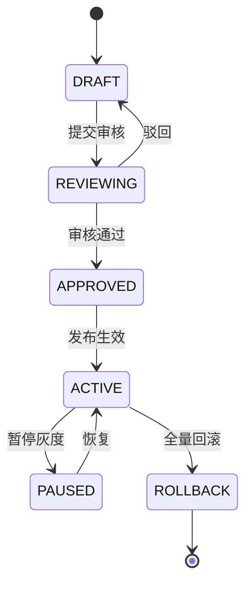

### 1.6 异常与边界

| 场景 | 处理 |
|---|---|
| JWKS 拉取失败 | 使用本地缓存公钥；缓存过期则放行至 auth 校验（降级） |
| 下游服务超时 | Sentinel 熔断，返回 `0000008`（503） |
| 请求体过大 | 413，直接拒绝 |
| 审计写入失败 | 本地磁盘队列缓冲，恢复后补写（不影响主链路） |

### 1.7 验收标准

- 鉴权校验 P99 ≤ 10ms；限流准确率 ≥ 99.9%；灰度粘滞率 100%；
- 端别串位 100% 拦截；`X-Request-Id` 全链路贯通率 100%。

---

## 2 fenglin-auth-service 统一认证与 SSO

### 2.1 功能清单

| 编号 | 功能 | 端别 | 说明 |
|---|---|---|---|
| F-AUTH-01 | 口令登录 | 双端 | 账号口令 + 图形/滑块验证码 |
| F-AUTH-02 | MFA 认证 | 双端 | TOTP/短信二次验证 |
| F-AUTH-03 | SSO 联邦 | 双端 | OIDC/SAML2/企微/飞书/钉钉 |
| F-AUTH-04 | 令牌签发 | 双端 | OAuth2.1 授权码+PKCE / 客户端凭证；JWT RS256 |
| F-AUTH-05 | 令牌刷新与撤销 | 双端 | refresh_token 轮换；黑名单/撤销列表 |
| F-AUTH-06 | 单点登出 SLO | 双端 | 全局登出，各产品会话失效 |
| F-AUTH-07 | 会话管理 | 双端 | 在线会话、设备管理、强制下线 |
| F-AUTH-08 | SSO 配置 | 管理端 | 租户级 SSO 连接器配置与测试 |

### 2.2 角色与权限

| 角色 | 端 | 权限 |
|---|---|---|
| 租户管理员 | 管理端 | `tenant:auth:sso:manage`、`tenant:auth:session:view`、`tenant:auth:session:kick` |
| 平台安全管理员 | 管理端 | `platform:auth:policy:manage` |
| 普通用户 | 用户端 | `biz:auth:profile`、`biz:auth:mfa:manage`、`biz:auth:session:manage` |

### 2.3 双端归属

SSO 连接器配置、会话策略归**管理端**；个人密码/MFA/我的设备归**用户端**（`/app/settings/security`）。

### 2.4 业务规则

1. 口令复杂度：≥ 12 位含大小写+数字+符号；5 次失败锁定 15 分钟；90 天强制轮换；
2. 会话超时 30min 空闲失效；并发会话上限默认 3（可配）；
3. MFA：平台超管/安全管理员强制开启；普通用户可选；
4. 令牌：access_token 有效期 2h，refresh_token 7d（轮换）；RS256 签名；
5. 异地/新设备登录触发提醒（用户端消息 + 邮件）。

### 2.5 状态机（登录会话）

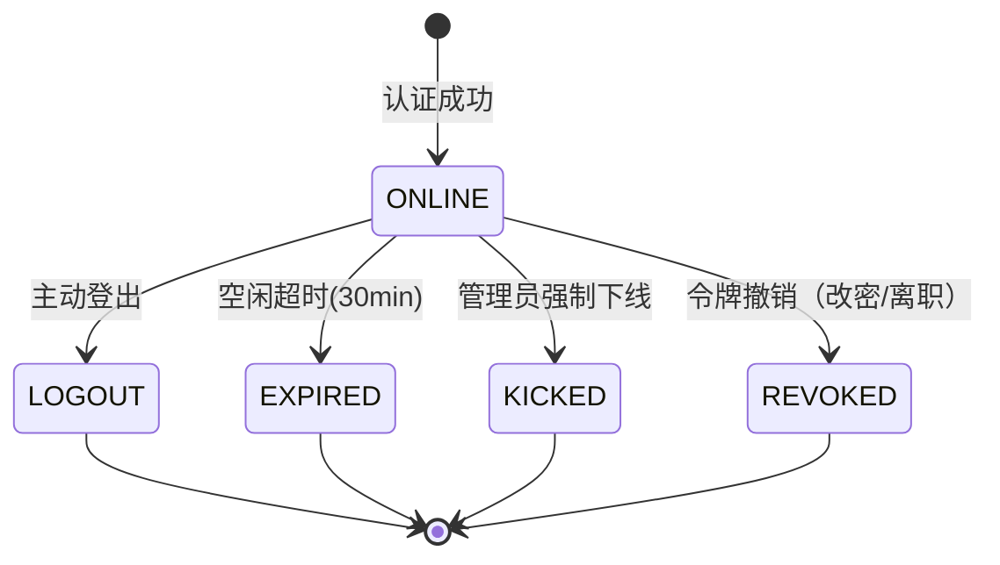

### 2.6 工作流

无独立审批流程；配置变更（SSO 配置、会话策略、强制 MFA）经**管理端**操作并落审计。SSO 联邦登录为串行编排：`发起登录 → 重定向 IdP → 回调 code → 换 token → 属性映射 → 用户匹配/自动开通 → 会话建立`。

### 2.7 异常与边界

| 场景 | 处理 |
|---|---|
| IdP 不可达 | 降级回本地口令登录入口，提示 SSO 暂不可用 |
| 属性映射缺失 | 按策略拒绝登录（严格）或补默认值（宽松，可配） |
| 重复 code 使用 | 拒绝并记录安全事件 |
| 令牌黑名单 Redis 不可用 | 本地缓存黑名单 + 短 TTL；风险期间缩短 access_token 有效期 |

### 2.8 验收标准

- 登录成功率 ≥ 99.9%；SSO 首次登录 P95 ≤ 800ms（含 IdP 往返另计）；
- 令牌校验 P99 ≤ 8ms；SLO 登出各端会话失效一致率 100%；
- MFA 强制用户绕过率 0。

---

## 3 fenglin-tenant-service 租户治理与计费

### 3.1 功能清单

| 编号 | 功能 | 端别 | 说明 |
|---|---|---|---|
| F-TEN-01 | 租户开通/变更/注销 | 管理端 | 开通、信息变更、暂停、注销 |
| F-TEN-02 | 套餐管理 | 管理端 | 套餐定义、套餐项、上下架 |
| F-TEN-03 | 订阅管理 | 管理端 | 订阅/续订/升降配/退订 |
| F-TEN-04 | 计量采集与汇总 | 管理端 | 多维用量采集、日汇总、幂等去重 |
| F-TEN-05 | 计费与账单 | 管理端 | 按量/包周期计费、出账、对账 |
| F-TEN-06 | 配额与限流 | 双端 | 席位/存储/Token/QPS 配额校验 |
| F-TEN-07 | 隔离策略配置 | 管理端 | SHARED/ISOLATED/HYBRID 配置与迁移 |
| F-TEN-08 | License 管理 | 管理端 | 私有化许可签发、续期、撤销 |

### 3.2 角色与权限

| 角色 | 端 | 权限 |
|---|---|---|
| 平台运维 | 管理端 | `platform:tenant:manage`、`platform:package:manage`、`platform:billing:manage`、`platform:license:manage` |
| 租户管理员 | 管理端 | `tenant:subscription:view`、`tenant:usage:view`、`tenant:billing:view` |
| 业务用户 | 用户端 | 无（仅受配额约束） |

### 3.3 双端归属

租户/套餐/计费/隔离策略全部归**管理端**；用户端仅感知配额与许可状态（超限提示）。租户管理员在管理端只读查看本租户订阅与用量。

### 3.4 业务规则

1. 租户编码 `T{6位}`，全局唯一；开通即初始化：默认组织、管理员账号、基础角色、字典/参数；
2. 配额校验在网关与业务服务双重执行；席位不足返回 `0000101`；License 过期返回 `0000102`；
3. 计量幂等键 `(tenant_id, metric_code, source_id)`；日报按 `stat_date` 汇总；
4. 升降配：升配即时生效（按比例补差），降配下周期生效；
5. 注销：保留 30 天冷静期，期满经审批物理擦除（剩余信息保护）。

### 3.5 状态机（租户）

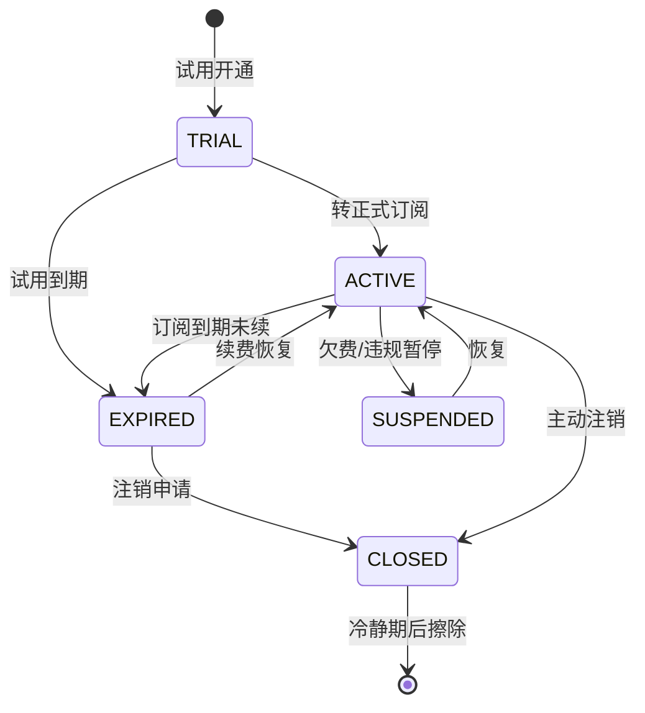

### 3.6 工作流：租户开通（BPMN 说明）

**流程键** `hub_tenant_provisioning`，参与角色：平台运维（发起）→ 平台安全管理员（合规审核）→ 平台运维（执行开通）。

**BPMN 结构**：
- `startEvent` 提交开通申请（表单：租户名称、套餐、席位数、隔离策略、试用期）；
- `userTask` 合规审核（安全管理员）：校验资质、数据合规、隔离策略合理性；
- `exclusiveGateway` 审核结果：驳回 → 回到发起（携意见）；通过 → 继续；
- `serviceTask` 执行开通：创建租户、初始化组织/管理员/角色/字典/参数、分配配额、签发许可（私有化）；
- `serviceTask` 通知：message-service 发送开通成功通知；
- `endEvent` 完成（记录 `opened_by`/`opened_at`）。
- 异常边界：初始化任一步失败则整体回滚（Seata AT），流程转 `ERROR` 分支并告警。

### 3.7 异常与边界

| 场景 | 处理 |
|---|---|
| 计量上报重复 | 幂等键去重，返回首次结果 |
| 出账期间写入 | 账期冻结（T+1 出账），冻结期写入顺延下期 |
| 隔离策略迁移中查询 | 双写过渡期，读走旧库，写双写，完成后切换 |
| 配额并发扣减 | Seata AT + 乐观锁，冲突重试 |

### 3.8 验收标准

- 租户开通全流程 ≤ 2min（自动）；计量对账误差 ≤ 0.01%；配额越限拦截率 100%；
- 账单金额与服务端计费一致率 100%（对账用例）。

---

## 4 fenglin-iam-service 统一身份与权限（4A）

### 4.1 功能清单

| 编号 | 功能 | 端别 | 说明 |
|---|---|---|---|
| F-IAM-01 | 用户管理 | 管理端 | 增删改查、批量导入、状态管理 |
| F-IAM-02 | 组织与岗位 | 管理端 | 组织树、岗位、负责人维护 |
| F-IAM-03 | 角色管理 | 管理端 | 角色、继承、预置基线 |
| F-IAM-04 | 功能权限 | 管理端 | 菜单/按钮/接口权限分配 |
| F-IAM-05 | 数据权限 | 管理端 | **未实现**：`hub_role.data_scope` 为保留字段，当前不生效；现由权限码（租户级码 / `*:self:*` 自助码）控制可见范围 |
| F-IAM-06 | 字段权限 | 管理端 | 字段隐藏/脱敏授权 |
| F-IAM-07 | 账号安全 | 双端 | 口令策略、MFA、锁定、轮换 |
| F-IAM-08 | 账号复核 | 管理端 | 季度复核任务与权限回收 |
| F-IAM-09 | 离职联动 | 管理端 | 停用/回收/转交/踢出 |
| F-IAM-10 | 统一授权决策 | 内部 | `/internal/v1/authz/**` 实时决策 |

### 4.2 角色与权限

| 角色 | 端 | 权限 |
|---|---|---|
| 租户管理员 | 管理端 | `tenant:iam:user:*`、`tenant:iam:org:*`、`tenant:iam:role:*`、`tenant:iam:authz:*` |
| 业务管理员 | 管理端 | `tenant:iam:user:view`、`tenant:iam:authz:grant`（本域） |
| 平台安全管理员 | 管理端 | `platform:iam:review:manage`、`platform:iam:policy:manage` |
| 普通用户 | 用户端 | `biz:iam:profile`（本人信息/权限查看） |

### 4.3 双端归属

组织/用户/角色/权限/复核全部归**管理端**（`/admin/platform/iam/**`、`/admin/tenant/iam/**`）；用户端仅"我的资料/我的权限"只读。

### 4.4 业务规则

1. 用户创建自动生成工号 `{公司码}{4位}`；`mobile/email` 加密存储 + 哈希检索；
2. 角色继承：子角色继承父角色权限；内置角色不可删除；
3. 数据权限解析（规划，当前未实现）：用户级 > 角色级 > 组织级；多角色取并集；
4. 授权决策：功能（权限码命中）→ 数据（`data_scope` 为保留字段，**不生成 SQL 条件**）→ 字段（规划）；
5. 离职：账号停用 + 会话踢出 + 待办转交（可选）+ 定期归档；离职联动作业由 XXL-Job 触发。

### 4.5 状态机（账号复核）

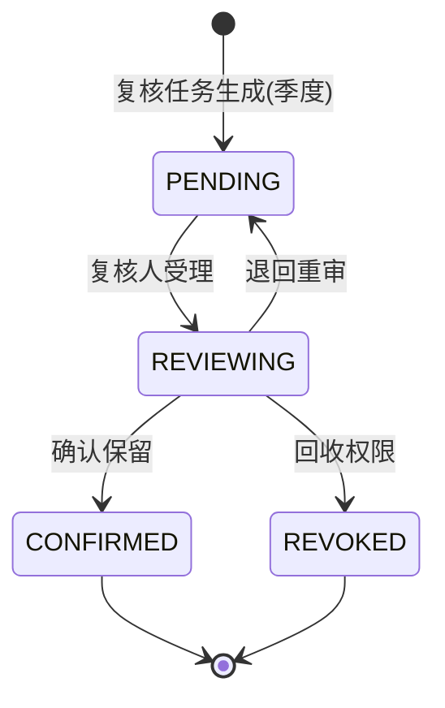

### 4.6 工作流：权限变更审批

**流程键** `hub_iam_authz_change`：发起人（业务管理员）→ 租户管理员审批（敏感权限如 `tenant:iam:role:*`）→ 生效 → 审计。
- 敏感权限（导出、跨租户、密钥相关）强制审批；普通权限可配置免审批（直生效，留审计）。
- 异常边界：审批期间权限不变更；审批通过后失效缓存（Redis + 本地 Caffeine 广播失效）。

### 4.7 异常与边界

| 场景 | 处理 |
|---|---|
| 权限缓存失效延迟 | 变更发布失效事件，各节点订阅刷新；TTL 兜底 5min |
| 组织删除有子节点/用户 | 拒绝并提示（`0000005`） |
| 用户多主部门 | 仅允许一个 `is_primary=1` |
| 复核期间用户离职 | 复核任务自动关闭并标记离职 |

### 4.8 验收标准

- 授权决策 P99 ≤ 15ms；越权拦截率 100%；权限变更生效 ≤ 5s；
- 复核覆盖率 100%（全部账号纳入季度复核）。

---

## 5 fenglin-workflow-service 统一工作流引擎

### 5.1 功能清单

| 编号 | 功能 | 端别 | 说明 |
|---|---|---|---|
| F-WF-01 | 流程定义 | 管理端 | BPMN 设计、版本、导入导出、发布 |
| F-WF-02 | 流程实例 | 双端 | 发起/挂起/激活/终止 |
| F-WF-03 | 任务处理 | 双端 | 同意/驳回/加签/转办/委托/会签 |
| F-WF-04 | 动态表单 | 管理端 | 与低代码表单联动 |
| F-WF-05 | 审批规则 | 管理端 | 条件分支、动态审批人 |
| F-WF-06 | 统一审批中心 | 用户端 | 待我审批/我已审批/我发起 |
| F-WF-07 | 回调与事件 | 内部 | 节点/流程回调业务系统 |
| F-WF-08 | 流程监控 | 管理端 | 轨迹、耗时、超时、效率报表 |

### 5.2 角色与权限

| 角色 | 端 | 权限 |
|---|---|---|
| 业务管理员 | 管理端 | `tenant:workflow:def:manage`、`tenant:workflow:monitor:view` |
| 平台运维 | 管理端 | `platform:workflow:engine:manage` |
| 普通用户 | 用户端 | `biz:workflow:task:handle`、`biz:workflow:instance:start`、`biz:workflow:instance:view` |

### 5.3 双端归属

流程定义/审批规则/表单归**管理端**；发起/审批/查看归**用户端**（`/app/workflow/**`）。

### 5.4 业务规则

1. 流程键 `(tenant_id, process_key)` 唯一，版本化发布；新实例走最新发布版本，运行中实例保持原版本；
2. 审批人解析：指定人/角色/上级主管/部门负责人/发起人自选（范围可配）；
3. 会签（全部通过）/或签（任一通过）/顺序会签（按序）；
4. 超时：`due_at` 到期由 XXL-Job 扫描催办，超时升级；
5. 回调幂等：以 `(instance_id, node_key, action)` 为幂等键；重复回调丢弃。

### 5.5 状态机（流程实例）

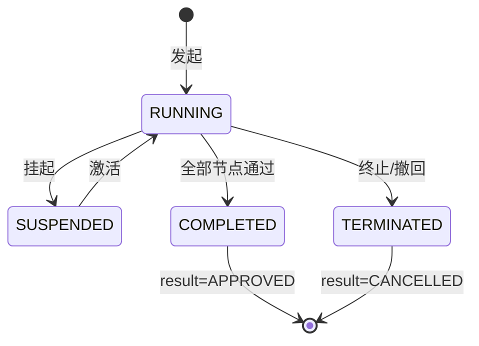

### 5.6 工作流：审批中心（BPMN 说明）

**通用审批模板** `hub_approval_generic`：
- `startEvent` 发起（业务系统经 `/internal/v1/workflow/start` 或用户端发起）；
- `userTask` 审批节点（含 `candidateGroups` 动态解析）；
- `exclusiveGateway` 金额/条件分支（`${amount > 100000}` 走总经理，否则财务）；
- `parallelGateway` 并行会签（可选）；
- `serviceTask` 回调业务系统（幂等）+ 发布事件；
- `endEvent` 完成。
- 驳回：`boundaryEvent` 捕获驳回 → 回到发起人节点（可重提，新实例）；
- 撤回：发起人在首节点前可撤回（`TERMINATED`）。

### 5.7 异常与边界

| 场景 | 处理 |
|---|---|
| 审批人离职 | 任务自动转交其主管或指定代理人 |
| 引擎不可用 | 审批请求入本地队列，恢复后续办（保证顺序与幂等） |
| 回调失败 | 重试（指数退避，最多 6 次），仍失败入死信+告警 |
| 并发审批同一任务 | 乐观锁，后到者提示"任务已处理"（`0000005`） |

### 5.8 验收标准

- 流程发起 P95 ≤ 200ms；待办列表 P95 ≤ 300ms（3400 并发）；
- 回调幂等率 100%；超时催办准确率 100%。

---

## 6 fenglin-message-service 消息中心

### 6.1 功能清单

| 编号 | 功能 | 端别 | 说明 |
|---|---|---|---|
| F-MSG-01 | 多通道发送 | 内部/双端 | 站内信/邮件/短信/企微/飞书/钉钉/WS |
| F-MSG-02 | 模板管理 | 管理端 | 模板 CRUD、变量、多语言、预览 |
| F-MSG-03 | 发送策略 | 管理端 | 即时/定时、去重、聚合、免打扰 |
| F-MSG-04 | 订阅偏好 | 用户端 | 个人通道/类别偏好 |
| F-MSG-05 | 回执统计 | 管理端 | 送达/失败状态与统计 |
| F-MSG-06 | 消息安全 | 双端 | 脱敏、敏感词、对外通道审批 |

### 6.2 角色与权限

| 角色 | 端 | 权限 |
|---|---|---|
| 租户管理员 | 管理端 | `tenant:message:template:manage`、`tenant:message:channel:manage` |
| 业务管理员 | 管理端 | `tenant:message:send`（本域） |
| 普通用户 | 用户端 | `biz:message:view`、`biz:message:preference:manage` |

### 6.3 双端归属

模板/通道/策略归**管理端**（`/admin/tenant/message/**`）；消息列表/偏好归**用户端**（`/app/messages`）。

### 6.4 业务规则

1. 通道优先级：WS（在线）> 站内信 > 邮件/短信（按偏好与场景）；
2. 去重键 `(tenant_id, template_code, biz_id, receiver_id)` 24h 内去重（可配）；
3. 聚合：同类别高频消息按窗口（如 30min）合并为摘要；
4. 免打扰：22:00–08:00 仅强制类消息送达；
5. 敏感消息（安全告警）强制送达且不可关闭。

### 6.5 状态机（消息）

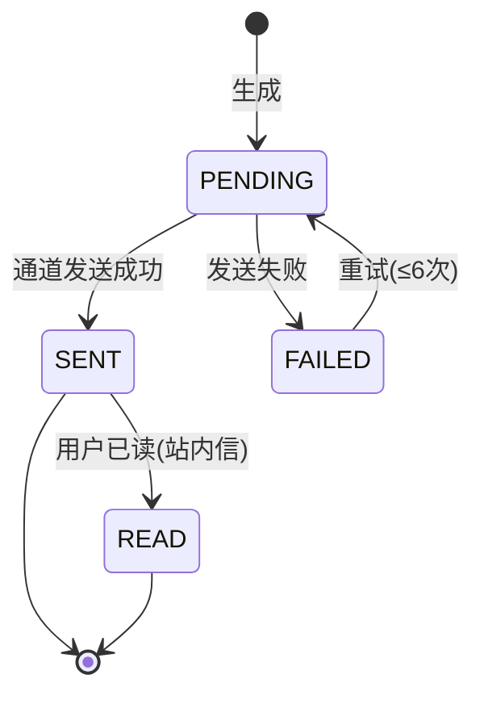

### 6.6 工作流

消息发送为 `内部事件驱动` 编排：业务服务 → `/internal/v1/message/send` → 模板渲染 → 通道适配 → 发送 → 回执回调 → 状态更新。无人工审批；**对外通道**（短信/邮件群发）经管理端配置审批。

### 6.7 异常与边界

| 场景 | 处理 |
|---|---|
| 通道服务不可用 | 进入本地重试表（指数退避），恢复补发 |
| 模板变量缺失 | 拒发并告警（避免脏数据发出） |
| 短信通道限流 | 排队削峰，超时降级站内信 |
| 用户无偏好配置 | 按租户默认策略执行 |

### 6.8 验收标准

- 站内信送达 P95 ≤ 1s；WS 推送延迟 P95 ≤ 500ms；重试最终送达率 ≥ 99.5%。

---

## 7 fenglin-file-service 文件中心

### 7.1 功能清单

| 编号 | 功能 | 端别 | 说明 |
|---|---|---|---|
| F-FILE-01 | 上传下载 | 双端 | 分片、断点续传、秒传、打包下载 |
| F-FILE-02 | 存储抽象 | 内部 | MinIO/S3 统一接口 |
| F-FILE-03 | 在线预览 | 双端 | Office/PDF/图片/音视频转换预览 |
| F-FILE-04 | 版本管理 | 双端 | 多版本、对比、回滚 |
| F-FILE-05 | 水印与 DLP | 双端 | 动态水印、DLP 钩子 |
| F-FILE-06 | 安全与配额 | 管理端 | 类型白名单、病毒扫描、签名 URL、配额 |

### 7.2 角色与权限

| 角色 | 端 | 权限 |
|---|---|---|
| 租户管理员 | 管理端 | `tenant:file:policy:manage`、`tenant:file:quota:manage` |
| 普通用户 | 用户端 | `biz:file:upload`、`biz:file:download`、`biz:file:preview` |
| 只读/访客 | 用户端 | `biz:file:preview`（无下载） |

### 7.3 双端归属

策略/配额/白名单归**管理端**；上传/下载/预览/版本归**用户端**。

### 7.4 业务规则

1. 分片：默认 5MB/片，最大 5GB/文件；秒传按 `(tenant_id, md5)` 命中；
2. 类型白名单：默认允许常见办公/图片/音视频，禁止可执行文件；
3. 病毒扫描：上传后置 `SCANNING`，通过转 `AVAILABLE`，命中转 `BLOCKED`；
4. 水印：预览/下载动态水印含用户名+时间+租户；密级 ≥ 3 强制水印；
5. 访问：签名 URL 有效期默认 15min，禁止公开桶。

### 7.5 状态机（文件）

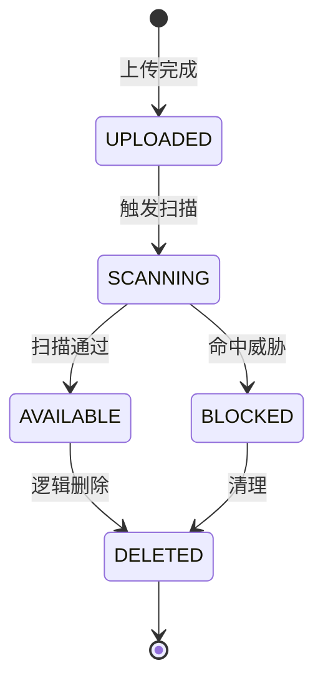

### 7.6 工作流

重置版本/密级变更经管理端策略；DLP 命中触发云法 `fenglin-legal-service` 审查流程（跨域）。

### 7.7 异常与边界

| 场景 | 处理 |
|---|---|
| 存储不可用 | 上传失败回滚分片；下载降级（重试/提示） |
| 预览转换服务不可用 | 降级为下载 |
| 配额超限 | 拒绝上传，提示清理（`0000101`） |
| 秒传 MD5 碰撞风险 | 结合文件大小二次校验 |

### 7.8 验收标准

- 100MB 文件上传成功率 ≥ 99.9%；签名 URL 越权访问拦截率 100%；
- 预览首屏 ≤ 3s（内网）。

---

## 8 fenglin-audit-service 统一审计中心

### 8.1 功能清单

| 编号 | 功能 | 端别 | 说明 |
|---|---|---|---|
| F-AUD-01 | 审计写入 | 内部 | 同步/异步写入，结构化 |
| F-AUD-02 | 哈希链与 WORM | 内部 | 防篡改链式存储 |
| F-AUD-03 | 审计检索 | 管理端 | 多维检索与导出（导出亦审计） |
| F-AUD-04 | 留存与归档 | 内部 | 分区、冷热分层、归档 |
| F-AUD-05 | 审计告警 | 管理端 | 高危操作实时告警 |
| F-AUD-06 | 合规报告 | 管理端 | 周期合规审计报告 |

### 8.2 角色与权限

| 角色 | 端 | 权限 |
|---|---|---|
| 审计管理员 | 管理端 | `platform:audit:log:view`、`platform:audit:export`、`platform:audit:report:manage` |
| 平台安全管理员 | 管理端 | `platform:audit:alert:manage` |
| 其他角色 | 无审计查看权（三员分立） |

### 8.3 双端归属

审计检索/告警/报告归**管理端**（`/admin/platform/audit/**`）；用户端"我的操作记录"仅本人可见（`biz:audit:self`）。

### 8.4 业务规则

1. 审计不可修改/删除（仅追加），WORM 保护；
2. 哈希链：`chain_hash = SHA256(prev_hash + content_hash)`，按分区维护链条；
3. 留存 ≥ 6 个月（建议 12 个月）；过期归档至 WORM 存储保留 5 年；
4. 导出审计：导出操作本身生成审计（`event_type=EXPORT`），加密水印；
5. 高危操作（越权、批量导出、密钥变更、跨租户）实时告警至安全管理员。

### 8.5 状态机（告警）

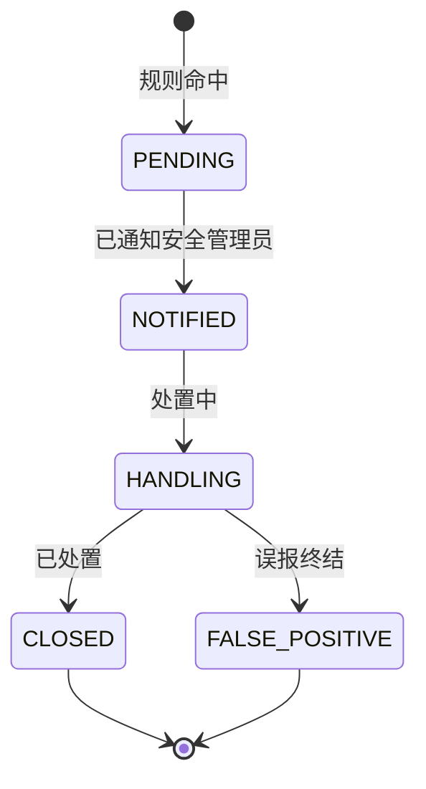

### 8.6 工作流

审计篡改校验为定时任务（XXL-Job 每小时校验当日链完整性）；异常触发告警与阻断（严重时冻结相关账号会话）。

### 8.7 异常与边界

| 场景 | 处理 |
|---|---|
| 审计写入高峰 | 异步批量写入 + 背压；核心安全事件同步写 |
| 链校验断裂 | 立即告警（高优先级）+ 导出该分区证据 |
| 归档查询 | 需先恢复归档分区（异步），走审批 |

### 8.8 验收标准

- 审计写入 P95 ≤ 50ms（异步）；链校验成功率 100%；
- 高危操作告警延迟 ≤ 1min；留存策略合规。

---

## 9 fenglin-search-service 统一搜索中心

### 9.1 功能清单

| 编号 | 功能 | 端别 | 说明 |
|---|---|---|---|
| F-SRCH-01 | 索引管理 | 内部/管理端 | 索引创建、映射、重建、别名切换 |
| F-SRCH-02 | 统一检索 | 双端 | 全文/向量/混合检索 |
| F-SRCH-03 | 权限感知 | 双端 | 权限/ACL/密级过滤 |
| F-SRCH-04 | 全局搜索入口 | 用户端 | 跨域命中分组展示（Ctrl+K） |
| F-SRCH-05 | 检索分析 | 管理端 | 热搜/零结果/零点分析 |
| F-SRCH-06 | 索引同步 | 内部 | 事件/CDC 增量同步 |

### 9.2 角色与权限

| 角色 | 端 | 权限 |
|---|---|---|
| 平台运维 | 管理端 | `platform:search:index:manage` |
| 租户管理员 | 管理端 | `tenant:search:analytics:view` |
| 普通用户 | 用户端 | `biz:search:query`、`biz:search:view` |

### 9.3 双端归属

索引治理/分析归**管理端**；检索/全局搜索归**用户端**。

### 9.4 业务规则

1. 索引按域隔离（`hub_*`、`{domain}_*`），租户过滤字段 `tenant_id` 强制过滤；
2. 混合检索 RRF 融合，默认全文权重 0.4/向量 0.6（可配）；
3. 权限过滤：功能权限 + 数据权限（部门/本人）+ 文档 ACL/密级；
4. 索引同步：业务事件驱动（Kafka）+ 定时全量校准（每日）。

### 9.5 状态机（索引任务）

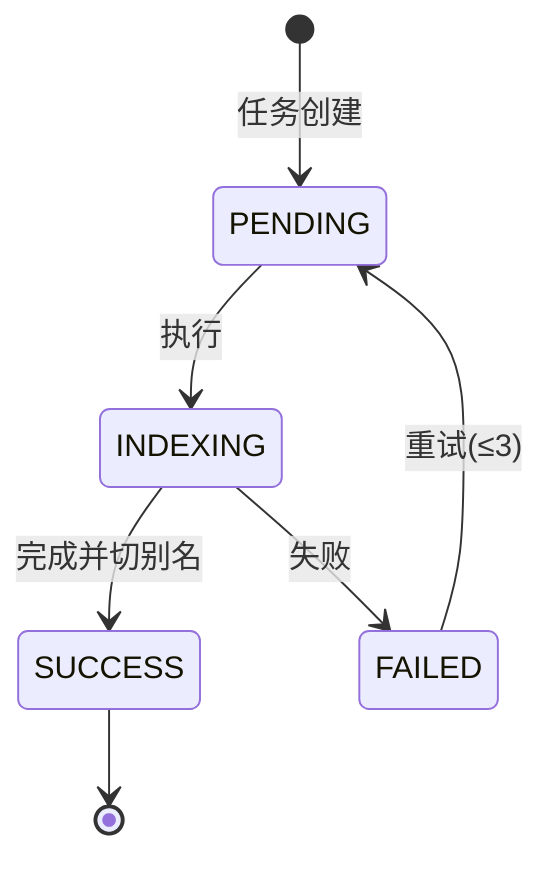

### 9.6 工作流

索引重建（全量）经管理端触发+审批（影响面大），采用蓝绿索引 + 别名原子切换，切换失败自动回滚别名。

### 9.7 异常与边界

| 场景 | 处理 |
|---|---|
| ES 不可用 | 降级数据库 LIKE 检索（限流）+ 提示 |
| 同步延迟 | 展示"索引可能滞后"标记；提供实时兜底查询 |
| 向量库不可用 | 退化为纯全文检索 |
| 大结果集 | 深分页限制（`search_after`），禁止 `from+size` 超 10000 |

### 9.8 验收标准

- 检索 P95 ≤ 300ms（3400 并发）；权限过滤准确率 100%；
- 索引同步延迟 ≤ 30s（事件驱动）。

---

## 10 fenglin-openapi-service 开放平台

### 10.1 功能清单

| 编号 | 功能 | 端别 | 说明 |
|---|---|---|---|
| F-OPEN-01 | 应用注册与管理 | 管理端/开发者门户 | 应用 CRUD、授权范围、回调 |
| F-OPEN-02 | 密钥管理 | 管理端/门户 | AppKey/AppSecret 生成、轮换、撤销 |
| F-OPEN-03 | OAuth2.1 授权 | 双端 | 授权码/客户端凭证 |
| F-OPEN-04 | 签名与防重放 | 内部 | HMAC-SHA256 + nonce |
| F-OPEN-05 | 配额与限流 | 管理端 | 应用/接口维度配额 |
| F-OPEN-06 | 应用审核 | 管理端 | 上架审核流程 |
| F-OPEN-07 | 开发者门户 | 门户 | API 目录、沙箱、SDK、公告 |
| F-OPEN-08 | 调用统计 | 管理端 | 调用量、错误率、Top 接口 |

### 10.2 角色与权限

| 角色 | 端 | 权限 |
|---|---|---|
| 平台运维 | 管理端 | `platform:openapi:app:review`、`platform:openapi:quota:manage` |
| 开发者 | 开发者门户 | `openapi:app:manage`、`openapi:sandbox:use` |
| 审计管理员 | 管理端 | `platform:openapi:calllog:view` |

### 10.3 双端归属

开放平台治理归**管理端**（`/admin/platform/openapi/**`）；开发者门户为独立站点（`open.fenglincloud.com`，鉴权复用）。

### 10.4 业务规则

1. 签名：`signature = HMAC-SHA256(AppSecret, method+path+timestamp+nonce+bodyHash)`；
2. 防重放：`timestamp` 偏差 ≤ 5min，`nonce` Redis 去重（TTL 5min）；
3. 配额：应用级 + 接口级；超限 `0000006`；配额预警（80% 阈值）通知开发者；
4. 应用审核：新应用上架、新增高危 scope（如写操作）需审核；
5. 沙箱：独立环境，与生产数据隔离，限流更严。

### 10.5 状态机（开放应用）

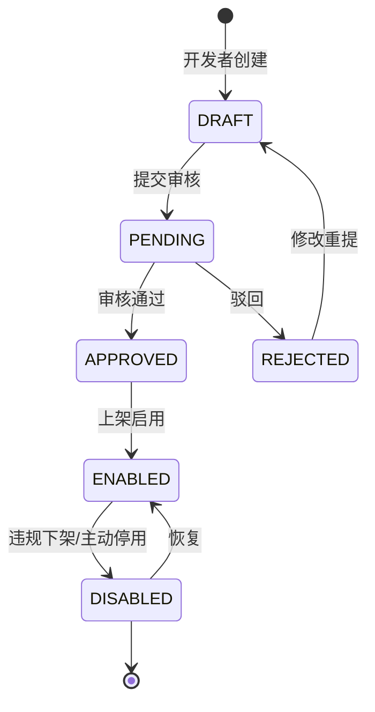

### 10.6 工作流：开放应用上架审批（BPMN 说明）

**流程键** `hub_openapp_review`：
- `startEvent` 开发者提交应用（含用途、scope、回调域、数据范围）；
- `userTask` 平台运维初审（资质/用途）；
- `userTask` 平台安全管理员复审（安全评估：数据范围最小化、回调白名单、加密要求）；
- `exclusiveGateway` 结果：通过 → `serviceTask` 生成 AppKey/AppSecret 并启用；驳回 → 通知开发者携意见；
- `endEvent`。
- 异常边界：审核期间应用不可调用生产；密钥仅生成时回显一次，之后只显示指纹。

### 10.7 异常与边界

| 场景 | 处理 |
|---|---|
| 签名校验失败 | 401 + `0000001`，记录（含 IP） |
| AppSecret 泄漏 | 支持立即轮换（旧密钥宽限期可配，默认 0）；撤销全量令牌 |
| 配额击穿 | 429 + `0000006`；异常调用风控（短时封禁） |
| 回调不可达 | Webhook 重试（指数退避，≤6 次）+ 死信 |

### 10.8 验收标准

- 开放网关额外开销 P95 ≤ 20ms；防重放拦截率 100%；配额准确率 ≥ 99.9%。

---

## 11 fenglin-report-service 报表与指标中心

### 11.1 功能清单

| 编号 | 功能 | 端别 | 说明 |
|---|---|---|---|
| F-RPT-01 | 指标管理 | 管理端 | 原子/派生/复合指标，口径与血缘 |
| F-RPT-02 | 数据集管理 | 双端 | SQL/加速/直连数据集，字段建模 |
| F-RPT-03 | 报表与看板 | 双端 | 拖拽设计、发布、订阅 |
| F-RPT-04 | 报表嵌入 | 内部 | iframe/SDK 嵌入业务产品 |
| F-RPT-05 | 导出与分发 | 双端 | 导出（水印）、定时分发 |
| F-RPT-06 | 指标中心服务 | 内部 | 统一口径指标查询 |

### 11.2 角色与权限

| 角色 | 端 | 权限 |
|---|---|---|
| 业务管理员 | 管理端 | `tenant:report:metric:manage`、`tenant:report:datasource:manage` |
| 平台运维 | 管理端 | `platform:report:scope:manage` |
| 普通用户 | 用户端 | `biz:report:view`、`biz:report:export` |

### 11.3 双端归属

指标口径/数据权限/数据源归**管理端**；报表查看/看板/导出归**用户端**。

### 11.4 业务规则

1. 指标口径唯一：同租户同 code 唯一；口径变更需重新审批（影响面大）；
2. 数据权限：报表查询强制注入数据范围；列级隐藏支持；
3. 导出：带水印，导出行为审计；大数据量走异步；
4. 加速：高频报表走预聚合加速层（如物化视图/ClickHouse 可选）。

### 11.5 状态机（报表定义）

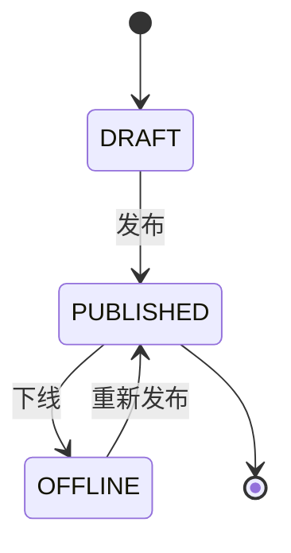

### 11.6 工作流

指标口径变更经**管理端**审批（流程键 `hub_metric_change`）：业务管理员 → 平台运维 → 生效并广播口径变更通知。

### 11.7 异常与边界

| 场景 | 处理 |
|---|---|
| 查询超时 | 返回部分结果 + 降级标记（`504`） |
| 数据源不可用 | 回退缓存快照（标注数据时间） |
| 越权数据 | 列/行过滤，命中越权返回 `8003003` 类语义（平台 `0000002`） |

### 11.8 验收标准

- 看板加载 P95 ≤ 1s（缓存命中）；指标口径一致性 100%；导出正确率 100%。

---

## 12 fenglin-lowcode-service 低代码引擎

### 12.1 功能清单

| 编号 | 功能 | 端别 | 说明 |
|---|---|---|---|
| F-LC-01 | 表单设计器 | 管理端 | 拖拽表单、校验、联动、公式 |
| F-LC-02 | 页面设计器 | 管理端 | 列表/详情/仪表盘页面 |
| F-LC-03 | 数据模型设计 | 管理端 | 可视化建模生成元数据 |
| F-LC-04 | 逻辑编排 | 管理端 | 事件/流程/AI 编排 |
| F-LC-05 | 发布与版本 | 管理端 | 环境提升、版本管理 |
| F-LC-06 | 运行时 | 用户端 | 渲染与执行、权限继承 |

### 12.2 角色与权限

| 角色 | 端 | 权限 |
|---|---|---|
| 业务管理员 | 管理端 | `tenant:lowcode:app:design`、`tenant:lowcode:app:publish` |
| 平台运维 | 管理端 | `platform:lowcode:engine:manage`、`platform:lowcode:data:manage` |
| 普通用户 | 用户端 | `biz:lowcode:app:use`（按应用授权） |

### 12.3 双端归属

设计/发布归**管理端**；运行时使用归**用户端**。

### 12.4 业务规则

1. 数据模型生成表受租户隔离约束（统一 `tenant_id` + RLS）；
2. 应用发布需环境提升（DEV→TEST→PROD）与审批（生产发布）；
3. 运行时鉴权继承平台权限模型；数据权限按配置继承；
4. 配额：单租户应用数/表数/记录数配额（套餐约束）。

### 12.5 状态机（低代码应用）

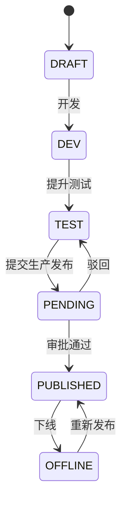

### 12.6 工作流：低代码应用发布审批

**流程键** `hub_lowcode_release`：设计者（业务管理员）→ 租户管理员审批 → 生产发布。BPMN 与开放应用审批同构（startEvent → userTask → gateway → serviceTask 发布 → endEvent）。

### 12.7 异常与边界

| 场景 | 处理 |
|---|---|
| 模型变更影响存量数据 | 强制迁移脚本预览 + 备份；破坏性变更需二次确认 |
| 运行时脚本注入 | 沙箱执行 + 白名单函数 + 超时限制 |
| 配额超限 | 拒绝创建（`0000101`） |

### 12.8 验收标准

- 表单渲染 P95 ≤ 300ms；发布原子性（失败全回滚）；运行时沙箱逃逸 0。

---

## 13 fenglin-ai-service AI 中台

### 13.1 功能清单

| 编号 | 功能 | 端别 | 说明 |
|---|---|---|---|
| F-AI-01 | 模型接入与路由 | 管理端 | 多模型、路由、降级、灰度 |
| F-AI-02 | 提示词管理 | 管理端 | 模板、版本、发布/回滚 |
| F-AI-03 | RAG 能力 | 双端 | 检索增强问答、引用溯源 |
| F-AI-04 | Agent 编排 | 双端 | 多步 Agent、步数限制、人工确认 |
| F-AI-05 | 内容护栏 | 双端 | 注入拦截、合规、PII 脱敏、水印 |
| F-AI-06 | 能力授权 | 管理端 | 按宿主产品/能力授权（embedded） |
| F-AI-07 | 计量与配额 | 管理端 | Token/调用量计量与配额 |
| F-AI-08 | 双模式配置 | 管理端 | standalone/embedded 配置与校验 |

### 13.2 角色与权限

| 角色 | 端 | 权限 |
|---|---|---|
| 平台运维 | 管理端 | `platform:ai:model:manage`、`platform:ai:mode:manage` |
| 租户管理员 | 管理端 | `tenant:ai:prompt:manage`、`tenant:ai:guardrail:config`、`tenant:ai:grant:manage` |
| 普通用户 | 用户端 | `ai:chat:rag`、`ai:search:query`、`ai:agent:run` |

### 13.3 双端归属

模型/提示词/护栏/授权配置归**管理端**；问答/检索/Agent 使用归**用户端**；能力嵌入经 `/internal/v1/**`（服务间）。

### 13.4 业务规则

1. 模型路由：按场景+配额+可用性选择；失败自动切换备选模型（≤2 次），仍失败降级为检索；
2. RAG：先检索（权限/密级过滤）后生成，输出必带引用；
3. 护栏：输入拦截提示注入/敏感词，输出合规检测 + PII 脱敏 + 水印；
4. embedded：以 `X-On-Behalf-Of` 解析用户权限，计量归集宿主产品；
5. 配额：Token 月配额 + QPS；超限 `8002005` 语义（平台映射 `0000006`）。

### 13.5 状态机（Agent 执行）

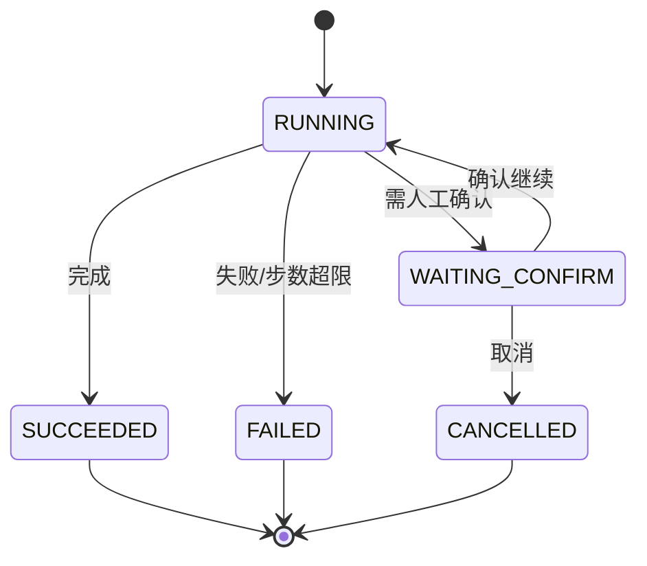

### 13.6 工作流

无独立审批；**提示词发布**与**护栏策略变更**经管理端审批（流程键 `hub_ai_prompt_publish`）；模式切换（standalone↔embedded）须一致性校验接口通过后生效。

### 13.7 异常与边界

| 场景 | 处理 |
|---|---|
| 大模型不可用 | 切换备选模型 → 降级为检索结果/模板回复（`degraded=true`） |
| 提示注入 | 拦截并返回 `8002003` 语义 |
| Token 超配额 | 拒绝并提示升级 |
| embedded 未授权 | 返回 `8004001` 语义 |

### 13.8 验收标准

- RAG 首 Token 延迟 P95 ≤ 1.2s；护栏拦截率 ≥ 99%；计量误差 ≤ 0.01%。

---

## 14 平台级贯通工作流

### 14.1 跨域工单流转

```
云服工单（F1）创建 → 关联域与业务键 → workflow 发起跨域流程
→ 云财成本归集 / 云法合同审查（按 domain 路由审批人）
→ 事件 svc.ticket.approved → 各域幂等消费 → 回写 → 通知
```

### 14.2 统一审批中心

聚合 8 大产品待办，统一入口 `/app/workflow/pending`；审批动作经 workflow-service 回调各域（幂等）。

### 14.3 租户开通（见 §3.6）、开放应用上架（见 §10.6）、低代码发布（见 §12.6）、权限变更（见 §4.6）

---

## 修订记录

| 版本 | 日期 | 修订人 | 说明 |
|---|---|---|---|
| V1.0 | 2026-10-19 | 平台架构组 | 首次发布，覆盖 13 个中台服务的功能清单、角色权限、双端归属、业务规则、状态机、工作流、异常边界与验收标准 |
