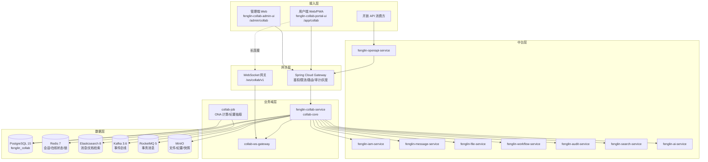
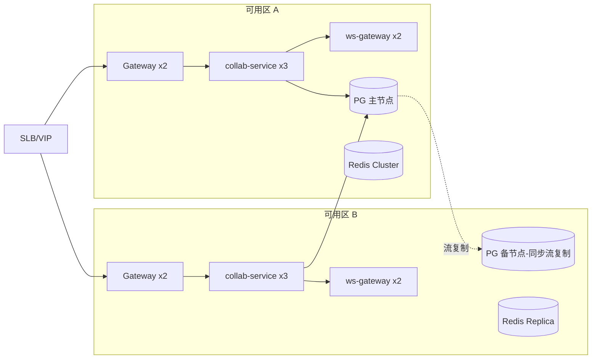
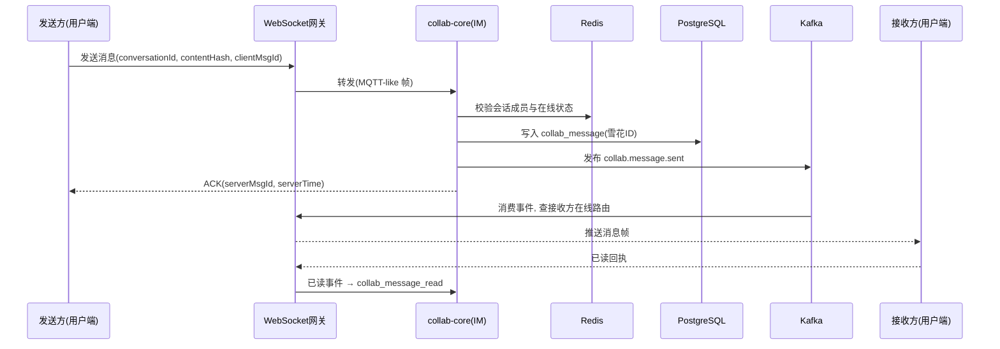
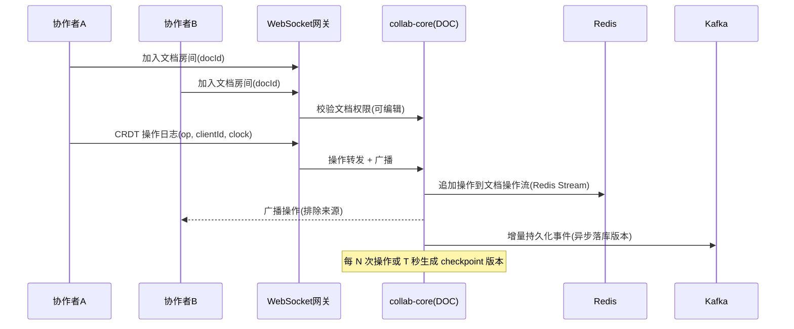
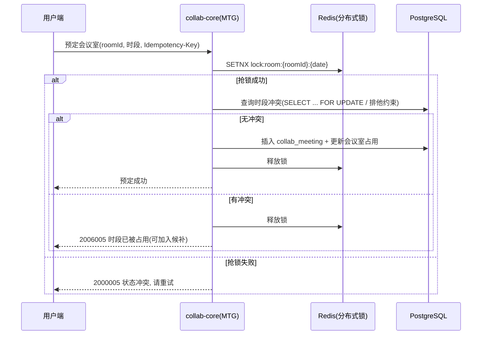
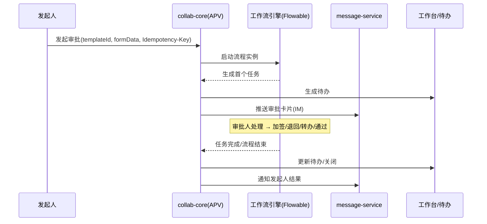
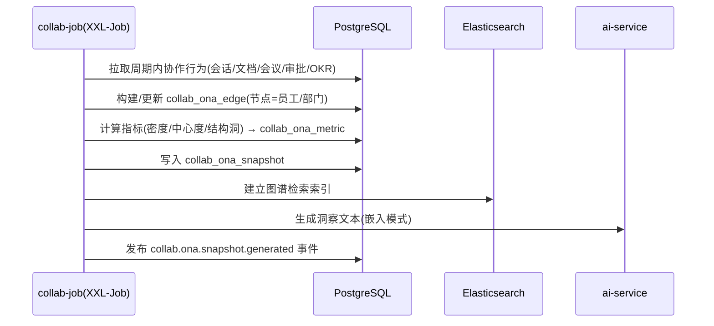

# 丰麟云协 · 系统架构设计文档

> 文档编号：FL-COLLAB-ARCH-001
> 版本：V1.0
> 编制单位：丰麟云创科技有限公司 · 云协产品组 / 平台架构组
> 密级：内部（管理端）
> 约束基线：FL-HUB-STD-001《丰麟云枢 · 平台总体规范与统一标准》

---

## 目录

1. [架构概览](#1-架构概览)
2. [分层与部署图](#2-分层与部署图)
3. [服务清单与技术选型](#3-服务清单与技术选型)
4. [关键流程时序](#4-关键流程时序)
5. [数据架构](#5-数据架构)
6. [集成与开放](#6-集成与开放)
7. [双端分离架构](#7-双端分离架构)
8. [高可用与容灾](#8-高可用与容灾)
9. [安全架构](#9-安全架构)
10. [技术风险](#10-技术风险)
11. [修订记录](#修订记录)

---

## 1. 架构概览

### 1.1 架构目标

丰麟云协作为域B（协作与办公）业务域产品，采用平台上统一的"微服务中台 + 业务域服务"架构，遵循 FL-HUB-STD-001 第 1 章逻辑分层。核心架构目标：

| 目标 | 说明 |
|---|---|
| 高并发实时 | IM 与协同编辑属于长连接高并发场景，须支撑 3400 人在线与峰值 1200 QPS、消息吞吐 ≥ 20,000 msg/s |
| 强隔离多租户 | 共享库共享模式 + RLS，跨租户默认拒绝 |
| 双端分离 | 管理端 `/admin/collab` 与用户端 `/app/collab`，前端工程、鉴权域、导航骨架完全分离 |
| 中台复用 | 复用消息、文件、工作流、审计、搜索、AI 能力，不自研重复能力 |
| 实时可靠 | 消息"至少一次投递 + 客户端去重"，断线重连游标补齐 |
| 安全合规 | 全链路加密、内容安全钩子、ONA 隐私边界 |

### 1.2 架构总览图



### 1.3 架构风格与原则

- **领域驱动**：`collab-core` 按 IM/文档/日历/会议/OKR/审批/工作台/ONA 划分聚合，模块内高内聚、模块间通过事件解耦。
- **读写分离**：写路径走 PostgreSQL 主库；检索走 ES；热点读（在线状态、会话成员）走 Redis。
- **异步解耦**：消息投递、索引构建、通知推送、ONA 计算通过 Kafka 异步化。
- **最终一致**：跨模块（如审批完成→待办更新、会议创建→日程同步）采用事件驱动最终一致；强一致场景（会议室预定）使用分布式锁 + 数据库唯一约束。
- **无状态服务**：业务服务无状态，会话状态外置 Redis，支持水平扩缩容。

---

## 2. 分层与部署图

### 2.1 逻辑分层

| 层 | 组件 | 职责 |
|---|---|---|
| 接入层 | 管理端/用户端 Web、PWA、开放 API | 交互与展示 |
| 网关层 | Spring Cloud Gateway、WebSocket 网关 | 统一鉴权、限流、路由、审计埋点 |
| 业务域层 | `fenglin-collab-service`（含 collab-core/collab-ws-gateway/collab-job） | 协作业务逻辑 |
| 中台层 | IAM/消息/文件/工作流/审计/搜索/AI/开放平台 | 通用能力 |
| 数据层 | PostgreSQL/Redis/ES/Kafka/RocketMQ/MinIO | 存储与消息 |

### 2.2 部署拓扑



### 2.3 容器与编排

- 容器：Docker 镜像统一基础镜像 `fenglin/jre17-base`；镜像扫描（Trivy）纳入流水线。
- 编排：Kubernetes 1.28+，命名空间 `fenglin-collab`；Deployment + HPA + PDB。
- 发布：GitLab CI 构建 → ArgoCD GitOps 同步 → 灰度（按租户/按用户比例）。
- 资源基线（生产）：

| 服务 | 副本 | 单副本 requests/limits | HPA 阈值 |
|---|---|---|---|
| `collab-service` | 3 | 1C/2Gi · 2C/4Gi | CPU 65% |
| `collab-ws-gateway` | 2 | 1C/2Gi · 2C/4Gi | 连接数 20k/副本 |
| `collab-job` | 1（可 2 主备） | 1C/2Gi · 4C/8Gi | 任务队列积压 |
| `fenglin-gateway` | 2 | 2C/4Gi · 4C/8Gi | CPU 70% |

---

## 3. 服务清单与技术选型

### 3.1 本产品服务清单

| 服务/模块 | 说明 | 关键技术 |
|---|---|---|
| `fenglin-collab-service` | 云协统一业务服务（spring.application.name） | Spring Boot 3.2、MyBatis-Plus 3.5、Seata 2.0 |
| `collab-core` | IM/文档/日历/会议/OKR/审批/工作台/ONA 领域模块 | Java 17 |
| `collab-ws-gateway` | WebSocket 网关（消息推送、协同广播） | Netty、Redis Pub/Sub、Kafka |
| `collab-job` | 定时与批量任务（ONA 快照、纪要抽取、消息归档、提醒） | XXL-Job 2.4 |
| `collab-search-indexer` | 消息/文档索引消费者 | Kafka Consumer、ES 8 |

### 3.2 复用中台服务

| 服务 | 复用能力 |
|---|---|
| `fenglin-iam-service` | 用户、组织、角色、权限、数据权限 |
| `fenglin-message-service` | 站内信、邮件、短信、企微/飞书/钉钉推送、WebSocket 通道能力 |
| `fenglin-file-service` | 文件上传/下载/预览/版本/水印/防泄漏钩子 |
| `fenglin-workflow-service` | Flowable 审批引擎 |
| `fenglin-audit-service` | 审计日志、哈希链、WORM |
| `fenglin-search-service` | ES 检索、IK 分词 |
| `fenglin-ai-service` | 语音转写、纪要摘要、ONA 洞察文本生成（嵌入模式） |
| `fenglin-openapi-service` | 开放 API、应用密钥、配额、事件订阅 |

### 3.3 技术选型（遵循规范第 3 章）

| 层次 | 选型 | 版本 |
|---|---|---|
| 后端 | Spring Boot / Spring Cloud / Alibaba | 3.2.x / 2023.0.x / 2023.0.x |
| 注册配置 | Nacos | 2.3.x |
| 网关 | Spring Cloud Gateway | 4.1.x |
| 流控 | Sentinel | 1.8.x |
| ORM | MyBatis-Plus | 3.5.x |
| 分布式事务 | Seata（AT） | 2.0.x |
| 数据库 | PostgreSQL | 15.x |
| 迁移 | Flyway | 10.x |
| 缓存 | Redis | 7.x |
| 消息 | Kafka / RocketMQ | 3.6 / 5.x |
| 检索 | Elasticsearch（IK） | 8.x |
| 对象存储 | MinIO / S3 | RELEASE.2024 |
| 调度 | XXL-Job | 2.4.x |
| 工作流 | Flowable | 7.x |
| 前端 | Vue 3.4 + TS + Vite 5 | — |
| UI | Element Plus（管理端）+ 自研 Portal 组件（用户端） | — |
| 实时 | WebSocket（STOMP over WS 自定义协议） | — |
| 协同 | CRDT（基于 Yjs 协议的 Java/TS 实现） | — |

---

## 4. 关键流程时序

### 4.1 IM 消息发送与投递



要点：
- 幂等：`clientMsgId` + 会话维度唯一，重复发送返回同一 `serverMsgId`。
- 至少一次投递：离线消息落库，重连按 `lastCursor` 补齐。
- 顺序性：同一会话内按雪花 ID 单调有序，客户端按序渲染。

### 4.2 文档协同编辑



要点：
- CRDT 保证无冲突合并，操作自身可交换、可结合、幂等。
- 大文档采用增量 checkpoint + 操作日志，历史版本可回放。
- 权限变更实时生效：踢出房间并通知。

### 4.3 会议室预定（并发防超定）



要点：Redis 分布式锁 + PostgreSQL 排他约束（`tstzrange` + GiST 排他约束）双重保证；候补队列基于抢占式通知。

### 4.4 审批流转（Flowable）



### 4.5 ONA 快照生成



---

## 5. 数据架构

### 5.1 数据分域

| 域 | 存储 | 说明 |
|---|---|---|
| 事务数据 | PostgreSQL `fenglin_collab`（主） | 会话/消息/文档/日历/会议/OKR/审批/工作台/ONA |
| 缓存 | Redis 7 | 在线状态（Hash）、会话成员 Set、未读数、分布式锁、文档操作流（Stream） |
| 检索 | Elasticsearch 8 | 消息全文、文档全文、会议纪要 |
| 事件 | Kafka | 领域事件总线 |
| 事务消息 | RocketMQ 5 | 审批状态回写、跨域强一致 |
| 对象存储 | MinIO | 文件附件、文档导出、ONA 报告、录制文件 |

### 5.2 分库分表与分区

- 单租户单库 `fenglin_collab`，表前缀 `collab_`；超大规模租户可独立库。
- `collab_message` 按月范围分区（`PARTITION BY RANGE (created_at)`），配合归档任务。
- `collab_ona_edge` 按快照周期分区。
- 冷热分离：>12 个月消息迁移至 ES 冷索引 + MinIO，主库仅保留索引指针。

### 5.3 缓存设计

| Key 模式 | 类型 | TTL | 用途 |
|---|---|---|---|
| `collab:online:{tenantId}:{userId}` | String | 90s | 在线状态（心跳续期） |
| `collab:conv:members:{convId}` | Set | 30min | 会话成员集合 |
| `collab:unread:{tenantId}:{userId}` | Hash | 持久 | 各会话未读数 |
| `collab:lock:room:{roomId}:{date}` | String | 30s | 会议室预定锁 |
| `collab:doc:ops:{docId}` | Stream | 24h | 文档操作流 |
| `collab:ona:metric:{period}` | Hash | 1h | ONA 指标缓存 |

### 5.4 数据一致性

| 场景 | 策略 |
|---|---|
| IM 消息落库 + 索引 + 推送 | 落库为事实源，Kafka 异步索引与推送，最终一致 |
| 审批结果回写 | RocketMQ 事务消息 + 本地消息表，最终一致 |
| 会议室预定 | 强一致（分布式锁 + DB 排他约束） |
| 会议创建 ↔ 日程同步 | Kafka 事件，最终一致，幂等消费 |
| ONA 指标 | 离线批处理，可重算 |

---

## 6. 集成与开放

### 6.1 内部集成

| 对端 | 方向 | 协议 | 说明 |
|---|---|---|---|
| IAM | 调用 | REST + mTLS | 用户/组织/权限校验 |
| message-service | 调用 | REST/Kafka | 站内信、IM 卡片、外部渠道 |
| file-service | 调用 | REST | 文件上传/预览/水印 |
| workflow-service | 调用 | REST | 审批流程 |
| audit-service | 上报 | Kafka | 审计事件 |
| search-service | 调用 | REST | 检索 |
| ai-service | 调用 | REST | 转写/摘要/洞察 |
| openapi-service | 被调用 | REST | 开放能力暴露 |

### 6.2 外部集成

- 企业 IM 渠道：企微/飞书/钉钉消息互通（经 message-service）。
- 日历互通：支持 iCal（ICS）订阅与导入导出；企业邮箱日历绑定。
- RTC：第三方音视频网关（会议音视频）。
- 单点登录：SAML2 / OIDC（经 IAM）。

### 6.3 开放 API 与事件

- 开放网关前缀 `/openapi/collab/v1`，AppKey/AppSecret HMAC-SHA256 签名，OAuth2.1 授权码模式。
- 配额：默认 100 QPS/应用，超限返回 `0000006`。
- 事件订阅：Kafka → Webhook 回调，重试（指数退避 3 次）+ 签名验签 + 幂等。
- 可开放资源示例：会话只读、消息发送（受限）、文档只读/导出、日程只读、会议只读、审批发起、ONA 部门级只读。

### 6.4 云智能力嵌入

本产品以 `intelligence.mode=embedded` 复用云智：语音转写（会议录制）、纪要摘要、文档智能问答、ONA 洞察文本生成。调用 `/internal/**` 内部能力接口，不暴露前台门户。

---

## 7. 双端分离架构

### 7.1 分离维度（依据规范 1.3 节）

| 维度 | 管理端 | 用户端 |
|---|---|---|
| 前端工程 | `fenglin-collab-admin-ui` | `fenglin-collab-portal-ui` |
| 路由前缀 | `/admin/collab` | `/app/collab` |
| 权限域 | `tenant:collab:*` | `biz:collab:*` |
| 导航骨架 | 左侧菜单 + 面包屑 | 顶部导航 + 卡片工作台 |
| 默认首页 | 协作运营概览/审批配置/会议室管理/ONA 度量配置 | 我的工作台/待办/消息/快捷入口 |
| 组件库 | Element Plus（紧凑） | 自研 Portal 组件（舒适） |
| 审计粒度 | 配置变更、授权、审批模板全量审计 | 业务操作审计 |
| 鉴权声明 | `X-Client-Type: ADMIN` | `X-Client-Type: PORTAL` |

### 7.2 网关鉴权策略

```
请求 → Gateway
  ├─ 校验 JWT 签名(RS256) 与有效期
  ├─ 校验 X-Tenant-Id 与令牌 tenant 一致
  ├─ 依据 X-Client-Type 与路径前缀匹配权限域
  │    /admin/collab/**  → 需 tenant:collab:* 或 platform:*
  │    /app/collab/**    → 需 biz:collab:*
  ├─ 权限码校验(RBAC) + 数据权限注入(ABAC 属性)
  ├─ Sentinel 限流(按租户/接口)
  └─ 路由至 collab-service
```

### 7.3 前端工程结构

```
fenglin-collab-admin-ui/          fenglin-collab-portal-ui/
  src/                              src/
    layouts/AdminLayout.vue           layouts/PortalLayout.vue
    views/                            views/
      dashboard/ (运营概览)              workbench/ (我的工作台)
      im/ (会话治理)                     im/ (消息)
      docs/ (文档策略)                   docs/ (文档)
      calendar/ (公共日历)               calendar/ (日历)
      meeting/ (会议室管理)              meeting/ (会议)
      okr/ (周期与口径)                  okr/ (我的目标)
      approval/ (模板设计)               approval/ (审批中心)
      ona/ (度量配置)                    ona/ (协作画像)
    api/ (ADMIN 域)                   api/ (PORTAL 域)
    stores/                           stores/
```

---

## 8. 高可用与容灾

### 8.1 高可用设计

| 层 | 措施 |
|---|---|
| 接入 | SLB 双活 + 健康检查；DNS 多 A 记录 |
| 网关 | 多副本 + 无状态；Sentinel 熔断降级 |
| 服务 | 3 副本 + PDB；就绪/存活探针；优雅停机 |
| 长连接 | ws-gateway 多副本 + Redis 路由表；单点故障重连 |
| 数据库 | PG 同步流复制（同城）+ 自动主备切换 |
| 缓存 | Redis Cluster 3 主 3 从 |
| 消息 | Kafka 3 副本 min.insync=2 |
| 对象存储 | MinIO 纠删码 / S3 多可用区 |

### 8.2 降级策略

| 故障 | 降级 |
|---|---|
| ES 不可用 | 消息/文档检索降级为主键范围查询；提示"检索暂不可用" |
| Redis 不可用 | 在线状态降级（全员视为离线，走离线投递）；文档协同降级为只读 |
| Kafka 不可用 | 消息落库后同步尝试直投；索引与通知延迟 |
| 工作流引擎不可用 | 审批发起/处理暂停，已在途实例只读 |
| ONA 任务失败 | 使用最近一次快照；不阻塞在线协作 |

### 8.3 容灾指标

| 指标 | 目标 |
|---|---|
| RPO | ≤ 5 min |
| RTO | ≤ 30 min |
| 可用性 | ≥ 99.99%/年 |
| 备份 | 每日全备 + 增量；异地容灾；季度恢复演练 |

---

## 9. 安全架构

### 9.1 分层安全

| 层 | 措施 |
|---|---|
| 网络 | WAF、IDS/IPS、安全组最小开放、VPC 隔离 |
| 传输 | 客户端↔网关 TLS1.3；服务间 mTLS；WebSocket over WSS |
| 应用 | OAuth2.1/OIDC、MFA、RBAC+ABAC+数据权限、Sentinel 限流、防重放（时间戳+nonce） |
| 数据 | PII/敏感内容 AES-256-GCM；`{field}_hash`；RLS；TDE |
| 内容 | 敏感词拦截、DLP 钩子（云法 G2）、外链与水印策略 |
| 审计 | 全链路审计、哈希链、WORM、留存 ≥6 个月 |
| 密钥 | KMS 管理，轮换 ≤ 90 天 |

### 9.2 IM 与文档内容安全（专项）

- 消息体入库前经敏感词引擎过滤 + 敏感字段加密；消息撤回/删除仅标记，原文保留于审计库（受严格权限与审计）。
- 文档密级策略：机密文档禁止外链、禁止下载、强制水印；水印含查看人身份与时间，可溯源。
- 协同编辑操作流留存操作者身份与时间，支持变更追溯。
- ONA 禁止采集与输出消息正文，仅使用聚合结构化指标。

### 9.3 三员分立

平台超级管理员 / 安全管理员 / 审计管理员三员分立，本产品管理端配置权限受租户管理员与安全管理员双重约束，审计数据对审计管理员只读。

---

## 10. 技术风险

| 编号 | 风险 | 等级 | 影响 | 应对 |
|---|---|---|---|---|
| TR-001 | 长连接规模与消息风暴 | 高 | 消息延迟、连接抖动 | ws-gateway 水平扩容 + 连接分片路由 + 批量合并推送 |
| TR-002 | CRDT 大文档内存与收敛 | 高 | 协同卡顿 | 增量 checkpoint + 操作流裁剪 + 大文档分片 |
| TR-003 | 会议室并发超定 | 中 | 业务冲突 | 分布式锁 + DB 排他约束 + 候补队列 |
| TR-004 | ONA 计算性能与隐私 | 高 | 计算超时/合规风险 | 离线批处理 + 聚合输出 + 小部门匿名阈值 |
| TR-005 | 跨域最终一致 | 中 | 数据不一致 | 幂等消费 + 对账任务 + 补偿 |
| TR-006 | 消息存储成本 | 中 | 成本上升 | 冷热分离 + 分区归档 + 压缩 |
| TR-007 | 中台服务依赖故障 | 中 | 功能降级 | 熔断 + 降级 + 本地缓存 |
| TR-008 | WebSocket 安全 | 中 | 越权订阅 | 握手鉴权 + 房间权限校验 + 帧级校验 |

---

## 修订记录

| 版本 | 日期 | 修订人 | 说明 |
|---|---|---|---|
| V1.0 | 2026-10-19 | 云协产品组 / 平台架构组 | 首次发布，含分层、部署、服务、时序、数据、双端、高可用与安全架构 |
