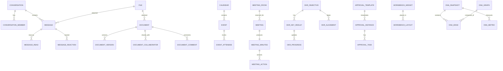

# 丰麟云协 · 数据库设计文档

> 文档编号：FL-COLLAB-DB-001
> 版本：V1.0
> 编制单位：丰麟云创科技有限公司 · 云协产品组
> 密级：内部（管理端）
> 约束基线：FL-HUB-STD-001《丰麟云枢 · 平台总体规范与统一标准》

---

## 目录

1. [设计原则](#1-设计原则)
2. [逻辑模型（ER）](#2-逻辑模型er)
3. [表清单](#3-表清单)
4. [字段字典](#4-字段字典)
5. [索引设计](#5-索引设计)
6. [约束与 RLS](#6-约束与-rls)
7. [敏感字段加密](#7-敏感字段加密)
8. [Flyway 脚本清单](#8-flyway-脚本清单)
9. [数据量估算与归档](#9-数据量估算与归档)
10. [修订记录](#修订记录)

---

## 1. 设计原则

1. 数据库：PostgreSQL 15.x，库名 `fenglin_collab`，模式 `public`，表前缀 `collab_`。
2. 全表强制公共字段：`id`、`tenant_id`、`created_by`、`created_at`、`updated_by`、`updated_at`、`deleted`、`version`。
3. 主键：高并发写表（消息、已读、反应）使用雪花 ID（`bigint`）；对外暴露资源使用 UUID（`uuid DEFAULT gen_random_uuid()`）。
4. 多租户：共享库共享模式 + `tenant_id` 逻辑隔离 + PostgreSQL RLS；跨租户默认拒绝。
5. 敏感数据：PII 与敏感内容 AES-256-GCM 加密，配套 `{field}_hash`（SHA-256 + 租户盐）用于唯一约束与检索。
6. 逻辑删除：`deleted` 0/1，配合部分唯一索引（`WHERE deleted = 0`）。
7. 时间：统一 `timestamptz` 存储 UTC。
8. 迁移：全部 DDL/DML 通过 Flyway，命名 `V{版本}__{描述}.sql`。
9. 分区：`collab_message` 按月分区；`collab_ona_edge` 按快照周期分区。

### 1.1 公共字段定义（全表复用）

| 字段 | 类型 | 可空 | 默认 | 说明 |
|---|---|---|---|---|
| `id` | `bigint` 或 `uuid` | 否 | 见各表 | 主键 |
| `tenant_id` | `bigint` | 否 | — | 租户 ID |
| `created_by` | `bigint` | 是 | NULL | 创建人（系统任务为空） |
| `created_at` | `timestamptz` | 否 | `now()` | 创建时间（UTC） |
| `updated_by` | `bigint` | 是 | NULL | 更新人 |
| `updated_at` | `timestamptz` | 否 | `now()` | 更新时间（UTC） |
| `deleted` | `smallint` | 否 | `0` | 0 正常 / 1 删除 |
| `version` | `int` | 否 | `0` | 乐观锁 |

> 以下字段字典中，公共字段统一以「公共字段」引用，各表不再重复展开（除需特别说明者）。

---

## 2. 逻辑模型（ER）



---

## 3. 表清单

| 序号 | 表名 | 中文名 | 模块 | 主键类型 | 分区 |
|---|---|---|---|---|---|
| 1 | `collab_conversation` | 会话 | IM | uuid | 否 |
| 2 | `collab_conversation_member` | 会话成员 | IM | bigint | 否 |
| 3 | `collab_message` | 消息 | IM | bigint | 是（月） |
| 4 | `collab_message_read` | 消息已读 | IM | bigint | 否 |
| 5 | `collab_message_reaction` | 消息表情回复 | IM | bigint | 否 |
| 6 | `collab_document` | 文档 | 文档 | uuid | 否 |
| 7 | `collab_document_version` | 文档版本 | 文档 | bigint | 否 |
| 8 | `collab_document_collaborator` | 文档协作者 | 文档 | bigint | 否 |
| 9 | `collab_document_comment` | 文档评论 | 文档 | bigint | 否 |
| 10 | `collab_calendar` | 日历 | 日历 | uuid | 否 |
| 11 | `collab_event` | 日程 | 日历 | uuid | 否 |
| 12 | `collab_event_attendee` | 日程参与人 | 日历 | bigint | 否 |
| 13 | `collab_meeting_room` | 会议室 | 会议 | bigint | 否 |
| 14 | `collab_meeting` | 会议 | 会议 | uuid | 否 |
| 15 | `collab_meeting_minutes` | 会议纪要 | 会议 | uuid | 否 |
| 16 | `collab_meeting_action` | 纪要行动项 | 会议 | bigint | 否 |
| 17 | `collab_okr_objective` | 目标 O | OKR | uuid | 否 |
| 18 | `collab_okr_key_result` | 关键结果 KR | OKR | uuid | 否 |
| 19 | `collab_okr_alignment` | OKR 对齐 | OKR | bigint | 否 |
| 20 | `collab_okr_progress` | KR 进展 | OKR | bigint | 否 |
| 21 | `collab_approval_template` | 审批模板 | 审批 | uuid | 否 |
| 22 | `collab_approval_instance` | 审批实例 | 审批 | uuid | 否 |
| 23 | `collab_approval_task` | 审批任务 | 审批 | bigint | 否 |
| 24 | `collab_workbench_widget` | 工作台组件 | 工作台 | bigint | 否 |
| 25 | `collab_workbench_layout` | 工作台布局 | 工作台 | bigint | 否 |
| 26 | `collab_ona_graph` | ONA 关系图谱 | ONA | uuid | 否 |
| 27 | `collab_ona_edge` | ONA 关系边 | ONA | bigint | 是（周期） |
| 28 | `collab_ona_metric` | ONA 指标 | ONA | bigint | 否 |
| 29 | `collab_ona_snapshot` | ONA 快照 | ONA | uuid | 否 |
| 30 | `collab_notification` | 通知 | 工作台 | bigint | 否 |
| 31 | `collab_file` | 文件附件 | 公共 | uuid | 否 |
| 32 | `collab_todo` | 待办 | 工作台 | bigint | 否 |

> 合计 **32** 张表，满足 ≥20 张要求。

---

## 4. 字段字典

> 各表均含「公共字段」（见 1.1），下文仅列业务字段。

### 4.1 IM 域

#### 4.1.1 `collab_conversation` 会话

| 字段 | 类型 | 可空 | 默认 | 说明 |
|---|---|---|---|---|
| `id` | `uuid` | 否 | `gen_random_uuid()` | 主键 |
| `conv_type` | `varchar(16)` | 否 | — | 会话类型：`SINGLE`/`GROUP`/`TOPIC` |
| `title` | `varchar(128)` | 是 | NULL | 会话标题（群名/话题名） |
| `avatar_file_id` | `uuid` | 是 | NULL | 会话头像 |
| `owner_id` | `bigint` | 是 | NULL | 群主/所有者 |
| `member_count` | `int` | 否 | `0` | 成员数快照 |
| `announcement` | `text` | 是 | NULL | 群公告 |
| `status` | `varchar(16)` | 否 | `ACTIVE` | `ACTIVE`/`ARCHIVED`/`DISSOLVED` |
| `last_message_at` | `timestamptz` | 是 | NULL | 最后消息时间 |
| `last_message_id` | `bigint` | 是 | NULL | 最后消息 ID |
| `source` | `varchar(16)` | 否 | `INTERNAL` | 来源：`INTERNAL`/`EXTERNAL` |

#### 4.1.2 `collab_conversation_member` 会话成员

| 字段 | 类型 | 可空 | 默认 | 说明 |
|---|---|---|---|---|
| `id` | `bigint` | 否 | 雪花 | 主键 |
| `conversation_id` | `uuid` | 否 | — | 会话 ID |
| `member_id` | `bigint` | 否 | — | 成员用户 ID |
| `role` | `varchar(16)` | 否 | `MEMBER` | `OWNER`/`ADMIN`/`MEMBER` |
| `join_at` | `timestamptz` | 否 | `now()` | 加入时间 |
| `mute` | `smallint` | 否 | `0` | 免打扰 |
| `pinned` | `smallint` | 否 | `0` | 会话置顶 |
| `last_read_message_id` | `bigint` | 是 | NULL | 最后已读消息 ID |
| `member_status` | `varchar(16)` | 否 | `NORMAL` | `NORMAL`/`QUIT`/`KICKED` |

**唯一约束**：`uk_conv_member (tenant_id, conversation_id, member_id) WHERE deleted = 0`

#### 4.1.3 `collab_message` 消息（按月分区）

| 字段 | 类型 | 可空 | 默认 | 说明 |
|---|---|---|---|---|
| `id` | `bigint` | 否 | 雪花 | 主键 |
| `conversation_id` | `uuid` | 否 | — | 会话 ID |
| `sender_id` | `bigint` | 否 | — | 发送人 |
| `msg_type` | `varchar(24)` | 否 | `TEXT` | `TEXT`/`RICH`/`IMAGE`/`FILE`/`AUDIO`/`VIDEO`/`CARD`/`SYSTEM` |
| `content_cipher` | `text` | 是 | NULL | 消息内容密文（AES-256-GCM） |
| `content_hash` | `varchar(64)` | 是 | NULL | 内容哈希（SHA-256+租户盐） |
| `summary` | `varchar(256)` | 是 | NULL | 内容摘要（明文，供列表展示，已脱敏） |
| `file_id` | `uuid` | 是 | NULL | 附件文件 ID |
| `card_type` | `varchar(24)` | 是 | NULL | 卡片类型：`APPROVAL`/`EVENT`/`DOC` |
| `card_payload` | `jsonb` | 是 | NULL | 卡片数据（脱敏） |
| `reply_to_id` | `bigint` | 是 | NULL | 引用消息 ID |
| `client_msg_id` | `varchar(64)` | 否 | — | 客户端消息 ID（幂等） |
| `seq` | `bigint` | 否 | — | 会话内序号 |
| `revoked` | `smallint` | 否 | `0` | 是否撤回 |
| `revoked_at` | `timestamptz` | 是 | NULL | 撤回时间 |
| `sent_at` | `timestamptz` | 否 | `now()` | 发送时间 |
| `mention_ids` | `bigint[]` | 是 | NULL | @提及用户 ID |

**唯一约束**：`uk_msg_idem (tenant_id, conversation_id, client_msg_id)`
**分区键**：`PARTITION BY RANGE (sent_at)`，按月建分区。

#### 4.1.4 `collab_message_read` 消息已读

| 字段 | 类型 | 可空 | 默认 | 说明 |
|---|---|---|---|---|
| `id` | `bigint` | 否 | 雪花 | 主键 |
| `conversation_id` | `uuid` | 否 | — | 会话 ID |
| `message_id` | `bigint` | 否 | — | 消息 ID |
| `reader_id` | `bigint` | 否 | — | 已读人 |
| `read_at` | `timestamptz` | 否 | `now()` | 已读时间 |

**唯一约束**：`uk_msg_read (tenant_id, message_id, reader_id)`

#### 4.1.5 `collab_message_reaction` 消息表情回复

| 字段 | 类型 | 可空 | 默认 | 说明 |
|---|---|---|---|---|
| `id` | `bigint` | 否 | 雪花 | 主键 |
| `message_id` | `bigint` | 否 | — | 消息 ID |
| `user_id` | `bigint` | 否 | — | 用户 ID |
| `emoji` | `varchar(32)` | 否 | — | 表情编码 |
| `reacted_at` | `timestamptz` | 否 | `now()` | 时间 |

**唯一约束**：`uk_msg_reaction (tenant_id, message_id, user_id, emoji)`

### 4.2 文档域

#### 4.2.1 `collab_document` 文档

| 字段 | 类型 | 可空 | 默认 | 说明 |
|---|---|---|---|---|
| `id` | `uuid` | 否 | `gen_random_uuid()` | 主键 |
| `title` | `varchar(256)` | 否 | — | 标题 |
| `doc_type` | `varchar(16)` | 否 | `RICH` | `RICH`/`SHEET`/`KANBAN` |
| `owner_id` | `bigint` | 否 | — | 所有者 |
| `folder_id` | `uuid` | 是 | NULL | 所属文件夹 |
| `content_cipher` | `text` | 是 | NULL | 正文密文（AES-256-GCM） |
| `content_hash` | `varchar(64)` | 是 | NULL | 正文哈希 |
| `current_version` | `int` | 否 | `1` | 当前版本号 |
| `secret_level` | `varchar(16)` | 否 | `INTERNAL` | `PUBLIC`/`INTERNAL`/`CONFIDENTIAL` |
| `watermark_enabled` | `smallint` | 否 | `0` | 强制水印 |
| `share_scope` | `varchar(16)` | 否 | `PRIVATE` | `PRIVATE`/`MEMBER`/`DEPT`/`LINK` |
| `link_token` | `varchar(64)` | 是 | NULL | 分享链接令牌 |
| `link_expire_at` | `timestamptz` | 是 | NULL | 链接过期时间 |
| `tags` | `varchar(64)[]` | 是 | NULL | 标签 |
| `status` | `varchar(16)` | 否 | `DRAFT` | `DRAFT`/`PUBLISHED`/`ARCHIVED` |

#### 4.2.2 `collab_document_version` 文档版本

| 字段 | 类型 | 可空 | 默认 | 说明 |
|---|---|---|---|---|
| `id` | `bigint` | 否 | 雪花 | 主键 |
| `document_id` | `uuid` | 否 | — | 文档 ID |
| `version_no` | `int` | 否 | — | 版本号 |
| `snapshot_file_id` | `uuid` | 是 | NULL | 快照文件 ID（MinIO） |
| `ops_count` | `int` | 否 | `0` | 操作数 |
| `editor_id` | `bigint` | 是 | NULL | 生成人 |
| `version_type` | `varchar(16)` | 否 | `AUTO` | `AUTO`/`MANUAL` |

**唯一约束**：`uk_doc_version (tenant_id, document_id, version_no)`

#### 4.2.3 `collab_document_collaborator` 文档协作者

| 字段 | 类型 | 可空 | 默认 | 说明 |
|---|---|---|---|---|
| `id` | `bigint` | 否 | 雪花 | 主键 |
| `document_id` | `uuid` | 否 | — | 文档 ID |
| `subject_type` | `varchar(16)` | 否 | `USER` | `USER`/`DEPT`/`ROLE` |
| `subject_id` | `bigint` | 否 | — | 主体 ID |
| `permission` | `varchar(16)` | 否 | `READ` | `READ`/`COMMENT`/`EDIT`/`MANAGE` |
| `granted_by` | `bigint` | 是 | NULL | 授权人 |

**唯一约束**：`uk_doc_collab (tenant_id, document_id, subject_type, subject_id) WHERE deleted = 0`

#### 4.2.4 `collab_document_comment` 文档评论

| 字段 | 类型 | 可空 | 默认 | 说明 |
|---|---|---|---|---|
| `id` | `bigint` | 否 | 雪花 | 主键 |
| `document_id` | `uuid` | 否 | — | 文档 ID |
| `parent_id` | `bigint` | 是 | NULL | 父评论 |
| `author_id` | `bigint` | 否 | — | 评论人 |
| `content_cipher` | `text` | 否 | — | 评论密文 |
| `anchor` | `jsonb` | 是 | NULL | 行内锚点位置 |
| `mention_ids` | `bigint[]` | 是 | NULL | @提及 |
| `resolved` | `smallint` | 否 | `0` | 是否已解决 |

### 4.3 日历域

#### 4.3.1 `collab_calendar` 日历

| 字段 | 类型 | 可空 | 默认 | 说明 |
|---|---|---|---|---|
| `id` | `uuid` | 否 | `gen_random_uuid()` | 主键 |
| `name` | `varchar(128)` | 否 | — | 日历名 |
| `cal_type` | `varchar(16)` | 否 | `PERSONAL` | `PERSONAL`/`TEAM`/`PUBLIC`/`HOLIDAY` |
| `owner_id` | `bigint` | 是 | NULL | 所有者 |
| `dept_id` | `bigint` | 是 | NULL | 归属部门（团队/公共） |
| `color` | `varchar(16)` | 是 | NULL | 颜色 |
| `visible_scope` | `varchar(16)` | 否 | `DEPT` | `PRIVATE`/`DEPT`/`ALL` |
| `subscribe_url` | `varchar(512)` | 是 | NULL | ICS 订阅地址 |

#### 4.3.2 `collab_event` 日程

| 字段 | 类型 | 可空 | 默认 | 说明 |
|---|---|---|---|---|
| `id` | `uuid` | 否 | `gen_random_uuid()` | 主键 |
| `calendar_id` | `uuid` | 否 | — | 日历 ID |
| `title` | `varchar(256)` | 否 | — | 标题 |
| `description_cipher` | `text` | 是 | NULL | 描述密文 |
| `location` | `varchar(256)` | 是 | NULL | 地点 |
| `start_at` | `timestamptz` | 否 | — | 开始时间 |
| `end_at` | `timestamptz` | 否 | — | 结束时间 |
| `all_day` | `smallint` | 否 | `0` | 全天 |
| `rrule` | `varchar(256)` | 是 | NULL | 重复规则（RRULE） |
| `recurrence_id` | `uuid` | 是 | NULL | 重复主日程 ID |
| `reminder_minutes` | `int[]` | 是 | NULL | 提醒提前分钟 |
| `meeting_id` | `uuid` | 是 | NULL | 关联会议 ID |
| `status` | `varchar(16)` | 否 | `CONFIRMED` | `TENTATIVE`/`CONFIRMED`/`CANCELLED` |

**排除约束**：`ex_event_owner_time (tenant_id, calendar_id, tstzrange(start_at,end_at))` — 仅对个人日历启用（可用 `EXCLUDE USING gist`）。

#### 4.3.3 `collab_event_attendee` 日程参与人

| 字段 | 类型 | 可空 | 默认 | 说明 |
|---|---|---|---|---|
| `id` | `bigint` | 否 | 雪花 | 主键 |
| `event_id` | `uuid` | 否 | — | 日程 ID |
| `attendee_id` | `bigint` | 否 | — | 参与人 |
| `response` | `varchar(16)` | 否 | `PENDING` | `PENDING`/`ACCEPTED`/`DECLINED`/`TENTATIVE` |
| `is_organizer` | `smallint` | 否 | `0` | 是否组织者 |
| `external_email` | `varchar(128)` | 是 | NULL | 外部参与人邮箱（脱敏展示） |

**唯一约束**：`uk_event_attendee (tenant_id, event_id, attendee_id)`

### 4.4 会议域

#### 4.4.1 `collab_meeting_room` 会议室

| 字段 | 类型 | 可空 | 默认 | 说明 |
|---|---|---|---|---|
| `id` | `bigint` | 否 | 雪花 | 主键 |
| `name` | `varchar(128)` | 否 | — | 会议室名 |
| `location` | `varchar(256)` | 是 | NULL | 位置 |
| `capacity` | `int` | 否 | `0` | 容纳人数 |
| `equipments` | `varchar(32)[]` | 是 | NULL | 设备：`VIDEO`/`WHITEBOARD`/`PROJECTOR` |
| `building_id` | `bigint` | 是 | NULL | 楼宇 |
| `dept_id` | `bigint` | 是 | NULL | 归属部门（可预订范围） |
| `bookable` | `smallint` | 否 | `1` | 是否可预订 |
| `status` | `varchar(16)` | 否 | `AVAILABLE` | `AVAILABLE`/`MAINTENANCE`/`DISABLED` |

#### 4.4.2 `collab_meeting` 会议

| 字段 | 类型 | 可空 | 默认 | 说明 |
|---|---|---|---|---|
| `id` | `uuid` | 否 | `gen_random_uuid()` | 主键 |
| `title` | `varchar(256)` | 否 | — | 会议主题 |
| `organizer_id` | `bigint` | 否 | — | 组织者 |
| `event_id` | `uuid` | 是 | NULL | 关联日程 |
| `room_id` | `bigint` | 是 | NULL | 会议室 ID |
| `room_slot` | `tstzrange` | 是 | NULL | 会议室占用时段 |
| `start_at` | `timestamptz` | 否 | — | 开始 |
| `end_at` | `timestamptz` | 否 | — | 结束 |
| `meeting_mode` | `varchar(16)` | 否 | `ONLINE` | `ONLINE`/`OFFLINE`/`HYBRID` |
| `join_code` | `varchar(16)` | 是 | NULL | 入会码 |
| `rtc_room_id` | `varchar(64)` | 是 | NULL | RTC 房间号 |
| `agenda_cipher` | `text` | 是 | NULL | 议程密文 |
| `status` | `varchar(16)` | 否 | `SCHEDULED` | `SCHEDULED`/`ONGOING`/`ENDED`/`CANCELLED` |
| `record_enabled` | `smallint` | 否 | `0` | 是否录制 |
| `external_allowed` | `smallint` | 否 | `0` | 是否允许外部参与人 |

**排除约束**：`ex_room_slot (tenant_id, room_id, room_slot)` — `EXCLUDE USING gist (room_id WITH =, room_slot WITH &&) WHERE (deleted = 0 AND status IN ('SCHEDULED','ONGOING'))`。

#### 4.4.3 `collab_meeting_minutes` 会议纪要

| 字段 | 类型 | 可空 | 默认 | 说明 |
|---|---|---|---|---|
| `id` | `uuid` | 否 | `gen_random_uuid()` | 主键 |
| `meeting_id` | `uuid` | 否 | — | 会议 ID |
| `template_id` | `bigint` | 是 | NULL | 纪要模板 |
| `content_cipher` | `text` | 是 | NULL | 纪要正文密文 |
| `summary` | `varchar(512)` | 是 | NULL | 摘要（明文脱敏） |
| `transcript_file_id` | `uuid` | 是 | NULL | 转录文件 |
| `status` | `varchar(16)` | 否 | `DRAFT` | `DRAFT`/`PUBLISHED`/`ARCHIVED` |
| `published_at` | `timestamptz` | 是 | NULL | 发布时间 |

#### 4.4.4 `collab_meeting_action` 纪要行动项

| 字段 | 类型 | 可空 | 默认 | 说明 |
|---|---|---|---|---|
| `id` | `bigint` | 否 | 雪花 | 主键 |
| `minutes_id` | `uuid` | 否 | — | 纪要 ID |
| `content` | `varchar(512)` | 否 | — | 行动项内容 |
| `assignee_id` | `bigint` | 是 | NULL | 责任人 |
| `due_at` | `timestamptz` | 是 | NULL | 截止时间 |
| `todo_id` | `bigint` | 是 | NULL | 生成的待办 ID |
| `status` | `varchar(16)` | 否 | `OPEN` | `OPEN`/`DONE`/`CANCELLED` |

### 4.5 OKR 域

#### 4.5.1 `collab_okr_objective` 目标 O

| 字段 | 类型 | 可空 | 默认 | 说明 |
|---|---|---|---|---|
| `id` | `uuid` | 否 | `gen_random_uuid()` | 主键 |
| `period_id` | `uuid` | 否 | — | 周期 ID |
| `owner_id` | `bigint` | 否 | — | 目标负责人 |
| `obj_type` | `varchar(16)` | 否 | `PERSONAL` | `COMPANY`/`DEPT`/`TEAM`/`PERSONAL` |
| `dept_id` | `bigint` | 是 | NULL | 归属部门 |
| `title` | `varchar(256)` | 否 | — | 目标标题 |
| `description_cipher` | `text` | 是 | NULL | 目标描述密文 |
| `visibility` | `varchar(16)` | 否 | `DEPT` | `PRIVATE`/`DEPT`/`ALL` |
| `status` | `varchar(16)` | 否 | `DRAFT` | `DRAFT`/`ACTIVE`/`CLOSED` |
| `score` | `numeric(5,2)` | 是 | NULL | 复盘得分 |

#### 4.5.2 `collab_okr_key_result` 关键结果 KR

| 字段 | 类型 | 可空 | 默认 | 说明 |
|---|---|---|---|---|
| `id` | `uuid` | 否 | `gen_random_uuid()` | 主键 |
| `objective_id` | `uuid` | 否 | — | 目标 ID |
| `owner_id` | `bigint` | 是 | NULL | KR 负责人 |
| `title` | `varchar(256)` | 否 | — | KR 标题 |
| `metric_type` | `varchar(16)` | 否 | `PERCENT` | `PERCENT`/`NUMBER`/`BOOLEAN` |
| `target_value` | `numeric(18,4)` | 是 | NULL | 目标值 |
| `current_value` | `numeric(18,4)` | 是 | NULL | 当前值 |
| `progress` | `numeric(5,2)` | 否 | `0` | 进度百分比 |
| `confidence` | `varchar(8)` | 否 | `MID` | 信心指数 `HIGH`/`MID`/`LOW` |

#### 4.5.3 `collab_okr_alignment` OKR 对齐

| 字段 | 类型 | 可空 | 默认 | 说明 |
|---|---|---|---|---|
| `id` | `bigint` | 否 | 雪花 | 主键 |
| `child_objective_id` | `uuid` | 否 | — | 下级目标 |
| `parent_objective_id` | `uuid` | 否 | — | 上级目标（被对齐） |
| `align_type` | `varchar(16)` | 否 | `VERTICAL` | `VERTICAL`/`HORIZONTAL` |
| `weight` | `numeric(5,2)` | 是 | NULL | 贡献权重 |

**唯一约束**：`uk_okr_align (tenant_id, child_objective_id, parent_objective_id)`

#### 4.5.4 `collab_okr_progress` KR 进展

| 字段 | 类型 | 可空 | 默认 | 说明 |
|---|---|---|---|---|
| `id` | `bigint` | 否 | 雪花 | 主键 |
| `kr_id` | `uuid` | 否 | — | KR ID |
| `progress` | `numeric(5,2)` | 否 | — | 进度 |
| `confidence` | `varchar(8)` | 否 | — | 信心指数 |
| `note_cipher` | `text` | 是 | NULL | 进展说明密文 |
| `reported_at` | `timestamptz` | 否 | `now()` | 汇报时间 |

### 4.6 审批域

#### 4.6.1 `collab_approval_template` 审批模板

| 字段 | 类型 | 可空 | 默认 | 说明 |
|---|---|---|---|---|
| `id` | `uuid` | 否 | `gen_random_uuid()` | 主键 |
| `code` | `varchar(64)` | 否 | — | 模板编码 |
| `name` | `varchar(128)` | 否 | — | 模板名 |
| `category` | `varchar(32)` | 否 | — | 分类 |
| `form_schema` | `jsonb` | 否 | `'{}'` | 表单定义 |
| `process_key` | `varchar(64)` | 否 | — | Flowable 流程定义 Key |
| `process_version` | `int` | 否 | `1` | 流程版本 |
| `enabled` | `smallint` | 否 | `1` | 是否启用 |
| `dept_scope` | `bigint[]` | 是 | NULL | 适用部门范围 |

**唯一约束**：`uk_apv_tpl_code (tenant_id, code) WHERE deleted = 0`

#### 4.6.2 `collab_approval_instance` 审批实例

| 字段 | 类型 | 可空 | 默认 | 说明 |
|---|---|---|---|---|
| `id` | `uuid` | 否 | `gen_random_uuid()` | 主键 |
| `template_id` | `uuid` | 否 | — | 模板 ID |
| `instance_no` | `varchar(32)` | 否 | — | 实例编号 `APV{yyyyMM}{6位}` |
| `initiator_id` | `bigint` | 否 | — | 发起人 |
| `form_data` | `jsonb` | 否 | `'{}'` | 表单数据（敏感字段加密标记） |
| `form_data_cipher` | `text` | 是 | NULL | 敏感字段密文 |
| `wf_instance_id` | `varchar(64)` | 是 | NULL | Flowable 实例 ID |
| `status` | `varchar(16)` | 否 | `RUNNING` | `RUNNING`/`APPROVED`/`REJECTED`/`CANCELLED` |
| `current_node` | `varchar(64)` | 是 | NULL | 当前节点 |
| `finished_at` | `timestamptz` | 是 | NULL | 完成时间 |
| `idempotency_key` | `varchar(64)` | 是 | NULL | 幂等键 |

**唯一约束**：`uk_apv_no (tenant_id, instance_no)`、`uk_apv_idem (tenant_id, idempotency_key)`

#### 4.6.3 `collab_approval_task` 审批任务

| 字段 | 类型 | 可空 | 默认 | 说明 |
|---|---|---|---|---|
| `id` | `bigint` | 否 | 雪花 | 主键 |
| `instance_id` | `uuid` | 否 | — | 实例 ID |
| `node_key` | `varchar(64)` | 否 | — | 节点 Key |
| `node_name` | `varchar(128)` | 否 | — | 节点名 |
| `assignee_id` | `bigint` | 是 | NULL | 处理人 |
| `assignee_type` | `varchar(16)` | 否 | `USER` | `USER`/`ROLE`/`DEPT_LEADER` |
| `task_type` | `varchar(16)` | 否 | `SINGLE` | `SINGLE`/`COUNTERSIGN`/`OR_SIGN` |
| `action` | `varchar(16)` | 是 | NULL | `APPROVE`/`REJECT`/`TRANSFER`/`ADD_SIGN` |
| `comment_cipher` | `text` | 是 | NULL | 审批意见密文 |
| `status` | `varchar(16)` | 否 | `PENDING` | `PENDING`/`DONE`/`SKIPPED` |
| `handled_at` | `timestamptz` | 是 | NULL | 处理时间 |

### 4.7 工作台域

#### 4.7.1 `collab_workbench_widget` 工作台组件

| 字段 | 类型 | 可空 | 默认 | 说明 |
|---|---|---|---|---|
| `id` | `bigint` | 否 | 雪花 | 主键 |
| `code` | `varchar(64)` | 否 | — | 组件编码 |
| `name` | `varchar(128)` | 否 | — | 组件名 |
| `widget_type` | `varchar(32)` | 否 | — | 类型：`TODO`/`MEETING`/`DOC`/`OKR`/`NOTICE`/`QUICK` |
| `default_size` | `varchar(16)` | 否 | `MEDIUM` | 默认尺寸 |
| `config_schema` | `jsonb` | 是 | NULL | 配置项定义 |
| `enabled` | `smallint` | 否 | `1` | 是否上架 |

**唯一约束**：`uk_wb_widget (tenant_id, code)`

#### 4.7.2 `collab_workbench_layout` 工作台布局

| 字段 | 类型 | 可空 | 默认 | 说明 |
|---|---|---|---|---|
| `id` | `bigint` | 否 | 雪花 | 主键 |
| `owner_id` | `bigint` | 是 | NULL | 个人布局所有者（模板为空） |
| `layout_type` | `varchar(16)` | 否 | `PERSONAL` | `PERSONAL`/`TEMPLATE` |
| `target_dept_id` | `bigint` | 是 | NULL | 模板适用部门 |
| `widgets` | `jsonb` | 否 | `'[]'` | 组件实例与位置 |
| `is_default` | `smallint` | 否 | `0` | 是否默认模板 |

#### 4.7.3 `collab_notification` 通知

| 字段 | 类型 | 可空 | 默认 | 说明 |
|---|---|---|---|---|
| `id` | `bigint` | 否 | 雪花 | 主键 |
| `receiver_id` | `bigint` | 否 | — | 接收人 |
| `category` | `varchar(16)` | 否 | — | `COLLAB`/`APPROVAL`/`MEETING`/`SYSTEM` |
| `title` | `varchar(256)` | 否 | — | 标题 |
| `content` | `varchar(512)` | 是 | NULL | 内容（脱敏） |
| `biz_type` | `varchar(32)` | 是 | NULL | 业务类型 |
| `biz_id` | `varchar(64)` | 是 | NULL | 业务 ID |
| `read_flag` | `smallint` | 否 | `0` | 已读 |
| `channel` | `varchar(32)` | 否 | `INBOX` | `INBOX`/`IM`/`EMAIL`/`SMS` |

#### 4.7.4 `collab_todo` 待办

| 字段 | 类型 | 可空 | 默认 | 说明 |
|---|---|---|---|---|
| `id` | `bigint` | 否 | 雪花 | 主键 |
| `owner_id` | `bigint` | 否 | — | 待办归属人 |
| `source_type` | `varchar(32)` | 否 | — | 来源：`APPROVAL`/`DOC_MENTION`/`MEETING_ACTION`/`OKR`/`IM` |
| `source_id` | `varchar(64)` | 是 | NULL | 来源 ID |
| `title` | `varchar(256)` | 否 | — | 标题 |
| `due_at` | `timestamptz` | 是 | NULL | 截止 |
| `priority` | `varchar(8)` | 否 | `NORMAL` | `HIGH`/`NORMAL`/`LOW` |
| `status` | `varchar(16)` | 否 | `OPEN` | `OPEN`/`DONE`/`CANCELLED` |
| `done_at` | `timestamptz` | 是 | NULL | 完成时间 |

**唯一约束**：`uk_todo_source (tenant_id, owner_id, source_type, source_id) WHERE deleted = 0`

### 4.8 ONA 域

#### 4.8.1 `collab_ona_graph` ONA 关系图谱

| 字段 | 类型 | 可空 | 默认 | 说明 |
|---|---|---|---|---|
| `id` | `uuid` | 否 | `gen_random_uuid()` | 主键 |
| `name` | `varchar(128)` | 否 | — | 图谱名 |
| `scope_type` | `varchar(16)` | 否 | `TENANT` | `TENANT`/`DEPT` |
| `scope_dept_id` | `bigint` | 是 | NULL | 范围部门 |
| `period_start` | `date` | 否 | — | 统计起始 |
| `period_end` | `date` | 否 | — | 统计结束 |
| `node_count` | `int` | 否 | `0` | 节点数 |
| `edge_count` | `int` | 否 | `0` | 边数 |
| `status` | `varchar(16)` | 否 | `BUILDING` | `BUILDING`/`READY`/`FAILED` |

#### 4.8.2 `collab_ona_edge` ONA 关系边（按周期分区）

| 字段 | 类型 | 可空 | 默认 | 说明 |
|---|---|---|---|---|
| `id` | `bigint` | 否 | 雪花 | 主键 |
| `graph_id` | `uuid` | 否 | — | 图谱 ID |
| `source_type` | `varchar(16)` | 否 | `USER` | `USER`/`DEPT` |
| `source_id` | `bigint` | 否 | — | 源节点 |
| `target_type` | `varchar(16)` | 否 | `USER` | 目标节点类型 |
| `target_id` | `bigint` | 否 | — | 目标节点 |
| `weight` | `numeric(12,4)` | 否 | `0` | 协作强度 |
| `im_count` | `int` | 否 | `0` | IM 交互次数 |
| `doc_count` | `int` | 否 | `0` | 文档协作次数 |
| `meeting_count` | `int` | 否 | `0` | 会议共现次数 |
| `approval_count` | `int` | 否 | `0` | 审批流转次数 |
| `okr_count` | `int` | 否 | `0` | OKR 对齐次数 |
| `cross_dept` | `smallint` | 否 | `0` | 是否跨部门 |

**唯一约束**：`uk_ona_edge (tenant_id, graph_id, source_type, source_id, target_type, target_id)`

#### 4.8.3 `collab_ona_metric` ONA 指标

| 字段 | 类型 | 可空 | 默认 | 说明 |
|---|---|---|---|---|
| `id` | `bigint` | 否 | 雪花 | 主键 |
| `snapshot_id` | `uuid` | 否 | — | 快照 ID |
| `node_type` | `varchar(16)` | 否 | `USER` | 节点类型 |
| `node_id` | `bigint` | 否 | — | 节点 |
| `degree_centrality` | `numeric(10,6)` | 是 | NULL | 度中心度 |
| `betweenness` | `numeric(10,6)` | 是 | NULL | 中介中心度 |
| `closeness` | `numeric(10,6)` | 是 | NULL | 接近中心度 |
| `clustering_coef` | `numeric(10,6)` | 是 | NULL | 集群系数 |
| `structural_hole` | `numeric(10,6)` | 是 | NULL | 结构洞指数 |
| `is_key_connector` | `smallint` | 否 | `0` | 是否关键连接人 |
| `cross_dept_ratio` | `numeric(5,4)` | 是 | NULL | 跨部门连接占比 |

**唯一约束**：`uk_ona_metric (tenant_id, snapshot_id, node_type, node_id)`

#### 4.8.4 `collab_ona_snapshot` ONA 快照

| 字段 | 类型 | 可空 | 默认 | 说明 |
|---|---|---|---|---|
| `id` | `uuid` | 否 | `gen_random_uuid()` | 主键 |
| `period_type` | `varchar(8)` | 否 | `MONTH` | `WEEK`/`MONTH`/`QUARTER` |
| `period_key` | `varchar(16)` | 否 | — | 周期标识 `2026-10` |
| `graph_id` | `uuid` | 否 | — | 关联图谱 |
| `network_density` | `numeric(10,6)` | 是 | NULL | 网络密度 |
| `avg_degree` | `numeric(10,4)` | 是 | NULL | 平均度 |
| `cross_dept_ratio` | `numeric(5,4)` | 是 | NULL | 跨部门连接占比 |
| `key_connector_count` | `int` | 否 | `0` | 关键连接人数 |
| `silo_count` | `int` | 否 | `0` | 孤岛数 |
| `generated_at` | `timestamptz` | 否 | `now()` | 生成时间 |

**唯一约束**：`uk_ona_snapshot (tenant_id, period_type, period_key, graph_id)`

### 4.9 公共域

#### 4.9.1 `collab_file` 文件附件

| 字段 | 类型 | 可空 | 默认 | 说明 |
|---|---|---|---|---|
| `id` | `uuid` | 否 | `gen_random_uuid()` | 主键 |
| `name` | `varchar(256)` | 否 | — | 文件名 |
| `ext` | `varchar(16)` | 是 | NULL | 扩展名 |
| `size` | `bigint` | 否 | `0` | 字节数 |
| `mime` | `varchar(128)` | 是 | NULL | MIME |
| `storage_key` | `varchar(512)` | 否 | — | 对象存储 Key |
| `sha256` | `varchar(64)` | 否 | — | 文件哈希 |
| `owner_id` | `bigint` | 是 | NULL | 上传人 |
| `biz_type` | `varchar(32)` | 是 | NULL | 业务类型 |
| `biz_id` | `varchar(64)` | 是 | NULL | 业务 ID |
| `dlp_status` | `varchar(16)` | 否 | `PASS` | `PASS`/`BLOCKED`/`PENDING` |

---

## 5. 索引设计

| 表 | 索引名 | 类型 | 字段 | 说明 |
|---|---|---|---|---|
| `collab_conversation` | `idx_conv_tenant_status` | B-tree | `(tenant_id, status, last_message_at DESC)` | 会话列表 |
| `collab_conversation_member` | `idx_conv_member_user` | B-tree | `(tenant_id, member_id, conversation_id)` | 我的会话 |
| `collab_message` | `idx_msg_conv_seq` | B-tree | `(tenant_id, conversation_id, seq DESC)` | 会话消息拉取 |
| `collab_message` | `idx_msg_sender` | B-tree | `(tenant_id, sender_id, sent_at DESC)` | 发送历史 |
| `collab_message` | `idx_msg_sent_at` | B-tree | `(sent_at)` | 分区/归档 |
| `collab_message_read` | `idx_msg_read_msg` | B-tree | `(tenant_id, message_id)` | 已读统计（部分索引 `WHERE deleted=0`） |
| `collab_document` | `idx_doc_owner` | B-tree | `(tenant_id, owner_id, updated_at DESC)` | 我的文档 |
| `collab_document` | `idx_doc_link` | B-tree | `(link_token) WHERE link_token IS NOT NULL` | 链接访问 |
| `collab_document_collaborator` | `idx_doc_collab_subject` | B-tree | `(tenant_id, subject_type, subject_id)` | 授权查询 |
| `collab_event` | `idx_event_cal_time` | B-tree | `(tenant_id, calendar_id, start_at, end_at)` | 日历视图 |
| `collab_event_attendee` | `idx_event_att_user` | B-tree | `(tenant_id, attendee_id, event_id)` | 我的日程 |
| `collab_meeting` | `idx_meeting_org_time` | B-tree | `(tenant_id, organizer_id, start_at DESC)` | 我发起的会议 |
| `collab_meeting` | `ex_room_slot` | GiST | `(room_id WITH =, room_slot WITH &&)` | 防超定 |
| `collab_meeting_action` | `idx_action_assignee` | B-tree | `(tenant_id, assignee_id, status)` | 我的行动项 |
| `collab_okr_key_result` | `idx_kr_objective` | B-tree | `(tenant_id, objective_id)` | KR 列表 |
| `collab_okr_objective` | `idx_okr_owner_period` | B-tree | `(tenant_id, owner_id, period_id)` | 我的 OKR |
| `collab_approval_instance` | `idx_apv_initiator` | B-tree | `(tenant_id, initiator_id, created_at DESC)` | 我发起的审批 |
| `collab_approval_task` | `idx_apv_task_assignee` | B-tree | `(tenant_id, assignee_id, status, created_at DESC)` | 我的待办审批 |
| `collab_notification` | `idx_notif_receiver` | B-tree | `(tenant_id, receiver_id, read_flag, created_at DESC)` | 通知中心 |
| `collab_todo` | `idx_todo_owner_status` | B-tree | `(tenant_id, owner_id, status, due_at)` | 待办聚合 |
| `collab_ona_edge` | `idx_ona_edge_graph` | B-tree | `(tenant_id, graph_id, source_id)` | 图谱查询 |
| `collab_ona_metric` | `idx_ona_metric_node` | B-tree | `(tenant_id, snapshot_id, node_id)` | 指标查询 |
| `collab_file` | `idx_file_biz` | B-tree | `(tenant_id, biz_type, biz_id)` | 业务附件 |
| `collab_message` | 全文索引 | GIN | `to_tsvector('simple', summary)` | 兜底检索（主力走 ES） |

> 检索主路径走 Elasticsearch，PostgreSQL 仅保留兜底与业务查询索引。

---

## 6. 约束与 RLS

### 6.1 外键与检查约束（示例）

| 表 | 约束 | 说明 |
|---|---|---|
| `collab_conversation` | `ck_conv_type` | `conv_type IN ('SINGLE','GROUP','TOPIC')` |
| `collab_message` | `ck_msg_type` | `msg_type IN ('TEXT','RICH','IMAGE','FILE','AUDIO','VIDEO','CARD','SYSTEM')` |
| `collab_message` | `fk_msg_conv` | `conversation_id` → `collab_conversation(id)` |
| `collab_event` | `ck_event_time` | `end_at > start_at` |
| `collab_meeting` | `ck_meeting_time` | `end_at > start_at` |
| `collab_okr_key_result` | `ck_kr_progress` | `progress BETWEEN 0 AND 100` |
| `collab_ona_metric` | `ck_metric_range` | 中心度指标介于 0 与 1 之间 |

> 考虑分布式与分区表维护成本，跨表强一致主要依赖应用层 + 事件补偿，仅核心父子关系（消息-会话、日程-日历）保留外键。

### 6.2 行级安全（RLS）

对所有业务表启用 RLS：

```sql
-- 以 collab_message 为例
ALTER TABLE collab_message ENABLE ROW LEVEL SECURITY;

CREATE POLICY p_collab_message_tenant ON collab_message
  USING (tenant_id = current_setting('app.tenant_id')::bigint)
  WITH CHECK (tenant_id = current_setting('app.tenant_id')::bigint);

-- 平台运营端跨租户（platform:*）通过独立连接角色绕过 RLS，并强制审计
CREATE ROLE collab_platform_ops NOINHERIT;
ALTER TABLE collab_message FORCE ROW LEVEL SECURITY;
-- 平台角色通过 BYPASSRLS 或专用策略放行，且操作全部写审计
```

约定：
- 应用连接以 `SET LOCAL app.tenant_id = ?` 注入当前租户，随事务生效。
- 平台运营端跨租户访问走独立数据库角色（`BYPASSRLS`），所有语句强制写审计表。
- 数据权限（行级）：在 RLS 基础之上叠加部门/本人范围，由应用层 SQL 拦截器实现（`data_scope`）。

### 6.3 逻辑删除与唯一约束

所有唯一约束均附加 `WHERE deleted = 0` 部分索引条件，避免逻辑删除后无法重建同名实体。

---

## 7. 敏感字段加密

### 7.1 加密字段清单

| 表 | 明文字段 | 密文字段 | 哈希字段 | 算法 |
|---|---|---|---|---|
| `collab_message` | — | `content_cipher` | `content_hash` | AES-256-GCM + SHA-256(租户盐) |
| `collab_document` | — | `content_cipher` | `content_hash` | AES-256-GCM |
| `collab_document_comment` | — | `content_cipher` | — | AES-256-GCM |
| `collab_event` | — | `description_cipher` | — | AES-256-GCM |
| `collab_meeting` | — | `agenda_cipher` | — | AES-256-GCM |
| `collab_meeting_minutes` | — | `content_cipher` | — | AES-256-GCM |
| `collab_okr_objective` | — | `description_cipher` | — | AES-256-GCM |
| `collab_okr_progress` | — | `note_cipher` | — | AES-256-GCM |
| `collab_approval_instance` | `form_data` | `form_data_cipher` | — | AES-256-GCM |
| `collab_approval_task` | — | `comment_cipher` | — | AES-256-GCM |
| `collab_event_attendee` | `external_email` | — | — | 展示层脱敏 |

### 7.2 实现方式

- 通过自定义 MyBatis-Plus `TypeHandler`（`AesGcmTypeHandler`）透明加解密，业务代码不感知。
- 密钥由 KMS 管理，数据密钥（DEK）经主密钥（KEK）包裹存储，轮换周期 ≤ 90 天。
- `content_hash` 用于会话内重复内容判断与检索辅助，仅存哈希，不可逆。
- 展示层脱敏：手机号 `138****8888`、邮箱 `a***@x.com`。

### 7.3 脱敏展示规则

| 数据类型 | 规则 | 示例 |
|---|---|---|
| 手机号 | 保留前 3 后 4 | `138****8888` |
| 邮箱 | 保留首字符与域名 | `z****@fenglincloud.com` |
| 身份证 | 保留前 3 后 4 | `110***********1234` |
| 消息摘要 | 列表展示 `summary`（脱敏） | 「关于 XX 项目…」 |

---

## 8. Flyway 脚本清单

| 版本 | 文件名 | 说明 |
|---|---|---|
| V1.0.0 | `V1_0_0__init_collab_schema.sql` | 创建模式 `fenglin_collab`、扩展（`pgcrypto`、`btree_gist`）、公共字段函数与触发器 |
| V1.0.1 | `V1_0_1__create_collab_im.sql` | 会话、会话成员、消息（含月分区）、已读、表情回复 |
| V1.0.2 | `V1_0_2__create_collab_message_partitions.sql` | `collab_message` 2026-10 ~ 2027-09 月分区 |
| V1.0.3 | `V1_0_3__create_collab_document.sql` | 文档、文档版本、协作者、评论 |
| V1.0.4 | `V1_0_4__create_collab_calendar.sql` | 日历、日程、日程参与人 |
| V1.0.5 | `V1_0_5__create_collab_meeting.sql` | 会议室、会议（含排他约束）、纪要、行动项 |
| V1.0.6 | `V1_0_6__create_collab_okr.sql` | 目标、关键结果、对齐、进展 |
| V1.0.7 | `V1_0_7__create_collab_approval.sql` | 审批模板、实例、任务 |
| V1.0.8 | `V1_0_8__create_collab_workbench.sql` | 工作台组件、布局、通知、待办 |
| V1.0.9 | `V1_0_9__create_collab_ona.sql` | ONA 图谱、关系边（分区）、指标、快照 |
| V1.0.10 | `V1_0_10__create_collab_file.sql` | 文件附件 |
| V1.0.11 | `V1_0_11__enable_rls_all_tables.sql` | 全表启用 RLS 与租户策略 |
| V1.0.12 | `V1_0_12__add_indexes.sql` | 业务索引与部分唯一索引 |
| V1.0.13 | `V1_0_13__add_encryption_columns.sql` | 加密与哈希字段补充、类型处理器配套 |
| V1.0.14 | `V1_0_14__seed_dict_and_widget.sql` | 字典、默认工作台组件与模板种子数据 |
| V1.0.15 | `V1_0_15__add_ona_partitions.sql` | ONA 关系边周期分区 |
| V1.1.0 | `V1_1_0__add_message_fulltext_index.sql` | 消息兜底全文索引（GIN） |

> 命名遵循 `V{版本}__{描述}.sql`；全部纳入发布流水线，禁止手工改库；生产迁移留痕审计。

---

## 9. 数据量估算与归档

### 9.1 容量估算（单租户 3400 人 / 3 年）

| 表 | 行数估算 | 单行均值 | 容量估算 | 归档 |
|---|---|---|---|---|
| `collab_message` | 3.0 亿 | 2.5 KB | 750 GB | >12 个月冷归档 |
| `collab_message_read` | 12 亿 | 60 B | 72 GB | 随消息归档 |
| `collab_document` | 120 万 | 4 KB | 4.8 GB | 3 年物理清理 |
| `collab_document_version` | 600 万 | 256 KB | 1.5 TB（对象存储） | 保留 100 版本 |
| `collab_event` | 800 万 | 500 B | 4 GB | >24 个月归档 |
| `collab_meeting` | 90 万 | 1 KB | 0.9 GB | 保留 5 年 |
| `collab_ona_edge` | 300 万 | 120 B | 0.36 GB | 保留 8 个周期 |
| `collab_ona_metric` | 200 万 | 120 B | 0.24 GB | 保留 8 个周期 |
| 其他业务表 | — | — | ~20 GB | 按策略 |

### 9.2 归档策略

1. **消息冷热分离**：主库保留近 12 个月热数据；历史数据归档至 ES 冷索引 + MinIO 压缩包，主库仅保留索引指针。
2. **分区滚动**：`collab_message` 每月预建未来 3 个月分区，超期分区 `DETACH` 后归档并 `DROP`。
3. **版本裁剪**：文档版本保留最近 100 个，历史版本合并为周期快照。
4. **ONA 保留**：快照与指标保留最近 8 个周期（约 2 年），更早聚合为年度汇总。
5. **审计留存**：审计数据（中台）留存 12 个月，WORM 不可篡改。

---

## 修订记录

| 版本 | 日期 | 修订人 | 说明 |
|---|---|---|---|
| V1.0 | 2026-10-19 | 云协产品组 | 首次发布，含 32 张表字段字典、索引、RLS、加密与 Flyway 清单 |
