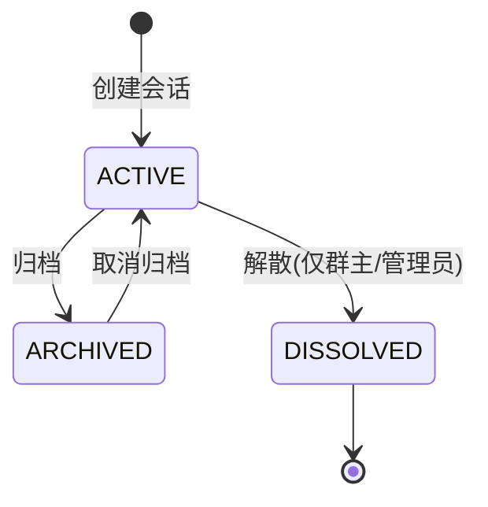
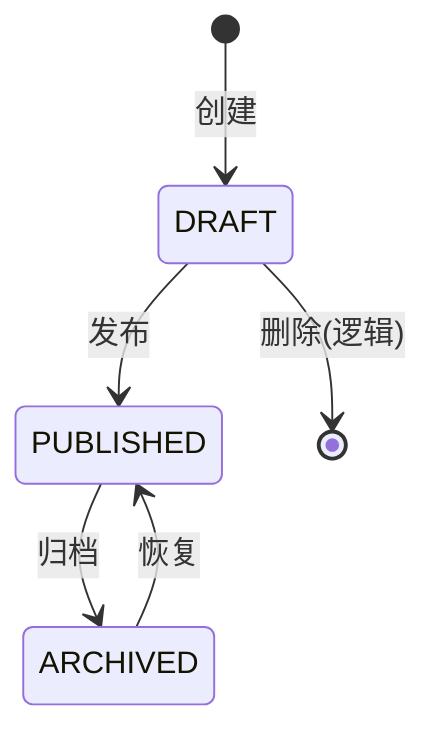
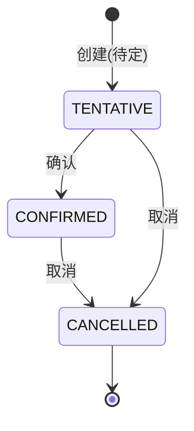
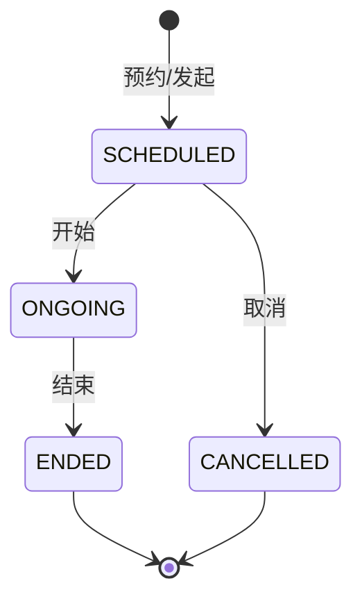
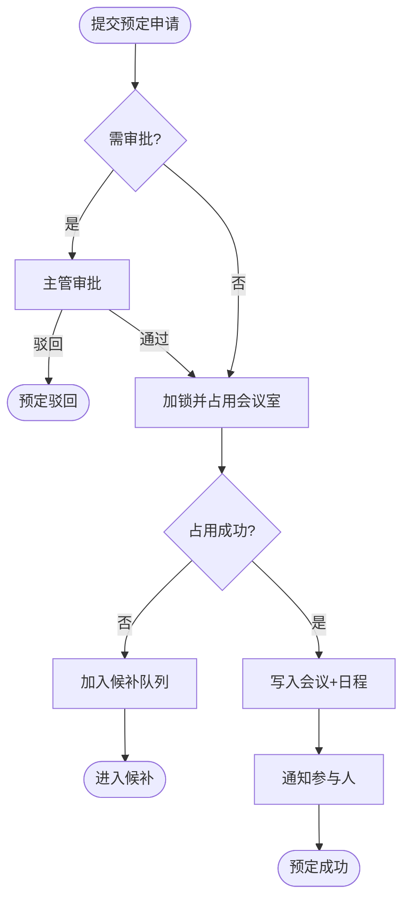
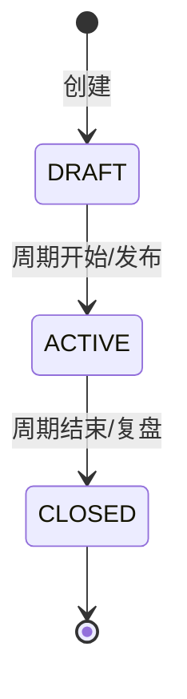
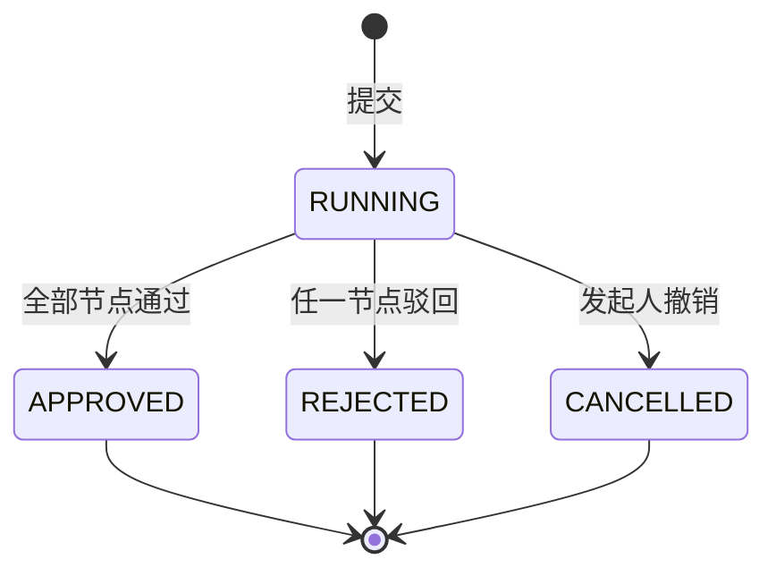
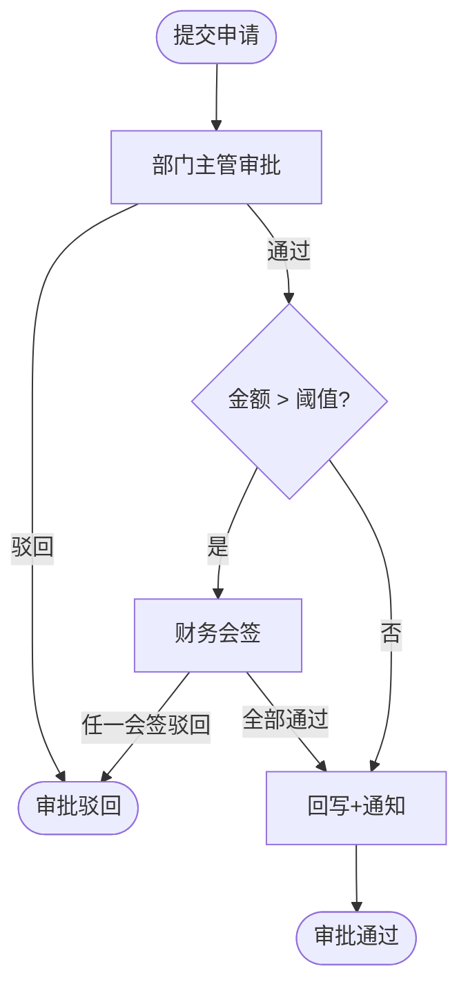
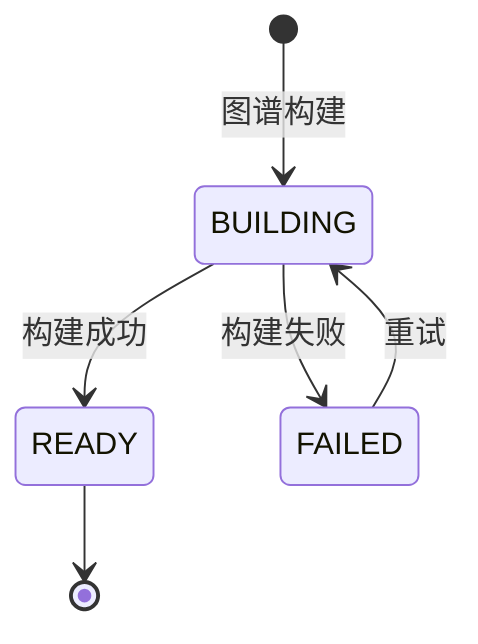

# 丰麟云协 · 模块详细功能与工作流设计

> 文档编号：FL-COLLAB-MOD-001
> 版本：V1.0
> 编制单位：丰麟云创科技有限公司 · 云协产品组
> 密级：内部（管理端）
> 约束基线：FL-HUB-STD-001《丰麟云枢 · 平台总体规范与统一标准》
> 模块范围：B1 内部协作与办公、B2 会议效率与协同网络分析（ONA）

---

## 目录

1. [模块总览与设计约定](#1-模块总览与设计约定)
2. [B1-IM 即时通讯](#2-b1-im-即时通讯)
3. [B1-DOC 协同文档](#3-b1-doc-协同文档)
4. [B1-CAL 日历](#4-b1-cal-日历)
5. [B1-MTG 会议](#5-b1-mtg-会议)
6. [B1-OKR OKR 协同](#6-b1-okr-okr-协同)
7. [B1-APV 审批](#7-b1-apv-审批)
8. [B1-WB 工作台](#8-b1-wb-工作台)
9. [B2 会议效率与 ONA](#9-b2-会议效率与协同网络分析ona)
10. [跨模块工作流汇总](#10-跨模块工作流汇总)
11. [修订记录](#修订记录)

---

## 1. 模块总览与设计约定

### 1.1 模块与需求映射

| 模块码 | 模块名 | 需求编号段 | 主要数据表 |
|---|---|---|---|
| B1-IM | 即时通讯 | FR-B1-001~008 | `collab_conversation*`、`collab_message*` |
| B1-DOC | 协同文档 | FR-B1-009~015 | `collab_document*` |
| B1-CAL | 日历 | FR-B1-016~020 | `collab_calendar`、`collab_event*` |
| B1-MTG | 会议 | FR-B1-021~026 | `collab_meeting*`、`collab_meeting_room` |
| B1-OKR | OKR 协同 | FR-B1-027~031 | `collab_okr_*` |
| B1-APV | 审批 | FR-B1-032~036 | `collab_approval_*` |
| B1-WB | 工作台 | FR-B1-037~040 | `collab_workbench_*`、`collab_notification`、`collab_todo` |
| B2 | 会议效率与 ONA | FR-B2-001~010 | `collab_ona_*` |

### 1.2 双端归属约定

- **管理端（`/admin/collab`，`tenant:collab:*`）**：配置、授权、审核、治理、度量口径、报表定义。
- **用户端（`/app/collab`，`biz:collab:*`）**：日常沟通、协同编辑、日程会议、目标、审批、待办。

### 1.3 状态机约定

所有状态机遵循：单一活动状态 + 显式终态 + 状态变更写审计。状态变更事件经 Kafka 广播，订阅方幂等消费。

---

## 2. B1-IM 即时通讯

### 2.1 功能清单

| 功能 | 描述 | 端 | 需求 |
|---|---|---|---|
| 会话管理 | 建群、群公告、成员管理、置顶/免打扰/归档/退出/解散 | 用户端 | FR-B1-001 |
| 单聊/群聊/话题群 | 三种会话形态 | 用户端 | FR-B1-001 |
| 消息收发 | 文本/富文本/图片/文件/语音/视频/卡片 | 用户端 | FR-B1-002 |
| 消息操作 | 引用、转发、撤回（24h）、@提及 | 用户端 | FR-B1-002 |
| 已读回执 | 单聊已读、群聊已读人数 | 用户端 | FR-B1-003 |
| 消息搜索 | 关键词/发送人/时间/类型检索 | 用户端 | FR-B1-004 |
| 表情回复与收藏 | Reaction、收藏夹 | 用户端 | FR-B1-005 |
| 会话内文件协同 | 文件转文档、共享链接 | 用户端 | FR-B1-006 |
| 敏感词策略 | 敏感词库、拦截/替换策略 | 管理端 | FR-B1-007 |
| 会话治理 | 会话审计、群组治理、解散/禁言 | 管理端 | FR-B1-001、007 |
| 多端同步推送 | Web/PWA 同步、离线补齐、外部渠道转发 | 用户端 | FR-B1-008 |

### 2.2 角色与权限

| 角色 | 端 | 权限码 | 说明 |
|---|---|---|---|
| 业务用户 | 用户端 | `collab:im:chat` | 收发消息、建群 |
| 群主/群管理员 | 用户端 | `collab:im:group:manage` | 管理成员、公告、禁言 |
| 协作业务管理员 | 管理端 | `collab:im:sensitive:manage` | 敏感词策略、会话审计 |
| 租户管理员 | 管理端 | `collab:im:govern` | 会话治理、解散会话 |

数据权限：会话消息仅对会话成员可见（成员关系校验）；管理端审计视图按 `data_scope` 限定。

### 2.3 业务规则

| 编号 | 规则 |
|---|---|
| IM-R01 | 群成员上限 2000；超过需申请扩容（管理端审批） |
| IM-R02 | 消息撤回限发送后 24h 内且限发送人本人（群主可撤回群成员消息） |
| IM-R03 | `client_msg_id` 在会话内唯一，重复提交返回已存在消息（幂等） |
| IM-R04 | 消息内容入库前执行敏感词过滤；命中"拦截"策略则拒发并提示 |
| IM-R05 | 消息正文加密存储，列表展示使用脱敏 `summary` |
| IM-R06 | 离线消息保留 30 天，超期仅可通过检索访问归档 |
| IM-R07 | 撤回/删除仅标记 `revoked`，原文保留于审计库（受严格权限控制） |

### 2.4 状态机



消息状态：`CREATED` → `SENT`（落库并 ACK）→ `DELIVERED`（投递成功）→ `READ`（接收方已读）；任意阶段（≤24h）可转 `REVOKED`。

### 2.5 工作流（消息投递）

1. 用户端经 WebSocket 发送消息帧（含 `clientMsgId`）。
2. 服务端校验会话成员与敏感词策略。
3. 落库（雪花 ID、`seq` 递增、内容加密）。
4. 返回 ACK（`serverMsgId`、`serverTime`）。
5. 经 Kafka 广播 `collab.message.sent`。
6. ws-gateway 根据在线路由表推送；离线成员落离线队列。
7. 接收方回执已读 → 更新 `collab_message_read` 与未读数。

### 2.6 异常与边界

| 场景 | 处理 |
|---|---|
| 重复 `clientMsgId` | 返回已存在消息，不重复落库 |
| 会话成员变更 | 退出成员不再接收推送；历史消息按策略保留 |
| 发送频率过高 | Sentinel 限流（单用户 30 msg/s），返回 `2001006` |
| WebSocket 断线 | 客户端按 `lastCursor` 重连补齐 |
| 敏感词命中 | 返回 `2001007` 并记录审计 |
| 群成员超限 | 返回 `2001008` |

### 2.7 验收标准

- 单聊/群聊/话题群消息收发、已读、撤回、搜索全部通过用例。
- 消息投递 P95 ≤ 200ms；吞吐 ≥ 20,000 msg/s。
- 敏感词拦截生效且留审计；消息内容加密存储验证通过。

### 2.8 与标杆产品（飞书）差异点

| 维度 | 飞书 | 丰麟云协 |
|---|---|---|
| 多租户 | 以企业为组织 | 原生 SaaS 多租户 + RLS，支持平台运营端跨租户治理（强审计） |
| 合规 | 通用合规 | 深度对接等保三级与云法 DLP 钩子，消息内容密文 + 审计双轨 |
| 生态 | 独立生态 | 与丰麟云枢八大域打通（审批回写云财、任务联动云研、知识沉淀云智） |
| ONA | 无组织网络分析 | IM 行为直接作为 ONA 关系边数据源（仅聚合指标） |

---

## 3. B1-DOC 协同文档

### 3.1 功能清单

| 功能 | 描述 | 端 | 需求 |
|---|---|---|---|
| 文档创建 | 空白/模板创建，类型 RICH/SHEET/KANBAN | 用户端 | FR-B1-009 |
| 模板库管理 | 模板上架、分类、定制 | 管理端 | FR-B1-009 |
| 实时协同编辑 | CRDT 无冲突合并、光标同步、在线状态 | 用户端 | FR-B1-010 |
| 版本与回滚 | 历史版本、对比、回滚 | 用户端 | FR-B1-010 |
| 权限与分享 | 成员/部门授权、链接分享、有效期/访问码 | 用户端 | FR-B1-011 |
| 评论批注 | 行内评论、@提及、解决/重开 | 用户端 | FR-B1-012 |
| 密级与水印 | 密级策略、动态水印、机密禁外链 | 管理端配置 + 用户端生效 | FR-B1-013 |
| 文档检索 | 全文检索、标签/创建人筛选 | 用户端 | FR-B1-014 |
| 嵌入与引用 | 文档卡片、双向链接 | 用户端 | FR-B1-015 |

### 3.2 角色与权限

| 角色 | 端 | 权限码 | 说明 |
|---|---|---|---|
| 文档所有者 | 用户端 | `collab:doc:manage` | 全部权限、授权 |
| 协作者-编辑 | 用户端 | `collab:doc:edit` | 编辑正文 |
| 协作者-评论 | 用户端 | `collab:doc:comment` | 评论 |
| 协作者-阅读 | 用户端 | `collab:doc:read` | 阅读 |
| 协作业务管理员 | 管理端 | `collab:doc:policy` | 密级策略、水印规则、模板库 |

数据权限：文档可见性由 `share_scope` + `collab_document_collaborator` 决定；密级 `CONFIDENTIAL` 禁止外链与下载。

### 3.3 业务规则

| 编号 | 规则 |
|---|---|
| DOC-R01 | 单文档协同在线人数上限 50（可配置），超出转只读 |
| DOC-R02 | CRDT 操作可交换、可结合、幂等；冲突自动收敛 |
| DOC-R03 | 版本每 5 分钟或每 500 次操作生成自动 checkpoint |
| DOC-R04 | 机密文档（`CONFIDENTIAL`）强制水印，禁止 `LINK` 分享与下载 |
| DOC-R05 | 分享链接可设有效期（≤30 天）与访问码；过期即失效 |
| DOC-R06 | 权限变更实时生效，无权限协作者被移出编辑房间 |
| DOC-R07 | 正文加密存储，检索索引仅索引标题与脱敏摘要（机密文档不建索引） |

### 3.4 状态机



### 3.5 工作流（协同编辑）

1. 客户端加入文档房间（ws-gateway 校验权限）。
2. 客户端发送 CRDT 操作（`op`、`clientId`、`clock`）。
3. 服务端校验权限 → 追加至 Redis Stream 操作流 → 广播给其他协作者。
4. 异步（Kafka）增量持久化；周期生成 checkpoint 版本。
5. 权限变更 → 立即踢出房间并通知。

### 3.6 异常与边界

| 场景 | 处理 |
|---|---|
| 并发编辑冲突 | CRDT 自动合并，无冲突提示 |
| 在线人数超限 | 后续进入者转只读，返回提示 |
| 无编辑权限 | 返回 `2002002`（无权限） |
| 大文档卡顿 | 分片加载 + 操作流裁剪 |
| 链接过期 | 返回 `2002009` |
| 机密文档外链 | 拒绝并审计，返回 `2002010` |

### 3.7 验收标准

- 50 人同时编辑无数据丢失、操作广播 P95 ≤ 150ms。
- 版本回滚、权限变更实时生效、密级水印验证通过。

### 3.8 与标杆产品（飞书文档）差异点

| 维度 | 飞书文档 | 丰麟云协 |
|---|---|---|
| 密级体系 | 基础权限 | 三级密级 + 动态可溯源水印 + 与云法 DLP 联动 |
| 内容安全 | 通用 | 机密文档不建检索索引、禁外链下载，防泄漏闭环 |
| 跨域协同 | 生态内 | 文档可嵌入审批/OKR/会议，并与云智知识索引打通 |
| 多租户 | 单企业 | RLS 隔离 + 跨租户治理强审计 |

---

## 4. B1-CAL 日历

### 4.1 功能清单

| 功能 | 描述 | 端 | 需求 |
|---|---|---|---|
| 个人/团队/公共日历 | 日历分类、订阅、颜色 | 用户端 | FR-B1-016 |
| 公共日历与假期 | 公共事件、假期规则配置 | 管理端 | FR-B1-016 |
| 日程创建与提醒 | 时间、地点、参与人、RRULE、提醒 | 用户端 | FR-B1-017 |
| 忙闲查询与推荐 | Free/Busy、最优时段推荐 | 用户端 | FR-B1-018 |
| 日历会议联动 | 带会议室日程自动创建会议 | 用户端 | FR-B1-019 |
| 日程审计 | 日程变更审计 | 管理端 | FR-B1-016 |
| 待办集成 | 会议行动项写待办 | 用户端 | FR-B1-020 |

### 4.2 角色与权限

| 角色 | 端 | 权限码 |
|---|---|---|
| 业务用户 | 用户端 | `collab:calendar:manage` |
| 部门协作管理员 | 管理端 | `collab:calendar:dept:manage` |
| 协作业务管理员 | 管理端 | `collab:calendar:public:manage` |

### 4.3 业务规则

| 编号 | 规则 |
|---|---|
| CAL-R01 | 忙闲查询仅返回"忙/空闲"，不暴露日程标题与详情 |
| CAL-R02 | RRULE 重复日程拆分实例共享 `recurrence_id`，单实例可单独修改 |
| CAL-R03 | 跨时区按 UTC 存储，展示按用户时区换算 |
| CAL-R04 | 日程关联会议室时，预约冲突按会议室规则处理 |
| CAL-R05 | 公共日历仅管理端可维护 |

### 4.4 状态机



### 4.5 工作流（日程与会议联动）

1. 用户创建日程并选择会议室。
2. 系统校验会议室可用性（并发锁）。
3. 创建 `collab_meeting` 并回填 `event.meeting_id`。
4. 写入参与人 `collab_event_attendee`。
5. 推送邀请通知（IM 卡片 + 通知中心）。
6. 参与人响应（接受/拒绝/待定）更新回执。

### 4.6 异常与边界

| 场景 | 处理 |
|---|---|
| 时段冲突（个人） | 提示冲突但允许强制创建（可配置禁止） |
| 会议室不可用 | 返回 `2006005` 并推荐临近时段 |
| 跨时区显示 | 按用户时区换算 |
| 重复日程修改 | 支持"仅此实例/此后全部" |

### 4.7 验收标准

- 日程创建、提醒、忙闲、会议联动全部通过用例；时区换算正确。

### 4.8 与标杆产品（飞书日历）差异点

- 忙闲隐私更强：默认仅暴露忙闲，不暴露详情。
- 与企业假期、会议室资源、审批（请假）深度联动，形成"日程—资源—流程"闭环。

---

## 5. B1-MTG 会议

### 5.1 功能清单

| 功能 | 描述 | 端 | 需求 |
|---|---|---|---|
| 会议发起与邀请 | 即时/预约会议，内外部参与人 | 用户端 | FR-B1-021 |
| 会议室管理 | 资源维护、设备、容量、可预订范围 | 管理端 | FR-B1-022 |
| 会议室预定 | 筛选、冲突检测、候补队列 | 用户端 | FR-B1-022 |
| 签到与出席 | 扫码/入会签到、缺席统计 | 用户端 | FR-B1-023 |
| 纪要与行动项 | 模板化纪要、行动项转待办 | 用户端 | FR-B1-024 |
| 录制与转录 | 录制、语音转写（AI 嵌入） | 用户端 | FR-B1-025 |
| 会议效率指标 | 时长、发言、准时率、决策率 | 管理端 | FR-B1-026 |

### 5.2 角色与权限

| 角色 | 端 | 权限码 | 说明 |
|---|---|---|---|
| 会议组织者 | 用户端 | `collab:meeting:manage` | 发起、管理会议 |
| 参与人 | 用户端 | `collab:meeting:join` | 参会、签到 |
| 协作业务管理员 | 管理端 | `collab:meeting:room:manage` | 会议室资源、会议策略 |
| 部门协作管理员 | 管理端 | `collab:meeting:dept:manage` | 本部门会议室 |

### 5.3 业务规则

| 编号 | 规则 |
|---|---|
| MTG-R01 | 会议室预定时段不可重叠（GiST 排他约束 + 分布式锁双重保证） |
| MTG-R02 | 预定冲突时提供候补队列，释放即通知首个候补 |
| MTG-R03 | 外部参与人需策略允许（`external_allowed`）且经审批（可配置） |
| MTG-R04 | 录制须经主持人授权，录制文件留存审计 |
| MTG-R05 | 行动项必须有责任人方可转为待办 |
| MTG-R06 | 会议取消释放会议室并通知参与人 |

### 5.4 状态机



会议室状态：`AVAILABLE` → `MAINTENANCE` / `DISABLED`。

### 5.5 工作流（会议室预定，含 BPMN 说明）

**BPMN 文本说明**：

```
流程：会议室预定
开始事件「提交预定申请」
  网关「是否需要审批」（根据会议室策略 decide）
    ├─ 是 → 用户任务「主管审批」
    │        ├─ 通过 → 服务任务「加锁并占用会议室」
    │        └─ 驳回 → 结束事件「预定驳回」
    └─ 否 → 服务任务「加锁并占用会议室」
  服务任务「加锁并占用会议室」
     → 排他网关「占用是否成功」
        ├─ 成功 → 服务任务「写入会议+日程」→ 服务任务「通知参与人」→ 结束事件「预定成功」
        └─ 失败 → 服务任务「加入候补队列」→ 结束事件「进入候补」
```

Mermaid 表达：



### 5.6 异常与边界

| 场景 | 处理 |
|---|---|
| 高并发抢同一会议室 | 锁 + 排他约束，仅一个成功，其余返回 `2006005` 或入候补 |
| 会议室维护中 | 不可预订，返回 `2006011` |
| 外部参与人未授权 | 返回 `2006012` |
| 录制未授权 | 拒绝录制，返回 `2006013` |
| 会议取消后时段释放 | 触发候补抢占通知 |

### 5.7 验收标准

- 500 并发抢同一会议室时段仅 1 成功、无重复占用。
- 纪要行动项转待办、候补抢占、录制授权均通过。

### 5.8 与标杆产品（飞书会议）差异点

- 会议室预定引入分布式锁 + 数据库排他约束双保险，杜绝超定。
- 会议数据直接输入 ONA 与会议效率模型（FR-B2），形成会议治理闭环。

---

## 6. B1-OKR OKR 协同

### 6.1 功能清单

| 功能 | 描述 | 端 | 需求 |
|---|---|---|---|
| 周期配置 | 季度/半年/年度周期 | 管理端 | FR-B1-027 |
| 目标与 KR | 多层级 O 与 KR | 用户端 | FR-B1-027 |
| 对齐与级联 | 上下/横向对齐，对齐图 | 用户端 | FR-B1-028 |
| 进度与信心指数 | 进度更新、信心指数 | 用户端 | FR-B1-029 |
| 协作关联 | OKR 关联文档/会议/审批 | 用户端 | FR-B1-030 |
| 周期复盘 | 打分、结项、原因 | 用户端 | FR-B1-031 |
| 度量口径 | 对齐规则、打分口径配置 | 管理端 | FR-B1-027 |

### 6.2 角色与权限

| 角色 | 端 | 权限码 |
|---|---|---|
| 目标负责人 | 用户端 | `collab:okr:manage` |
| OKR 参与者 | 用户端 | `collab:okr:progress` |
| 协作业务管理员 | 管理端 | `collab:okr:period:manage` |

### 6.3 业务规则

| 编号 | 规则 |
|---|---|
| OKR-R01 | 对齐关系禁止循环（构建时做环检测） |
| OKR-R02 | 周期关闭后目标只读；复盘可继续补充 |
| OKR-R03 | 进度更新保留历史（`collab_okr_progress`） |
| OKR-R04 | 公司级 OKR 默认全员可见；个人 OKR 默认本部门可见 |
| OKR-R05 | 对齐权重之和建议为 100%（非强制） |

### 6.4 状态机



KR 信心指数：`HIGH` / `MID` / `LOW`（可随进度更新）。

### 6.5 工作流（OKR 对齐）

1. 创建目标 O（选择周期、负责人、类型）。
2. 添加 KR（指标类型、目标值）。
3. 建立对齐关系（选择上级目标）→ 环检测。
4. 周期中更新进度与信心指数 → 通知关注者。
5. 周期末复盘打分 → 结项归档。

### 6.6 异常与边界

| 场景 | 处理 |
|---|---|
| 循环对齐 | 拒绝并返回 `2005001` |
| 周期已关闭再编辑 | 返回 `2005002` |
| 无权限查看他人 OKR | 按可见性返回 `2000002` |
| KR 进度越界（>100 或 <0） | 参数校验失败 `2000003` |

### 6.7 验收标准

- 对齐图正确无环；进度与信心指数更新留痕；周期关闭只读生效。

### 6.8 与标杆产品（Worktile OKR）差异点

- OKR 与协作行为（文档/会议/审批）强关联，形成"目标—协作—度量"闭环。
- OKR 对齐行为构成 ONA 关系边（`okr_count`），用于组织目标网络分析。

---

## 7. B1-APV 审批

### 7.1 功能清单

| 功能 | 描述 | 端 | 需求 |
|---|---|---|---|
| 审批模板设计 | 表单、节点、条件分支、抄送、会签/或签 | 管理端 | FR-B1-032 |
| 审批发起 | 选模板、填表单、提交 | 用户端 | FR-B1-033 |
| 审批流转 | 通过/驳回/退回/加签/转办/撤销/催办 | 用户端 | FR-B1-033 |
| IM/待办联动 | 审批卡片推送、待办生成 | 用户端 | FR-B1-034 |
| 代理授权 | 出差/休假代理 | 用户端 | FR-B1-035 |
| 数据权限 | 实例可见范围 | 双端 | FR-B1-036 |

### 7.2 角色与权限

| 角色 | 端 | 权限码 | 说明 |
|---|---|---|---|
| 发起人 | 用户端 | `collab:approval:submit` | 发起审批 |
| 审批人 | 用户端 | `collab:approval:handle` | 处理审批 |
| 协作业务管理员 | 管理端 | `collab:approval:template:manage` | 模板与流程 |
| 抄送人 | 用户端 | `collab:approval:read` | 查看 |

### 7.3 业务规则

| 编号 | 规则 |
|---|---|
| APV-R01 | 审批发起强制幂等（`Idempotency-Key`），重复提交返回同一实例 |
| APV-R02 | 会签节点需全部通过；或签节点任一通过即通过 |
| APV-R03 | 条件分支基于表单字段表达式路由 |
| APV-R04 | 退回可选择退回至发起人或指定节点 |
| APV-R05 | 代理关系限定期限，过期自动失效，全程审计 |
| APV-R06 | 审批意见加密存储 |
| APV-R07 | 审批完成经 RocketMQ 事务消息回写发起人并入待办 |

### 7.4 状态机



任务状态：`PENDING` → `DONE` / `SKIPPED`。

### 7.5 工作流（审批，BPMN 说明）

```
流程：审批实例
开始事件「提交申请」
  → 用户任务「部门主管审批」（串行）
      ├─ 驳回 → 结束事件「审批驳回」
      └─ 通过 → 排他网关「金额 > 阈值?」
            ├─ 是 → 用户任务「财务会签」（会签）
            │        ├─ 全部通过 → 服务任务「回写+通知」→ 结束事件「审批通过」
            │        └─ 任一会签驳回 → 结束事件「审批驳回」
            └─ 否 → 服务任务「回写+通知」→ 结束事件「审批通过」
```

Mermaid：



### 7.6 异常与边界

| 场景 | 处理 |
|---|---|
| 重复提交 | 幂等返回同一实例 |
| 审批人离职 | 任务自动转办至角色默认人或上级 |
| 流程定义变更 | 在途实例锁定原版本，新实例用新版本 |
| 工作流引擎不可用 | 发起/处理暂停，返回 `2000008` |
| 越权查看实例 | 返回 `2000002` |

### 7.7 验收标准

- 串行/并行/会签/或签/条件分支全部通过；幂等与数据权限验证通过。

### 8.8 与标杆产品（飞书审批）差异点

- 复用平台统一工作流引擎（Flowable），与云财、云才、云法审批统一编排。
- 审批意见加密 + 全量审计，满足等保三级；并支持跨域审批回写与对账。

---

## 8. B1-WB 工作台

### 8.1 功能清单

| 功能 | 描述 | 端 | 需求 |
|---|---|---|---|
| 组件与布局 | 待办/会议/文档/OKR/公告/快捷入口 | 用户端 | FR-B1-037 |
| 待办聚合 | 多来源待办统一 | 用户端 | FR-B1-038 |
| 通知中心 | 分类通知、免打扰、标记已读 | 用户端 | FR-B1-039 |
| 工作台模板 | 租户级默认布局 | 管理端 | FR-B1-040 |
| 组件上架 | 组件管理 | 管理端 | FR-B1-037 |

### 8.2 角色与权限

| 角色 | 端 | 权限码 |
|---|---|---|
| 业务用户 | 用户端 | `collab:workbench:personal` |
| 协作业务管理员 | 管理端 | `collab:workbench:template:manage` |

### 8.3 业务规则

| 编号 | 规则 |
|---|---|
| WB-R01 | 个人布局覆盖租户模板；新员工入职套用模板 |
| WB-R02 | 待办来源唯一约束（`source_type`+`source_id`）防重复 |
| WB-R03 | 免打扰时段内仅聚合，不推送即时提醒 |
| WB-R04 | 待办完成回写来源（如审批任务、行动项） |

### 8.4 状态机

待办：`OPEN` → `DONE` / `CANCELLED`。通知：`UNREAD` → `READ`。

### 8.5 工作流（待办聚合）

1. 各模块产生事件（审批任务、文档提及、会议邀请、OKR 更新）。
2. 事件消费生成 `collab_todo`（按来源唯一约束去重）。
3. 工作台待办组件聚合查询（`owner_id` + `status=OPEN`）。
4. 用户处理待办 → 回写来源模块 → 标记 `DONE`。

### 8.6 异常与边界

| 场景 | 处理 |
|---|---|
| 重复待办 | 来源唯一约束去重 |
| 来源已删除 | 待办自动取消 |
| 布局组件失效 | 降级隐藏并提示 |

### 8.7 验收标准

- 待办聚合完整、去重正确、完成回写来源；模板套用正确。

### 8.8 与标杆产品（飞书工作台）差异点

- 待办中心与八大域打通（如云财报销、云才培训），形成企业级统一待办。
- 工作台组件可通过低代码（云服 F2）扩展，支持租户自定义。

---

## 9. B2 会议效率与协同网络分析（ONA）

### 9.1 功能清单

| 功能 | 描述 | 端 | 需求 |
|---|---|---|---|
| 会议效率度量 | 效率评分模型 | 管理端 | FR-B2-001 |
| 会议成本核算 | 人力成本估算 | 管理端 | FR-B2-002 |
| 会议健康度预警 | 低效会议识别与建议 | 管理端 | FR-B2-003 |
| 协作图谱构建 | 多源行为构建关系图谱 | 管理端（后台计算） | FR-B2-004 |
| ONA 指标计算 | 密度/中心度/结构洞等 | 管理端 | FR-B2-005 |
| 关键人识别 | 关键连接人/断点 | 管理端 | FR-B2-006 |
| 部门协作视图 | 网络可视化与下钻 | 双端（按权限） | FR-B2-007 |
| 快照与趋势 | 周期快照、趋势 | 管理端 | FR-B2-008 |
| 洞察报告 | 组织效能报告 | 管理端 | FR-B2-009 |
| 隐私边界 | 聚合输出、匿名阈值 | 管理端配置 | FR-B2-010 |
| 个人协作画像 | 本人协作画像 | 用户端 | FR-B2-007、010 |

### 9.2 角色与权限

| 角色 | 端 | 权限码 | 说明 |
|---|---|---|---|
| 业务用户 | 用户端 | `collab:ona:self` | 仅查看本人协作画像 |
| 部门协作管理员 | 管理端 | `collab:ona:dept` | 查看本部门网络（受匿名阈值约束） |
| 协作业务管理员 | 管理端 | `collab:ona:config` | 度量模型、口径、隐私边界配置 |
| 租户管理员 | 管理端 | `collab:ona:tenant` | 全租户组织网络视图 |
| 审计管理员 | 管理端 | `collab:ona:audit` | 查看 ONA 调用与访问审计 |

数据权限：ONA 结果按 `data_scope` 与匿名阈值双重约束。

### 9.3 业务规则

| 编号 | 规则 |
|---|---|
| ONA-R01 | ONA 禁止采集与输出消息正文，仅使用结构化行为计数 |
| ONA-R02 | 个人协作画像默认仅本人可见，管理端可见范围可配置 |
| ONA-R03 | 部门人数 < 匿名阈值（默认 5）不出图，避免个体推断 |
| ONA-R04 | 关系强度 `weight` = 加权归一化（IM×0.3 + 文档×0.25 + 会议×0.25 + 审批×0.1 + OKR×0.1） |
| ONA-R05 | 关键连接人识别：中介中心度或度中心度 Top N（默认 Top 5%）且跨部门占比 ≥ 阈值 |
| ONA-R06 | 快照周期保留最近 8 个（约 2 年） |
| ONA-R07 | 所有 ONA 查询记录访问审计（谁在何时查询了哪个范围） |

### 9.4 状态机



### 9.5 工作流（ONA 快照生成）

```mermaid
flowchart TD
  S([XXL-Job 触发]) --> P1[拉取周期内协作行为]
  P1 --> P2[构建/更新节点与关系边]
  P2 --> P3[计算指标: 密度/中心度/结构洞]
  P3 --> P4[识别关键连接人与孤岛]
  P4 --> P5[写入快照与指标]
  P5 --> P6[生成洞察文本(云智嵌入)]
  P6 --> P7[发布 collab.ona.snapshot.generated]
  P7 --> E([完成])
```

### 9.6 会议效率计算说明

**会议效率评分模型（0-100）**：

```
效率分 = 40×决策达成率 + 20×准时率 + 20×行动项完成率 + 10×(1 - 超员系数) + 10×(1 - 超时系数)
其中：
  决策达成率 = 有明确结论的会议数 / 总会议数
  准时率     = 准时开始会议数 / 总会议数
  行动项完成率 = 已关闭行动项 / 总行动项
  超员系数   = max(0, 实到人数 - 建议人数) / 建议人数，封顶 1
  超时系数   = max(0, 实际时长 - 计划时长) / 计划时长，封顶 1
```

**会议人力成本**：

```
成本 = Σ(参会人时薪系数 × 时长(h))
时薪系数来自管理端配置的岗位系数表，非真实薪资
```

### 9.7 异常与边界

| 场景 | 处理 |
|---|---|
| 数据源缺失 | 使用可用数据源，缺失源权重按比例重归一 |
| 部门人数不足阈值 | 不出图，返回"样本不足" |
| 图谱计算超时 | 分片计算 + 增量更新，失败重试 |
| 越权查询个人画像 | 返回 `2000002` |
| 隐私合规审计 | 每次查询写审计 |

### 9.8 验收标准

- 3400 节点、约 5 万边图谱指标计算 P95 ≤ 60s。
- 会议效率评分、关键人识别、匿名阈值、访问审计全部通过。
- 确认无任何消息正文参与 ONA 计算。

### 9.9 与标杆产品（阔知·ONA）差异点

| 维度 | 阔知·ONA | 丰麟云协 ONA |
|---|---|---|
| 数据源 | 以学习/协作行为为主 | IM+文档+会议+审批+OKR 五源融合，权重可配 |
| 会议效率 | 无独立会议治理 | 会议效率评分 + 人力成本 + 健康度预警 |
| 隐私 | 通用 | 匿名阈值 + 聚合输出 + 全量访问审计，满足等保与个保法 |
| 落地 | 分析报告 | 与组织管理（云才）、绩效协同，形成"分析—改进—复测"闭环 |

---

## 10. 跨模块工作流汇总

| 工作流 | 触发 | 涉及模块 | 说明 |
|---|---|---|---|
| WF-01 消息投递 | 发送消息 | IM、通知 | 落库→广播→推送→回执 |
| WF-02 协同编辑 | 打开文档 | 文档、IM | 房间加入→CRDT→checkpoint |
| WF-03 会议室预定 | 预定会议室 | 会议、日历、审批、工作台 | 锁→占用→通知（可含审批） |
| WF-04 会议纪要转待办 | 发布会纪要 | 会议、工作台、IM | 行动项→待办→通知责任人 |
| WF-05 审批流转 | 提交审批 | 审批、IM、工作台 | Flowable 驱动 + 卡片推送 |
| WF-06 OKR 对齐 | 建立对齐 | OKR、ONA | 环检测→关系边 |
| WF-07 待办聚合 | 各模块事件 | 工作台、全模块 | 事件→待办→回写 |
| WF-08 ONA 快照 | 定时任务 | ONA、会议、全模块 | 数据拉取→指标→快照 |
| WF-09 文档密级降级 | 管理员调整 | 文档、IM、审批 | 权限回收→外链失效→通知 |

---

## 修订记录

| 版本 | 日期 | 修订人 | 说明 |
|---|---|---|---|
| V1.0 | 2026-10-19 | 云协产品组 | 首次发布，覆盖 B1 七大能力族与 B2 ONA 的功能、权限、规则、状态机、工作流与标杆差异点 |
