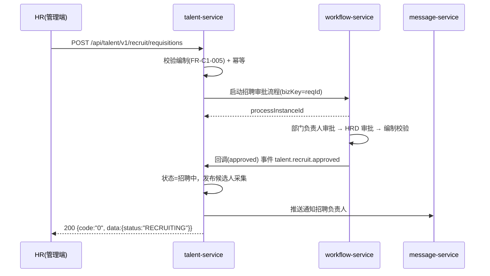
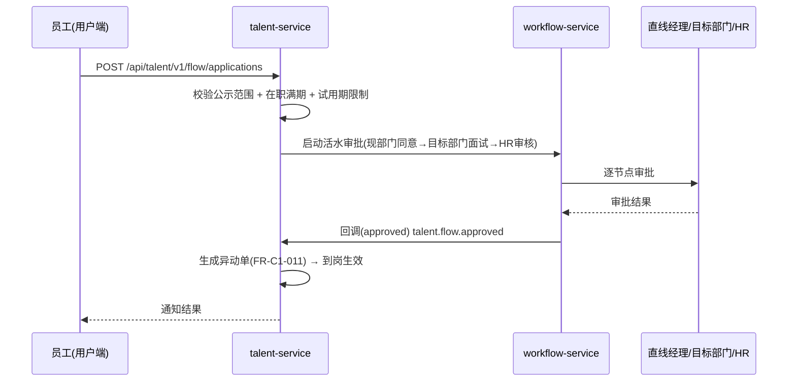
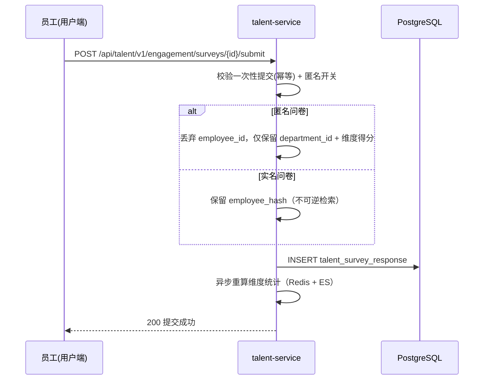
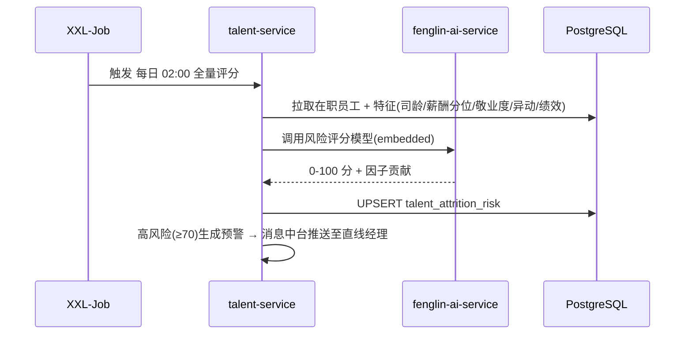
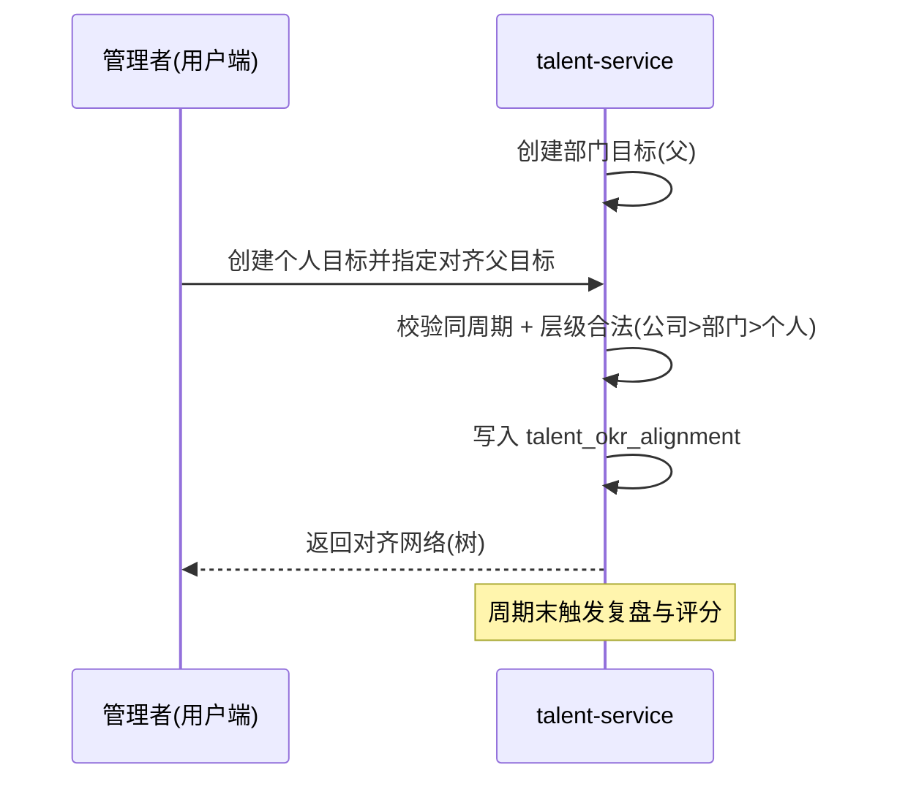

# 丰麟云才 · 架构设计文档

| 项目 | 内容 |
|---|---|
| 文档编号 | FL-TALENT-ARCH-001 |
| 版本 | V1.0 |
| 编制单位 | 丰麟云创科技有限公司 · 组织与人才产品组 |
| 适用产品 | 丰麟云才（Fenglin Cloud Talent） |
| 密级 | 内部（管理端） |
| 基线依据 | 《丰麟云枢 · 平台总体规范与统一标准》FL-HUB-STD-001 |
| 发布日期 | 2026-10-19 |

---

## 目录

1. [架构概览](#1-架构概览)
2. [分层与部署图](#2-分层与部署图)
3. [服务清单与技术选型](#3-服务清单与技术选型)
4. [关键流程时序](#4-关键流程时序)
5. [数据架构](#5-数据架构)
6. [集成与开放](#6-集成与开放)
7. [双端分离架构](#7-双端分离架构)
8. [高可用与容灾](#8-高可用与容灾)
9. [安全架构](#9-安全架构)
10. [技术风险](#10-技术风险)

---

## 1 架构概览

### 1.1 定位

丰麟云才作为丰麟云枢平台"域C：组织与人才"业务域产品，采用微服务中台 + 业务域服务架构，复用平台中台（IAM/权限/工作流/消息/文件/审计/搜索/AI），对外提供管理端与用户端双端能力及开放 API。

### 1.2 架构原则

| 原则 | 说明 |
|---|---|
| 中台复用 | 组织、权限、工作流、消息、文件、审计、搜索、AI 复用平台中台，不重复造轮子 |
| 双端分离 | 管理端 `fenglin-talent-admin-ui`（`/admin/talent`）与用户端 `fenglin-talent-portal-ui`（`/app/talent`）独立工程 |
| 数据隔离 | 共享库共享模式 + `tenant_id` + PostgreSQL RLS |
| 敏感数据保护 | PII AES-256-GCM + `*_hash` 透明加解密（MyBatis TypeHandler） |
| 事件驱动 | Kafka 事件总线解耦招聘/培训/活水/OKR 与中台联动 |
| 无状态 | 业务服务无状态，支持水平扩展 |

### 1.3 能力地图

```
丰麟云才 (fenglin-talent)
├── C1 人力资源管理          招聘 / 员工 / 组织 / 异动 / 离职
├── C2 企业培训与知识沉淀     课程 / 学习 / 考试 / 知识库
├── C3 技能库与活水市场       技能 / 人才池 / 活水 / 匹配
├── C4 敬业度与离职预测       问卷 / 分析 / 风险评分 / 干预
└── C5 创新与 OKR 对齐        OKR / 对齐 / 提案 / 孵化
```

---

## 2 分层与部署图

### 2.1 逻辑分层

```
┌───────────────────────────────────────────────────────────────┐
│  接入层  Admin UI(/admin/talent) · Portal UI(/app/talent) · PWA │
├───────────────────────────────────────────────────────────────┤
│  网关层  Spring Cloud Gateway（鉴权/限流/路由/审计埋点/灰度）      │
│          /api/talent/v1/**   /openapi/talent/v1/**             │
├───────────────────────────────────────────────────────────────┤
│  业务域层  fenglin-talent-service（C1–C5 模块）                  │
├───────────────────────────────────────────────────────────────┤
│  中台层  IAM · 权限(4A) · 工作流(Flowable) · 消息 · 文件 · 审计   │
│          · 搜索(ES) · AI(人岗匹配/离职预测) · 报表 · 开放平台       │
├───────────────────────────────────────────────────────────────┤
│  数据层  PostgreSQL(fenglin_talent) · Redis · ES · Kafka         │
│          RocketMQ · MinIO · XXL-Job                            │
└───────────────────────────────────────────────────────────────┘
```

### 2.2 部署拓扑（K8s）

```
                    ┌────────────┐
   Internet ──TLS──▶│  WAF + LB   │
                    └─────┬──────┘
                          │
                  ┌───────▼────────┐
                  │ fenglin-gateway│  (3 副本)
                  └───────┬────────┘
        ┌─────────────────┼──────────────────┐
        ▼                 ▼                  ▼
┌───────────────┐ ┌──────────────────┐ ┌──────────────┐
│ talent-service│ │ talent-admin-ui  │ │talent-portal │
│  (4-8 副本)   │ │  (静态 CDN)       │ │  -ui (CDN)   │
└───────┬───────┘ └──────────────────┘ └──────────────┘
        │
        ├─ PostgreSQL 15 主从（同城双活）
        ├─ Redis 7 哨兵集群
        ├─ Kafka 3.6 集群（3 broker）
        ├─ Elasticsearch 8（3 节点）
        ├─ MinIO 分布式（4 节点）
        └─ XXL-Job 调度中心（2 副本）
```

### 2.3 命名空间与配置

| 项目 | 值 |
|---|---|
| Nacos 命名空间 | `fenglin-talent` |
| 配置 DataId | `fenglin-talent-{env}.yaml`（dev/test/staging/prod） |
| K8s Namespace | `fenglin-talent` |
| 服务名 | `fenglin-talent-service` |
| 私有化替换 | `{customer}-fenglin-talent` |

---

## 3 服务清单与技术选型

### 3.1 服务清单

| 服务 | 类型 | 副本 | 说明 |
|---|---|---|---|
| `fenglin-talent-service` | 业务域 | 4–8 | C1–C5 全部业务 API |
| `fenglin-talent-admin-ui` | 前端 | CDN | 管理端 |
| `fenglin-talent-portal-ui` | 前端 | CDN | 用户端 |
| `fenglin-talent-job` | 任务 | 2 | XXL-Job 执行器（离职预测批处理、问卷提醒、OKR 提醒、待办同步） |

### 3.2 技术选型（继承规范第 3 章，锁定）

| 层次 | 选型 | 版本 |
|---|---|---|
| 语言/运行时 | Java / TypeScript | Java 17 LTS / Node 20 LTS |
| 后端框架 | Spring Boot + Spring Cloud + Alibaba | Boot 3.2.x / Cloud 2023.0.x / Alibaba 2023.0.x |
| 注册与配置 | Nacos | 2.3.x |
| 网关 | Spring Cloud Gateway | 4.1.x |
| 流控熔断 | Sentinel | 1.8.x |
| ORM | MyBatis-Plus | 3.5.x |
| 分布式事务 | Seata（AT） | 2.0.x |
| 数据库 | PostgreSQL | 15.x |
| 迁移 | Flyway | 10.x |
| 缓存 | Redis | 7.x |
| 消息 | Kafka 3.6 / RocketMQ 5.x | — |
| 搜索 | Elasticsearch（IK） | 8.x |
| 对象存储 | MinIO | RELEASE.2024 |
| 调度 | XXL-Job | 2.4.x |
| 工作流 | Flowable（BPMN 2.0） | 7.x |
| 认证 | Spring Security + OAuth2.1/OIDC + JWT(RS256) | — |
| 前端 | Vue 3.4 + TS + Vite 5；Element Plus（管理端）+ 自研 Portal 组件 | — |
| 可观测 | Prometheus + Grafana + Loki + SkyWalking | — |

### 3.3 模块与包结构

```
com.fenglin.talent
├── common            // 通用：加解密 TypeHandler、多租户、审计、异常、错误码
│   ├── crypto        // AesGcmTypeHandler, TenantSaltHasher
│   ├── tenant        // TenantContext, RlsInterceptor
│   └── error         // TalentErrorCode (30000xx)
├── hr                // C1 人力资源管理
│   ├── org  position  grade  headcount  employee  recruit
│   ├── candidate  interview  offer  onboarding  transfer  resignation
├── training          // C2 培训与知识
│   ├── course  session  enrollment  learning  exam  knowledge
├── skill             // C3 技能与活水
│   ├── tag  employeeskill  talentpool  demand  flow  matching
├── engagement        // C4 敬业度与离职预测
│   ├── survey  response  analysis  attrition  intervention
├── okr               // C5 创新与 OKR
│   ├── period  objective  keyresult  alignment  proposal  review
└── integration       // 中台适配（IAM/工作流/消息/文件/AI）
```

---

## 4 关键流程时序

### 4.1 招聘审批流程（C1）



### 4.2 活水申请流程（C3）



### 4.3 敬业度问卷提交与匿名（C4）



### 4.4 离职预测批处理（C4）



### 4.5 OKR 对齐（C5）



---

## 5 数据架构

### 5.1 数据存储职责

| 存储 | 用途 |
|---|---|
| PostgreSQL `fenglin_talent` | 全部业务主数据、事务数据 |
| Redis | 会话、组织树缓存、问卷统计缓存、幂等键、分布式锁 |
| Elasticsearch | 员工/岗位/知识/提案全文检索、技能匹配倒排 |
| Kafka | 领域事件总线（talent.* 事件） |
| RocketMQ | 事务消息（入职联动、离职联动） |
| MinIO | 简历、证书、课程视频、提案附件 |

### 5.2 缓存策略

| 缓存对象 | Key | 失效 |
|---|---|---|
| 组织树 | `talent:org:tree:{tenantId}` | 组织变更事件失效 |
| 员工基础信息 | `talent:emp:{tenantId}:{empId}` | 更新/离职失效 |
| 问卷统计 | `talent:survey:stat:{surveyId}` | 答卷提交后延迟重算 |
| 幂等键 | `talent:idem:{key}` | 24h TTL |
| 离职风险 | `talent:risk:high:{tenantId}` | 每日批处理刷新 |

### 5.3 PII 加密数据流

```
业务写请求
  → MyBatis EncryptTypeHandler
      ├─ AES-256-GCM(明文, 租户数据密钥) → phone_enc / id_card_enc
      └─ SHA-256(明文 + 租户盐)          → phone_hash / id_card_hash
  → INSERT/UPDATE
读请求
  → DecryptTypeHandler → 明文（受字段权限）
  → 展示层脱敏（138****8888 / 110***********1234）
检索
  → 精确检索走 *_hash；模糊检索走倒排/分词（不落明文索引）
```

### 5.4 分库与容量

| 项 | 说明 |
|---|---|
| 部署形态 | SaaS 共享库共享模式 + RLS；高合规客户 database per tenant |
| 单租户数据量基线 | ≤ 10 亿行 |
| 审计日志留存 | 12 个月（等保 ≥ 6 个月） |
| 归档策略 | 离职员工满 2 年归档至归档库；问卷原始答卷留存 24 个月 |

---

## 6 集成与开放

### 6.1 中台集成

| 中台服务 | 集成点 |
|---|---|
| `fenglin-iam-service` | 用户、组织、岗位主数据同步；离职联动停用账号 |
| `fenglin-workflow-service` | 招聘审批、异动审批、活水审批、Offer 审批、提案评审 |
| `fenglin-message-service` | 面试通知、问卷触达、OKR 提醒、风险预警 |
| `fenglin-file-service` | 简历、证书、附件（水印/防泄漏钩子） |
| `fenglin-audit-service` | 全链路审计埋点 |
| `fenglin-search-service` | 员工/知识/提案检索 |
| `fenglin-ai-service` | 简历解析、人岗匹配、离职预测（embedded 模式） |
| `fenglin-report-service` | 花名册、敬业度、OKR 看板 |

### 6.2 开放 API（`/openapi/talent/v1`）

| 能力 | 说明 |
|---|---|
| 应用鉴权 | AppKey/AppSecret + HMAC-SHA256 签名 + OAuth2.1 授权码 |
| 员工同步 | 批量拉取/推送员工主数据（脱敏策略可配） |
| 组织同步 | 组织树拉取 |
| 学习记录同步 | 外部 LMS 学习记录回写 |
| 事件订阅 | Webhook 订阅 `talent.*` 事件（重试+验签+幂等） |

### 6.3 事件清单（Kafka Topic）

| 事件 | Topic | 触发 |
|---|---|---|
| 招聘需求已批准 | `talent.recruit.approved` | 招聘审批通过 |
| Offer 已接受 | `talent.offer.accepted` | 候选人接受 Offer |
| 员工已入职 | `talent.employee.onboarded` | 入职完成 |
| 员工已异动 | `talent.employee.transferred` | 异动生效 |
| 员工已离职 | `talent.employee.resigned` | 离职生效 |
| 活水申请已批准 | `talent.flow.approved` | 活水审批通过 |
| 问卷已结束 | `talent.survey.closed` | 问卷到期 |
| 风险预警生成 | `talent.attrition.alert` | 高风险评分生成 |
| OKR 已对齐 | `talent.okr.aligned` | 对齐关系建立 |
| 提案已立项 | `talent.innovation.incubated` | 提案立项 |

---

## 7 双端分离架构

### 7.1 双端对照

| 维度 | 管理端 | 用户端 |
|---|---|---|
| 前端工程 | `fenglin-talent-admin-ui` | `fenglin-talent-portal-ui` |
| 路由前缀 | `/admin/talent` | `/app/talent` |
| 权限域 | `platform:*`、`tenant:*`、`talent:admin:*` | `biz:talent:*` |
| 组件库 | Element Plus | 自研 Portal 组件 |
| 布局 | 左侧菜单 + 面包屑 | 顶部导航 + 卡片工作台 |
| 默认首页 | 人才运营概览 | 我的工作台 |
| 令牌 `client_type` | `ADMIN` | `PORTAL` |

### 7.2 网关端别策略

```
网关解析 JWT 中 client_type：
  ADMIN  → 仅放行 /admin/** 与 /api/talent/v1/**（管理端权限码）
  PORTAL → 仅放行 /app/** 与 /api/talent/v1/**（用户端权限码）
越端访问 → 403 / 错误码 0000002
```

### 7.3 数据权限

| 数据范围 | 适用角色 |
|---|---|
| 本人 | 员工 |
| 本部门 | 部门经理 |
| 本部门及下级 | 部门经理（下级）、HRBP |
| 指定部门 | HRBP |
| 全部（本租户） | HR 管理员、租户管理员 |

通过 `data_scope` + 数据权限注解 + MyBatis SQL 拦截实现；跨租户默认拒绝。

---

## 8 高可用与容灾

### 8.1 高可用设计

| 层次 | 措施 |
|---|---|
| 接入 | LB + WAF + 网关多副本 |
| 应用 | 业务服务 4–8 副本，Sentinel 熔断降级，K8s 健康探针 |
| 缓存 | Redis 哨兵/集群，主从自动切换 |
| 消息 | Kafka 3 broker 多副本（RF=3），RocketMQ 主从 |
| 数据库 | PostgreSQL 流复制主从 + 自动故障转移（Patroni） |
| 存储 | MinIO 分布式纠删码 |
| 调度 | XXL-Job 调度中心 2 副本 |

### 8.2 容灾指标

| 指标 | 目标 |
|---|---|
| 可用性 | ≥ 99.99%（年不可用 ≤ 52.6 分钟） |
| RPO | ≤ 5 min |
| RTO | ≤ 30 min |
| 容灾模式 | 同城双活 |
| 备份 | 每日全备 + 增量，异地容灾，季度演练 |

### 8.3 降级策略

| 场景 | 降级 |
|---|---|
| AI 服务不可用 | 人岗匹配降级为规则匹配；离职预测降级为统计基线 |
| ES 不可用 | 检索降级为数据库模糊查询（限流） |
| 消息中台不可用 | 站内信本地降级队列，恢复后补发 |
| 风险批处理超时 | 记录断点，下一周期续跑 |

---

## 9 安全架构

### 9.1 安全分层

| 层 | 措施 |
|---|---|
| 网络 | WAF、IDS/IPS、安全组最小开放、TLS1.3 入口 |
| 应用 | OAuth2.1/OIDC + JWT(RS256)、MFA、RBAC+ABAC+数据权限、Sentinel 限流 |
| 服务间 | mTLS 双向认证 |
| 数据 | PII AES-256-GCM + `*_hash`、TDE 透明加密、KMS 密钥轮换（≤90 天） |
| 审计 | 全链路审计、哈希链 + WORM、留存 ≥ 6 个月 |
| 个人信息 | 最小必要、脱敏、授权访问、匿名问卷不可反推 |

### 9.2 PII 加解密密钥体系

```
KMS 主密钥(CMK, 每租户一份, ≤90 天轮换)
   └── 数据密钥(DEK) 加密后存入 talent_tenant_key
          ├── AES-256-GCM 加密 PII 字段
          └── 租户盐(HMAC-SHA-256 pepper) 参与 *_hash 计算
```

详见《FL-TALENT-SEC-001 安全评估报告》。

---

## 10 技术风险

| 编号 | 风险 | 等级 | 应对 |
|---|---|---|---|
| R-001 | PII 加解密性能损耗 | 中 | TypeHandler 懒解密 + 精准加密列策略；压测验证 |
| R-002 | `*_hash` 检索无法模糊匹配 | 中 | 精确用 hash，模糊走向量/倒排（云智） |
| R-003 | 匿名问卷反推风险 | 高 | 低于阈值组织不展示，答卷不存明文标识 |
| R-004 | 离职预测模型偏见 | 高 | 因子可解释 + 人工复核 + 公平性评估 |
| R-005 | 组织树大层级查询性能 | 中 | 物化路径 + Redis 缓存 + 异步刷新 |
| R-006 | 问卷提交峰值冲击 | 中 | 异步入库 + 队列削峰 + 限流 |
| R-007 | 与中台工作流耦合 | 低 | 事件驱动解耦，工作流回调幂等 |
| R-008 | 多租户越权 | 高 | RLS + 租户上下文强校验 + 审计 |

---

## 修订记录

| 版本 | 日期 | 修订人 | 说明 |
|---|---|---|---|
| V1.0 | 2026-10-19 | 组织与人才产品组 | 首次发布，定义云才分层架构、服务清单、关键时序、双端分离、高可用与安全架构 |
