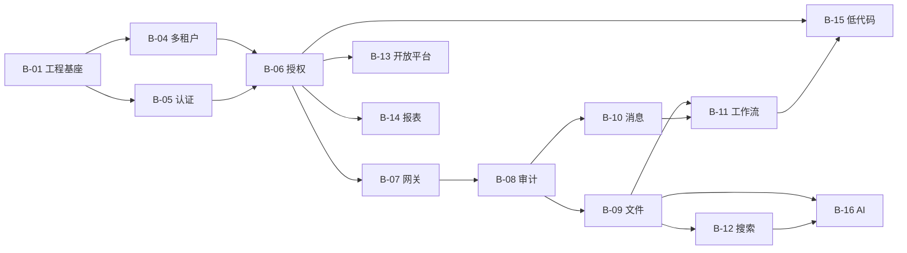
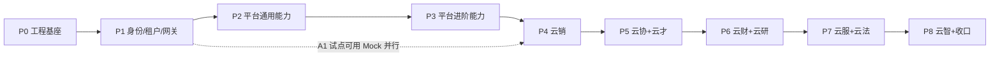

# 丰麟云枢 · 9 产品 0→1 建设方案 V1

> 编制日期：2026-11-07  
> 依据：`丰麟云创科技有限公司项目文档` 下 00 总纲 + 01~08 八个业务域产品，共 109 份文档（00 总纲 13 份，01~08 每域 12 份）  
> 范围：技术基线、服务与仓库结构、公共基座、阶段划分、第一批任务清单、风险与文档缺口  
> 明确不做：本方案不写业务代码，不替代各产品 SRS/详细设计；所有结论以文档为事实源，冲突处给出裁决

---

## 0. 结论摘要

| 项目 | 结论 |
|---|---|
| 产品与服务规模 | 9 个产品、8 个业务域、**21 个服务 / 24 个部署单元**（云服 1 服务拆 4 部署单元） |
| 数据规模 | **9 个 PostgreSQL 库**、**339 张表**（平台 47 + 业务域 292） |
| 接口规模 | **约 710 个接口**（平台 87 个核心 + 13 个内部契约；业务域 610 个清单条目） |
| 前端规模 | 2 个主前端应用（管理端/用户端）+ 1 个开发者门户，**约 200 个页面**（含平台 29 个；07 云法缺页面清单，待补） |
| 技术路线 | Java 17 + Spring Boot 3.2 + Spring Cloud 2023 + PostgreSQL 15 + Vue 3.4，严格继承总纲第 3 章，不引入异构框架 |
| 仓库形态 | **单仓（Monorepo）**：Maven 多模块 + pnpm workspace；按目录与 CI 路径过滤实现独立发布 |
| 建设顺序 | 基座（P0）→ 身份/租户/网关（P1）→ 平台通用能力（P2）→ 平台进阶能力（P3）→ 云销试点（P4）→ 其余七域（P5~P8） |
| 第一批 | P0 + P1 + 云销 A1 试点，4 个 Sprint，**约 410 人日** |
| 总工作量量级 | **约 2700 人日**（2600~2800，含测试、联调、安全与私有化，不含客户 UAT） |
| 开工前必须拍板 | 共 9 项，其中 5 项阻塞 P0：①单仓与平台库迁移所有权 ②AI 能力归属 ③外部供应商（CA/电子签、银企、发票、舆情、LLM）④云协实时协同范围 ⑤私有化是否首版交付 |

**一句话结论**：文档的“功能与数据设计”颗粒度足够开工，“平台内部持久化、跨域归属、实时协同、外部集成”四类契约不足；先用 4 个 Sprint 把基座和云销 A1 打通，再并行铺开其余产品，是风险最低的路径。

---

## 1. 技术栈与版本基线

### 1.1 锁定基线

依据 [平台总体规范 §3](../丰麟云创科技有限公司项目文档/00_丰麟云枢平台总纲_fenglin-cloud-Hub/00_丰麟云枢_平台总体规范与统一标准.md) 与各产品架构文档，统一锁定如下。补丁号在 P0 用 SCA BOM 做一次兼容性冒烟后写入 `fenglin-dependencies-bom`，此后不得由业务域自行升级。

| 层次 | 选型 | 文档基线 | 建议锁定 | 落地要点 |
|---|---|---|---|---|
| 语言/运行时 | Java | 17 LTS | Temurin 17.0.11 | 全平台 `--release 17`，禁止 Java 21 语法 |
| 后端构建 | Maven | 3.9+ | Maven 3.9.9 | 多模块聚合；`mvn -T 4` 并行构建 |
| 前端构建 | pnpm + Vite | — | pnpm 9.x + Vite 5.4 | pnpm workspace；禁止 npm/yarn 混用 |
| 后端框架 | Spring Boot | 3.2.x | 3.2.12 | 以 SCA 2023.0.1.2 的依赖管理为准 |
| 微服务框架 | Spring Cloud | 2023.0.x | 2023.0.3 | 与 Boot 3.2 对齐 |
| 微服务套件 | Spring Cloud Alibaba | 2023.0.x | 2023.0.1.2 | Nacos/Sentinel/Seata 版本由 BOM 统一 |
| 注册与配置 | Nacos | 2.3.x | 2.3.2 | 命名空间 `fenglin-hub-{env}`；业务域独立 DataId |
| 网关 | Spring Cloud Gateway | 4.1.x | BOM 管理 | 仅做边缘网关；`fenglin-gateway` 不连业务库 |
| 流控熔断 | Sentinel | 1.8.x | 1.8.8（先验证 SCA 托管版本） | 网关适配器需 Boot 3 兼容版本 |
| ORM | MyBatis-Plus | 3.5.x | 3.5.7 | **必须用 `mybatis-plus-spring-boot3-starter`** |
| 分布式事务 | Seata（AT） | 2.0.x | 2.0.0 | 仅跨域金额/额度场景；每库建 `undo_log` |
| 数据库 | PostgreSQL | 15.x | 15.8 | 9 个库；RLS 仅 SaaS 共享库启用 |
| 迁移 | Flyway | 10.x | 10.17.0 | **额外引入 `flyway-database-postgresql`**，否则 PG15 不识别 |
| 缓存 | Redis | 7.x | 7.2.5 | 集群/哨兵按环境；禁止跨租户共享 key 无前缀 |
| 事件总线 | Kafka | 3.6 | 3.6.2 | 领域事件唯一主通道 |
| 事务消息 | RocketMQ | 5.x | 5.1.4 | 首版仅佣金/结算等强一致场景启用，其余用 Outbox |
| 搜索 | Elasticsearch + IK | 8.x | 8.11.4 + IK 8.11.4 | 索引模板统一由 search-service 管理 |
| 对象存储 | MinIO / S3 | RELEASE.2024 | 固定单一 2024 版本 | 私有化 MinIO，SaaS S3 兼容 |
| 调度 | XXL-Job | 2.4.x | 2.4.1 | 2.4.0 有 Boot 3 兼容问题，禁用 |
| 工作流 | Flowable | 7.x | 7.0.1 | 只由 workflow-service 持有引擎与 `ACT_*` 表 |
| 认证 | Spring Security + OAuth2.1/OIDC + JWT(RS256) | 未指定实现 | **Spring Authorization Server 1.2.x** | 由 Boot 3.2 BOM 管理；补充 JWKS 轮换方案 |
| 接口文档 | springdoc-openapi（OpenAPI 3.1 规范） | OpenAPI 3.1 | springdoc 2.3.0 | 契约文件入 `backend/contracts`，先契约后实现 |
| 前端 | Vue + TS + Vite | 3.4 / 5 | 3.4.38 / 5.4.x | Node 20.11 + pnpm 9 |
| 前端状态/路由 | Pinia + Vue Router | — | 2.2.x / 4.4.x | 按域拆 store 与路由模块 |
| UI | Element Plus（管理端）+ 自研 Portal 组件（用户端） | — | Element Plus 2.8.x | Portal 组件库先在 P0 建最小集 |
| 可视化 | ECharts | 5 | 5.5.x | 看板/漏斗/流程挖掘统一封装 |
| 移动端 | 响应式 Web（PWA）+ 可选 Uni-app 封装 | — | 首版 PWA，不启用 Uni-app | 8 域用户端共用同一套响应式页面 |
| 向量库 | Milvus / pgvector | 2.4.x / 0.7 | 私有化 pgvector，SaaS Milvus 2.4 | 首版不强依赖 Milvus，P8 再切 |
| OLAP | ClickHouse / Doris | 24.x / 2.1 | 首版不引入 | 云智 H3 大屏确有性能瓶颈再上，先用 PG 物化视图 |
| 容器 | Docker + K8s | 1.28+ | 1.28~1.30 | 不追新版本 |
| GitOps | GitLab CI + ArgoCD | — | ArgoCD 2.10 | 环境用 Kustomize overlay |
| 可观测 | Prometheus + Grafana + Loki + SkyWalking | — | 2.51 / 10.4 / 3.0 / 10.0 | 统一 JSON 日志 + TraceId |
| 测试 | JUnit5 + Testcontainers + Playwright | 文档未指定 | Testcontainers 1.19 / Playwright 1.4x | P0 建立契约测试与 E2E 基座 |

> 版本矩阵说明：SCA 2023.0.1.2 的官方基线是 Spring Boot 3.2.4 + Spring Cloud 2023.0.1；本方案建议的 3.2.12/2023.0.3 属于同一 minor 的补丁上浮。P0 必须对 Nacos、Sentinel、Seata 做三项冒烟；任一失败即回落到官方矩阵，**不在业务开发期再调版本**。

### 1.2 必须按此实现的 9 个落地差异

文档只写到“技术栈名称”，以下 9 处若按字面实现会踩坑：

1. **MyBatis-Plus**：Boot 3 必须引 `mybatis-plus-spring-boot3-starter`，不能用旧 `mybatis-plus-boot-starter`。
2. **Flyway 10 + PG15**：Boot 3.2 默认管理的是 Flyway 9.x，必须在 BOM 显式覆盖为 10.17.0，并同时引 `flyway-core` 与 `flyway-database-postgresql`；`V1.0.13` 这种点号命名非法，统一 `V1_0_13__desc.sql`。
3. **OAuth2.1/OIDC**：文档只说 Spring Security，未指定授权服务器；锁定 Spring Authorization Server，避免自研令牌端点。
4. **Sentinel/XXL-Job**：两者在 Boot 3 下都有 jakarta 适配差异，必须在 P0 做冒烟示例，不能等到业务联调。
5. **RocketMQ**：`rocketmq-spring-boot-starter` 需选 Boot 3 兼容版本；首版不建议双 MQ 全量铺开（见 C-04）。
6. **PII 加密**：MyBatis `TypeHandler` 只能透明处理加解密，**唯一约束必须显式写 `*_hash`**；不能指望 TypeHandler 参与唯一索引。
7. **RLS**：连接池初始化 `SET app.tenant_id` 会造成跨租户串数据，必须每事务 `SET LOCAL`（见 C-05）。
8. **分区表**：Flyway 静态建分区只能覆盖到建库时；需配套 XXL-Job 预建下月分区，否则月初写入失败。
9. **私有化**：MinIO/Milvus/ClickHouse 不能默认全上；首版私有化只保证 PG + Redis + Kafka + ES + MinIO 五件套。

### 1.3 文档冲突与裁决

> 影响度：**S1 阻塞开工 / S2 影响排期或验收 / S3 一致性问题**。本方案后续一律按“裁决”列执行。

| 编号 | 影响度 | 冲突/问题 | 文档位置 | 影响 | 裁决（本方案执行） |
|---|---|---|---|---|---|
| C-01 | S1 | 启动顺序与依赖表自相矛盾：依赖表写 auth 依赖 iam、tenant 依赖 workflow、workflow 依赖 message，但启动顺序把 auth 放在 iam 之前 | [00 部署 §3.1/§3.2](../丰麟云创科技有限公司项目文档/00_丰麟云枢平台总纲_fenglin-cloud-Hub/00_丰麟云枢_10_部署运维手册.md) | 按文档顺序部署会反复 CrashLoop | 固定顺序：中间件 → **iam → auth → tenant → message → workflow → file → audit → search → report → lowcode → ai → gateway → openapi** → 业务域。其中 tenant→workflow 判为文档错误，降为“运行期可选依赖”（停用租户需终止流程），不参与启动编排 |
| C-02 | S1 | 接口数量声明与清单不一致：00 称 79 实 87（另 13 内部）；01 称 71 实 72；02 称 80 实 71；06 称 76 实 100；08 称 76+10 实 74 | [00 接口 §3](../丰麟云创科技有限公司项目文档/00_丰麟云枢平台总纲_fenglin-cloud-Hub/00_丰麟云枢_05_接口文档.md)、各产品 05 文档 | RTM、报价、验收口径全部失真 | **以清单表格为唯一事实源**；P0 用脚本重生成 9 份接口索引与 RTM，文档声明数改为自动统计 |
| C-03 | S1 | 平台 13 个服务共写 `fenglin_hub`，但迁移脚本分散在各服务，存在多 Flyway history 竞争 | [00 架构 §3](../丰麟云创科技有限公司项目文档/00_丰麟云枢平台总纲_fenglin-cloud-Hub/00_丰麟云枢_02_架构设计文档.md)、[00 DB §8](../丰麟云创科技有限公司项目文档/00_丰麟云枢平台总纲_fenglin-cloud-Hub/00_丰麟云枢_03_数据库设计文档.md) | 启动顺序/版本不一致时表结构漂移 | 新增 `platform/fenglin-hub-migrations` 作为**平台库唯一迁移所有者**；各服务 `flyway.enabled=false`，仅做启动版本校验 |
| C-04 | S1 | Kafka + RocketMQ 双 MQ 全量并用，且 Seata AT 跨 9 库 | [00 规范 §3](../丰麟云创科技有限公司项目文档/00_丰麟云枢平台总纲_fenglin-cloud-Hub/00_丰麟云枢_平台总体规范与统一标准.md) | 运维复杂、消息重复/乱序概率上升 | 首版 **Kafka 为唯一事件总线**；RocketMQ 仅用于佣金结算等 3 类事务消息；Seata 仅跨域金额场景，其余用 Outbox + 幂等消费 |
| C-05 | S1 | RLS 会话变量在“连接池初始化时 SET”，连接复用会串租户 | [00 DB §6.2](../丰麟云创科技有限公司项目文档/00_丰麟云枢平台总纲_fenglin-cloud-Hub/00_丰麟云枢_03_数据库设计文档.md) | 致命数据泄露 | MyBatis 拦截器在**事务开始时 `SET LOCAL app.tenant_id`**，事务结束自动失效；连接池不做全局 SET；补跨租户集成测试 |
| C-06 | S1 | `hub_account.password_enc` 同时被描述为 BCrypt 哈希与 AES-256-GCM 加密 | [00 DB §4.11/§7](../丰麟云创科技有限公司项目文档/00_丰麟云枢平台总纲_fenglin-cloud-Hub/00_丰麟云枢_03_数据库设计文档.md) | 认证实现无法落地 | 拆为 `password_hash`（BCrypt 成本 12）与 `mfa_secret_enc`/`client_secret_enc`（AES-GCM）；`*_enc` 一律可解密 |
| C-07 | S2 | `hub_wf_definition.version` 与公共字段 `version` 同名，注释又说改叫 `def_version` | [00 DB §4.28/§4.29](../丰麟云创科技有限公司项目文档/00_丰麟云枢平台总纲_fenglin-cloud-Hub/00_丰麟云枢_03_数据库设计文档.md) | ORM 映射冲突、乐观锁失效 | DDL 直接改名 `def_version`，公共 `version` 保留给乐观锁 |
| C-08 | S1 | AI 能力双归属：平台 `ai-service` 与云智 `intelligence-service` 都声明拥有 LLM/RAG/向量库 | [00 规范 §4.1](../丰麟云创科技有限公司项目文档/00_丰麟云枢平台总纲_fenglin-cloud-Hub/00_丰麟云枢_平台总体规范与统一标准.md)、[08 架构 §3.1](../丰麟云创科技有限公司项目文档/08_丰麟云智_fenglin-cloud-Intelligence/08_丰麟云智_02_架构设计文档.md) | 两团队重复建设、接口打架 | 平台 `ai-service` = 模型网关/提示词/护栏/能力授权/计量；云智 = 知识库/文档分块/Agent/BI。`HUB-API-1303/1304` 由平台代理云智；无云智授权时降级为纯检索 |
| C-09 | S2 | AI 表重复：`hub_ai_capability_grant`/`hub_ai_metering` 与云智 `ai_capability_grant`/`ai_usage_metering`/`ai_data_permission` | [00 DB §4.46-4.47](../丰麟云创科技有限公司项目文档/00_丰麟云枢平台总纲_fenglin-cloud-Hub/00_丰麟云枢_03_数据库设计文档.md)、[08 DB §3](../丰麟云创科技有限公司项目文档/08_丰麟云智_fenglin-cloud-Intelligence/08_丰麟云智_03_数据库设计文档.md) | 双写、计量对不上 | `hub_ai_*` 为授权与计费唯一源；云智表只存产品运行态，不再重复计量；计量统一上报 `HUB-INT-112` |
| C-10 | S1 | 报表数据集缺失：`hub_report_def.dataset_id` 无对应表，但 `HUB-API-1103/1104` 依赖数据集 | 00 DB §4.43、00 接口 §4.11 | 报表服务无法实现 | 新增 `hub_report_dataset`、`hub_report_dataset_field`；或删除 `dataset_id` 改为指标组合。推荐前者 |
| C-11 | S1 | 低代码只有 `hub_lowcode_app`，缺表单/字段/页面/模型数据/发布版本表 | 00 DB §4.45、00 接口 §4.12 | `HUB-API-1201~1204` 无法实现 | 新增 6 张表：`hub_lowcode_app_version`、`hub_lowcode_form`、`hub_lowcode_field`、`hub_lowcode_page`、`hub_lowcode_data_record`、`hub_lowcode_data_index` |
| C-12 | S1 | 平台缺表：消息偏好、流程回调注册、Webhook 订阅/投递、AI 模型/提示词、网关路由/灰度 | 00 DB 全表清单 vs 00 接口 605/INT-105/§6.3/1301/1302、00 模块 §1 | 5 组接口无法落地 | 新增 `hub_message_preference`、`hub_wf_callback`、`hub_webhook_subscription`、`hub_webhook_delivery`、`hub_ai_model`、`hub_ai_prompt`、`hub_gw_route`、`hub_gw_gray_rule` |
| C-13 | S2 | 00 部署只列 8 个业务域服务，06 云服实际声明 4 个部署单元 | [00 架构 §3.2](../丰麟云创科技有限公司项目文档/00_丰麟云枢平台总纲_fenglin-cloud-Hub/00_丰麟云枢_02_架构设计文档.md)、[06 架构 §3.1](../丰麟云创科技有限公司项目文档/06_丰麟云服_fenglin-cloud-Service/06_丰麟云服_02_架构设计文档.md) | 部署清单/资源预算少 3 个单元 | 按 **24 个部署单元**排产与算资源（21 服务 + 云服 worker/scheduler/rpa-agent） |
| C-14 | S2 | 云协接口声明 80 个，清单仅 71 个 | [02 接口 §3](../丰麟云创科技有限公司项目文档/02_丰麟云协_fenglin-cloud-Collaborate/02_丰麟云协_05_接口文档.md) | 云协排期低估 9 个接口 | P5 开工前补齐 9 个接口契约；未补齐不得进入开发 |
| C-15 | S2 | 云法 UIUX 无“双端页面清单”，只有关键页面线框 | [07 UIUX](../丰麟云创科技有限公司项目文档/07_丰麟云法_fenglin-cloud-Legal/07_丰麟云法_06_UIUX设计规范.md) | 前端无法排期 | P7 开工前由产品/设计补页面清单；暂以 07 模块设计 §1.3/§2.3 的路由为准 |
| C-16 | S2 | 云服接口声明 76 个，清单 100 个 | [06 接口 §3](../丰麟云创科技有限公司项目文档/06_丰麟云服_fenglin-cloud-Service/06_丰麟云服_05_接口文档.md) | 云服工作量与 RTM 失真 | 以 100 条清单为准重估 P7；删除/合并重复条目后再冻结 |
| C-17 | S3 | 工号规则 `{公司码}{4位}` 未定义公司码来源与并发唯一 | [00 DB §4.10](../丰麟云创科技有限公司项目文档/00_丰麟云枢平台总纲_fenglin-cloud-Hub/00_丰麟云枢_03_数据库设计文档.md) | 批量导入可能撞号 | 公司码取租户 `code` 后 4 位；序列用 Redis `INCR` + 唯一索引兜底冲突重试 |
| C-18 | S1 | 哈希列使用 `tenant_salt`，但 `hub_tenant` 无盐字段 | 00 DB §7 vs §4.1 | PII 哈希无法实现/无法轮换 | 新增 `hub_tenant.hash_salt_enc`（KMS 包裹）或由 KMS 按 tenantId 派生；盐版本写入 `hash_version` |
| C-19 | S3 | 审计留存口径不一致：热数据 12 个月、留存 ≥6 个月、WORM 5 年 | 00 DB §5/§9、00 模块 §8 | 合规检查口径不一 | 统一为：热库 12 个月 + 对象存储归档 5 年；WORM 只存审计链 |
| C-20 | S2 | 私有化只有检查清单，无最小资源规格 | [00 部署 §9.4](../丰麟云创科技有限公司项目文档/00_丰麟云枢平台总纲_fenglin-cloud-Hub/00_丰麟云枢_10_部署运维手册.md) | 私有化报价/交付不可控 | P8 补最小规格：PG/Redis/Kafka/ES/MinIO 五件套；Milvus/ClickHouse 标注可选 |
| C-21 | S2 | 云研 53 表/74 接口，但外部系统（GitLab/Jenkins/Jira）适配清单未列 | [05 架构](../丰麟云创科技有限公司项目文档/05_丰麟云研_fenglin-cloud-DevOps/05_丰麟云研_02_架构设计文档.md) | 集成工作量不可估 | P6 开工前补适配矩阵与 Mock 契约 |
| C-22 | S2 | 云财银企直联/发票查验、云法 CA/电子签、云销舆情采集均无供应商与适配契约 | 04/07/01 架构与接口 | 外部联调阻塞 | 统一先定义 SPI + Mock Provider，供应商确定后替换实现 |
| C-23 | S2 | `hub_user` 唯一约束写作 `UNIQUE(tenant_id, employee_no/username)`，未带逻辑删除条件；但 V1_0_15 又声称建 `WHERE deleted=0` 部分索引 | [00 DB §4.10/§6.1/§8](../丰麟云创科技有限公司项目文档/00_丰麟云枢平台总纲_fenglin-cloud-Hub/00_丰麟云枢_03_数据库设计文档.md) | 逻辑删除后工号/登录名无法复用，或与迁移脚本冲突 | 所有业务唯一索引统一为 `UNIQUE (...) WHERE deleted = 0`；DDL 评审清单强制检查 |

---

## 2. 服务拆分与仓库结构

### 2.1 服务清单（21 服务 / 24 部署单元）

拆分原则：

1. **平台按“能力复用边界”拆**，业务按“领域边界”拆；不按团队拆，避免组织变动导致服务边界漂移。
2. **一个业务域一个服务、一个库**；跨域只走内部契约或 Kafka，禁止共享表。
3. **只有 06 云服拆 4 个部署单元**：主服务负责同步业务；worker 承担 SLA/回调等异步；scheduler 是 XXL-Job 执行器；rpa-agent 必须跑在 Windows，无法与 JVM 服务同 Pod。
4. **gateway 与 openapi 计入 13 个中台服务**，但 gateway 无业务库；`search-service` 只依赖 ES，无 PG 表。

| 序 | 服务 | 类型 | 数据库 | 表数 | 接口 | 建设阶段 |
|---|---|---|---|---|---|---|
| 1 | `fenglin-gateway` | 平台-接入 | 无 | 0 | 0（配置型） | P1 |
| 2 | `fenglin-auth-service` | 平台-身份 | `fenglin_hub` | 2 | 10 | P1 |
| 3 | `fenglin-iam-service` | 平台-身份 | `fenglin_hub` | 16 | 17 + 3 内部 | P1 |
| 4 | `fenglin-tenant-service` | 平台-租户 | `fenglin_hub` | 9 | 9 | P1 |
| 5 | `fenglin-workflow-service` | 平台-能力 | `fenglin_hub` | 4 | 8 | P2 |
| 6 | `fenglin-message-service` | 平台-能力 | `fenglin_hub` | 3（+1 待补） | 5 | P2 |
| 7 | `fenglin-file-service` | 平台-能力 | `fenglin_hub` | 2 | 6 | P2 |
| 8 | `fenglin-audit-service` | 平台-能力 | `fenglin_hub` | 2 | 5 | P2 |
| 9 | `fenglin-search-service` | 平台-能力 | ES（无 PG 表） | 0 | 4 | P2 |
| 10 | `fenglin-openapi-service` | 平台-生态 | `fenglin_hub` | 4 | 6 | P3 |
| 11 | `fenglin-report-service` | 平台-能力 | `fenglin_hub` | 2（+2 待补） | 5 | P3 |
| 12 | `fenglin-lowcode-service` | 平台-能力 | `fenglin_hub` | 1（+6 待补） | 4 | P3 |
| 13 | `fenglin-ai-service` | 平台-能力 | `fenglin_hub` | 2（+2 待补） | 8 | P3 |
| 14 | `fenglin-crm-service` | 业务域 | `fenglin_crm` | 32 | 72 | P4 |
| 15 | `fenglin-collab-service` | 业务域 | `fenglin_collab` | 32 | 71（+9 待补） | P5 |
| 16 | `fenglin-talent-service` | 业务域 | `fenglin_talent` | 36 | 79 | P5 |
| 17 | `fenglin-finance-service` | 业务域 | `fenglin_finance` | 45 | 76 | P6 |
| 18 | `fenglin-devops-service` | 业务域 | `fenglin_devops` | 53 | 74 | P6 |
| 19 | `fenglin-service-service` | 业务域 | `fenglin_service` | 37 | 100 | P7 |
| 20a | `fenglin-service-worker` | 业务域（部署单元） | 同库 | — | 异步消费 | P7 |
| 20b | `fenglin-service-scheduler` | 业务域（部署单元） | 同库 | — | XXL-Job 执行器 | P7 |
| 20c | `fenglin-service-rpa-agent` | 业务域（部署单元） | 只读 | — | Windows 机器人 | P7 |
| 21 | `fenglin-legal-service` | 业务域 | `fenglin_legal` | 27 | 64 | P7 |
| 22 | `fenglin-intelligence-service` | 业务域 | `fenglin_intelligence` | 30 | 74（+10 内部） | P8 |

> 说明：编号 20a/20b/20c 不是独立服务，是 06 云服的 3 个附加部署单元；因此“21 个服务 / 24 个部署单元”。私有化场景允许按客户规模把同一业务组的服务合并部署（总纲 §4.2 的“领域聚合部署”），但**包结构、数据库归属与接口契约不变**；SaaS 环境仍按 24 个单元独立扩缩容。

### 2.2 单仓 vs 多仓裁决

**选单仓。** 理由：

1. **契约同步**：9 个产品共享 13 个中台契约，跨仓改动需要 21 次 MR 联动，版本一错全链路失败。
2. **基座复用**：`common-*` 与 `starter-*` 被 21 个服务依赖，单仓可用 Maven 聚合一次编译验证，避免“基座升级后某域编译不过”。
3. **统一门禁**：一次 CI 可跑架构约束（禁止业务域直连他人库、禁止绕过网关）、依赖漏洞扫描、契约兼容性检查。
4. **团队规模匹配**：21 个服务由 3~4 个小组维护，单仓的认知成本低于多仓的版本协调成本。
5. **独立发布不受影响**：CI 按路径过滤 + 镜像 tag 独立，服务仍可单独发版；单仓不等于单体发布。

代价与对策：仓库体积增大 → 启用 Git LFS 管理大文件、CI 只构建受影响模块；权限粒度粗 → CODEOWNERS 按目录分权。

### 2.3 目录树

```text
fenglin-cloud-tech/
├── 丰麟云创科技有限公司项目文档/          # 现有交付文档（只读事实源）
├── 建设方案/                              # 本方案及后续 ADR
│   ├── 丰麟云枢_0到1建设方案_v1.md
│   └── adr/                               # 架构决策记录 ADR-001...
├── backend/
│   ├── pom.xml                            # 聚合父 POM
│   ├── fenglin-dependencies-bom/          # 全部版本锁定，唯一升级入口
│   ├── fenglin-common/
│   │   ├── fenglin-common-core/           # 响应体/错误码/异常/工具
│   │   ├── fenglin-common-web/            # 全局异常/参数校验/OpenAPI/请求上下文
│   │   ├── fenglin-common-mybatis/        # 租户拦截器/RLS/雪花/逻辑删除/乐观锁/分页
│   │   ├── fenglin-common-tenant/         # 租户上下文/跨租户开关/隔离策略
│   │   ├── fenglin-common-security/       # JWT 资源服务器/权限注解/端别校验
│   │   ├── fenglin-common-crypto/         # AES-256-GCM TypeHandler/哈希/KMS SPI
│   │   ├── fenglin-common-audit/          # @Audit 注解/异步上报
│   │   ├── fenglin-common-mq/             # Kafka/Outbox/幂等消费
│   │   ├── fenglin-common-idempotent/     # Idempotency-Key/分布式锁
│   │   └── fenglin-common-test/           # Testcontainers/契约测试/测试数据
│   ├── fenglin-starter/
│   │   ├── fenglin-starter-web/
│   │   ├── fenglin-starter-mybatis/
│   │   ├── fenglin-starter-security/
│   │   ├── fenglin-starter-mq/
│   │   └── fenglin-starter-observability/
│   ├── platform/
│   │   ├── fenglin-hub-migrations/        # 平台库唯一 Flyway 所有者（V1_0_0..）
│   │   ├── fenglin-gateway/
│   │   ├── fenglin-auth-service/
│   │   ├── fenglin-iam-service/
│   │   ├── fenglin-tenant-service/
│   │   ├── fenglin-workflow-service/
│   │   ├── fenglin-message-service/
│   │   ├── fenglin-file-service/
│   │   ├── fenglin-audit-service/
│   │   ├── fenglin-search-service/
│   │   ├── fenglin-openapi-service/
│   │   ├── fenglin-report-service/
│   │   ├── fenglin-lowcode-service/
│   │   └── fenglin-ai-service/
│   ├── domains/
│   │   ├── fenglin-crm-service/
│   │   ├── fenglin-collab-service/
│   │   ├── fenglin-talent-service/
│   │   ├── fenglin-finance-service/
│   │   ├── fenglin-devops-service/
│   │   ├── fenglin-service-service/       # 云服聚合模块（主服务产物同名）
│   │   │   ├── fenglin-service-bootstrap/ # 主服务启动（端口 8600）
│   │   │   ├── fenglin-service-worker/    # 异步/SLA/回调（8601）
│   │   │   ├── fenglin-service-scheduler/ # XXL-Job 执行器（8602）
│   │   │   └── fenglin-service-rpa-agent/ # 机器人执行代理（8603）
│   │   ├── fenglin-legal-service/
│   │   └── fenglin-intelligence-service/
│   └── contracts/                         # OpenAPI 3.1 契约（按域）
│       ├── hub/  crm/  collab/  talent/  finance/
│       ├── devops/  service/  legal/  intelligence/
│       └── events/                        # Kafka 事件 Schema
├── frontend/
│   ├── pnpm-workspace.yaml
│   ├── package.json
│   ├── apps/
│   │   ├── admin-ui/                      # /admin/**（Element Plus）
│   │   ├── portal-ui/                     # /app/**（自研 Portal 组件）
│   │   └── developer-portal/              # 开放平台开发者门户
│   ├── packages/
│   │   ├── design-tokens/                 # 00 UIUX 设计令牌
│   │   ├── ui-admin/                      # 管理端基础组件
│   │   ├── ui-portal/                     # 用户端 Portal 组件
│   │   ├── api-client/                    # OpenAPI 生成 + 拦截器
│   │   ├── auth/                          # OIDC/PKCE/令牌刷新
│   │   ├── shared/                        # 工具/类型/常量/错误码
│   │   ├── charts/                        # ECharts 封装
│   │   └── lowcode-runtime/               # 低代码渲染器
│   └── domains/                           # 各域路由与页面模块
│       ├── crm/  collab/  talent/  finance/
│       ├── devops/  service/  legal/  intelligence/
│       └── platform/                      # 租户/IAM/工作流/审计/开放平台
├── deploy/
│   ├── compose/                           # 本地一键起中间件
│   ├── docker/                            # 各服务 Dockerfile 模板
│   ├── k8s/
│   │   ├── base/                          # 通用 Deployment/Service/ConfigMap
│   │   ├── overlays/{dev,test,uat,prod}/
│   │   └── jobs/                          # Flyway 迁移 Job
│   ├── helm/                              # 私有化 Chart
│   ├── argocd/                            # app-of-apps
│   └── observability/                     # Prometheus 规则/Grafana/Loki
├── db/
│   ├── roles/                             # 各库账号/RLS 角色初始化
│   └── seed/                              # 内置权限/菜单/字典/套餐
├── scripts/
│   ├── gen-api-index.*                    # 重生成接口索引/RTM
│   ├── check-flyway-naming.*
│   ├── check-arch.*                       # 禁止跨库/绕过网关等架构门禁
│   └── setup-local.*
└── .gitlab-ci.yml
```

### 2.4 数据库与迁移所有权

| 数据库 | 归属 | 迁移所有者 | 说明 |
|---|---|---|---|
| `fenglin_hub` | 平台 13 服务 | `platform/fenglin-hub-migrations` | 单一迁移模块；服务只读校验版本 |
| `fenglin_crm` | 云销 | `fenglin-crm-service` | 含 32 张 `crm_*` |
| `fenglin_collab` | 云协 | `fenglin-collab-service` | 含 32 张 `collab_*` |
| `fenglin_talent` | 云才 | `fenglin-talent-service` | 含 36 张 `talent_*` |
| `fenglin_finance` | 云财 | `fenglin-finance-service` | 含 45 张 `fin_*` |
| `fenglin_devops` | 云研 | `fenglin-devops-service` | 含 53 张 `devops_*` |
| `fenglin_service` | 云服 | `fenglin-service-service` | 含 37 张 `svc_*`；4 个部署单元共用 |
| `fenglin_legal` | 云法 | `fenglin-legal-service` | 含 27 张 `legal_*` |
| `fenglin_intelligence` | 云智 | `fenglin-intelligence-service` | 含 30 张 `ai_*` |

硬规则：

1. **禁止跨库 JOIN、禁止跨库外键、禁止业务服务直连他人库**；跨域一律走内部契约或 Kafka。
2. 平台库所有 DDL 只允许出现在 `fenglin-hub-migrations`；业务域服务启动时只校验 `flyway_schema_history` 版本，不执行迁移。
3. 每库独立 `flyway_schema_history`，因此各域 `V1_0_1` 重名合法；但文件名必须 `V{主}_{次}_{序}__desc.sql`。
4. `undo_log`（Seata）只在启用 AT 的库创建：`hub`、`crm`、`finance`、`service`。

### 2.5 服务间通信与契约

| 场景 | 方式 | 约束 |
|---|---|---|
| 同步调用 | 内部 REST `/internal/v1/**` | mTLS + `X-Caller-Product` + `X-Tenant-Id` + `X-On-Behalf-Of` |
| 异步事件 | Kafka `hub.*` / `{domain}.*` | CloudEvents 风格信封；`eventId` 幂等；Schema 入 `contracts/events` |
| 强一致金额 | Seata AT 或 RocketMQ 事务消息 | 仅限 3 类场景；必须有对账任务 |
| 跨域最终一致 | Outbox + 幂等消费 | 业务库本地 `outbox_event` 表，P0 统一实现 |
| 契约先行 | OpenAPI 3.1 入 `backend/contracts` | CI 做 breaking change 检查；实现与契约不一致直接失败 |

---

## 3. 公共基座清单

### 3.1 基座组件清单

| 编号 | 组件 | 归属 | 复用方式 | 关键内容 | 前置依赖 | 阶段 |
|---|---|---|---|---|---|---|
| B-01 | 版本与依赖治理 | 平台架构组 | Maven BOM + pnpm catalog | 版本唯一入口、依赖漏洞扫描、许可证检查 | — | P0 |
| B-02 | 统一响应/错误码/异常 | common-core/web | jar | `code/message/data/requestId/timestamp`；错误码 `{域2}{模块2}{序号3}` | B-01 | P0 |
| B-03 | 请求与租户上下文 | common-tenant | jar + Filter | `X-Request-Id`/`X-Tenant-Id`/`X-Client-Type`/`X-User-Id`；线程池与 MQ 透传 | B-02 | P0 |
| B-04 | 多租户数据隔离 | tenant-service + common-mybatis | 服务 + 拦截器 | 租户生命周期、隔离策略、RLS 每事务 `SET LOCAL`、跨租户显式开关 | B-03 | P1 |
| B-05 | 统一认证 | auth-service + common-security | 服务 + starter | OIDC 发现、授权码/PKCE、令牌签发/刷新/撤销、JWKS、SSO、SLO | B-03 | P1 |
| B-06 | 统一授权 | iam-service + common-security | 服务 + starter | RBAC + 数据权限五档 + 字段权限 + 4A；`/internal/v1/authz/decision`；本地缓存 5s 失效 | B-04/B-05 | P1 |
| B-07 | 统一网关 | gateway | 部署 | 路由、JWT 本地验签、端别校验、租户/接口限流、灰度、审计埋点 | B-05/B-06 | P1 |
| B-08 | 统一审计 | audit-service + common-audit | 服务 + 注解 | `@Audit` 埋点、Kafka 异步、哈希链、WORM 归档、篡改校验 | B-07 | P2 |
| B-09 | 文件中心 | file-service | 服务 | 分片上传、秒传、版本、预览、水印、DLP 钩子、签名下载 | B-05/B-08 | P2 |
| B-10 | 消息中心 | message-service | 服务 | 模板、站内信/邮件/短信/企微/飞书/钉钉、WebSocket、偏好、回执 | B-05/B-08 | P2 |
| B-11 | 工作流 | workflow-service | 服务 | Flowable 定义/部署/发起/待办/回调、超时升级、业务键关联 | B-06/B-10 | P2 |
| B-12 | 统一搜索 | search-service | 服务 | 索引模板、Kafka 同步、权限过滤、检索建议、分析 | B-09 | P2 |
| B-13 | 开放平台 | openapi-service | 服务 | 应用/密钥、HMAC 验签、配额、沙箱、开发者门户、Webhook | B-06/B-08 | P3 |
| B-14 | 报表与指标 | report-service | 服务 | 指标注册、数据集、查询、导出、缓存 | B-06/B-12 | P3 |
| B-15 | 低代码引擎 | lowcode-service | 服务 | 表单/页面/模型 Schema、运行时、版本与发布、数据存储 | B-06/B-11 | P3 |
| B-16 | AI 中台 | ai-service | 服务 | 模型网关、提示词、护栏、能力授权、计量、RAG 代理 | B-09/B-12 | P3 |
| B-17 | 可观测 | 全服务 | starter | Prometheus 指标、JSON 日志、SkyWalking Trace、告警规则 | B-01 | P0 |
| B-18 | 幂等/锁/Outbox | common-idempotent/mq | jar | `Idempotency-Key` 24h、Redisson 锁、`outbox_event` 投递 | B-02 | P0 |
| B-19 | 测试基座 | common-test | jar | Testcontainers、契约测试、数据工厂、E2E 基座 | B-01 | P0 |
| B-20 | 安全与密钥 | common-crypto + KMS | jar + SPI | AES-256-GCM、SHA-256+盐、密钥轮换、脱敏、日志脱敏 | B-02 | P1 |

### 3.2 依赖顺序



建设顺序不可跳：**B-01 → B-02/03/17/18/19 → B-04 → B-05 → B-06 → B-07 → B-08 → B-09/B-10 → B-11/B-12（可并行）→ B-13/B-14/B-15/B-16**。

### 3.3 多租户基座规范（修正文档实现）

1. **租户上下文**：网关校验 `X-Tenant-Id` 与 JWT `tenant_id` 一致后注入；服务端不得信任前端裸传。
2. **RLS 执行**：MyBatis 拦截器在事务开始执行
   ```sql
   SELECT set_config('app.tenant_id', #{tenantId}, true);
   ```
   第三个参数 `true` = `SET LOCAL`，事务结束自动恢复，避免连接池串租户。
3. **平台跨租户**：仅 `fl_platform_role` 可 `SET LOCAL app.cross_tenant='on'`，且强制写审计 + 告警。
4. **私有化**：独立库时仍保留 `tenant_id` 列（默认 0/1），RLS 可关闭，保证同一套代码。
5. **验收**：同一连接连续处理租户 A、B 请求，B 查询不得返回 A 数据；该用例列入 P1 必测。

### 3.4 PII 加密规范（AES-256-GCM + hash 唯一）

| 项 | 规范 |
|---|---|
| 加密列 | `*_enc text`：`base64( nonce(12B) + ciphertext + tag(16B) )` |
| AAD | `tenant_id + table + column`，防止密文跨列搬运 |
| 哈希列 | `*_hash varchar(64)`：`SHA-256(normalize(明文) + tenant_salt)`，小写 hex；手机号即文档中的 `mobile_hash`（需求口径的 phone_hash） |
| 归一化 | 手机号去空格/连字符，统一 `+86`；邮箱 trim + 小写；企业名去全半角空格 |
| 唯一约束 | `UNIQUE (tenant_id, mobile_hash) WHERE deleted = 0`；**禁止在明文/密文列建唯一索引** |
| 盐管理 | 新增 `hub_tenant.hash_salt_enc`（KMS 包裹）；`hash_version` 支持轮换 |
| 展示 | 默认脱敏；查看明文需 `*:pii:view` 且写审计 |
| 检索 | 精确查询用 hash；模糊查询走 search-service；加密列禁止 `LIKE` |
| 轮换 | KMS 数据密钥 ≤90 天；提供离线重加密 Job，按 `key_version` 分批 |
| 日志 | Logback 脱敏规则拦截 `mobile/email/idCard/bankCard`；禁止打印请求体原文 |

### 3.5 认证授权链路

```text
浏览器/客户端
  → /sso/authorize（auth-service，PKCE）
  → 登录（IAM 校验口令/锁定/MFA）
  → 授权码 → /sso/token 签发 access_token(RS256, 30min) + refresh_token(7d)
  → 网关本地 JWKS 验签 + 黑名单（Redis）+ client_type 校验
  → 注入 X-User-Id / X-Tenant-Id / X-Permissions
  → 业务服务 @PreAuthorize 功能权限
  → 数据权限：/internal/v1/authz/decision 或本地缓存 + SQL 条件注入
  → 字段权限：序列化阶段 HIDDEN/MASK
```

必须补的 3 个实现点：

1. **JWKS 轮换**：kid 双密钥灰度，旧公钥保留 ≥ 2 个令牌周期。
2. **权限缓存**：本地 Caffeine + Redis pub/sub 失效；TTL 5min 兜底。
3. **端别隔离**：PORTAL 令牌访问 `/admin/**` 一律 403，网关与业务服务双重校验。

### 3.6 审计/消息/文件/工作流接入规范

| 基座 | 业务接入方式 | 硬约束 |
|---|---|---|
| 审计 | `@Audit(eventType, riskLevel)` + `AuditService.write()` | 金额、权限、导出、PII 查看、跨租户必须审计 |
| 消息 | `messageService.send(templateCode, receivers, vars, channels)` | 业务不得直连短信/邮件供应商；必须带 `bizType/bizId` 便于追踪 |
| 文件 | 前端直传预签名 URL；业务只存 `fileId` | 禁止业务把文件二进制写库；下载必须签名 URL |
| 工作流 | 发起时传 `businessType/businessKey`；注册回调 `HUB-INT-105` | 回调必须幂等；流程状态不得由业务直接改 |
| 搜索 | 通过 `HUB-INT-109` 同步索引；查询带权限过滤 DSL | 业务不得直连 ES |
| AI | `HUB-INT-111` 调用；计量自动上报 | 禁止业务直连模型供应商；PII 出域前必须脱敏/护栏 |

### 3.7 错误码、幂等、事件、可观测

- **错误码**：`{域2}{模块2}{序号3}` 字符串；平台 `00`，云销 `10`…云智 `80`。P0 生成错误码常量类，禁止硬编码字符串。
- **幂等**：写操作支持 `Idempotency-Key`；金额/审批/结算强制；存储 `idem:{tenant}:{key}` 24h，值为响应快照。
- **事件**：统一信封 `{eventId,eventType,version,tenantId,occurredAt,producer,payload}`；消费端按 `eventId` 去重。
- **可观测**：每个服务暴露 `/actuator/health`、`/actuator/prometheus`；日志字段含 `traceId/tenantId/userId/requestId`；核心接口 P95/P99 入看板。

### 3.8 基座验收基线

1. 跨租户越权测试 100% 拦截，含 RLS、数据权限、字段权限三层。
2. PII 落库无明文，hash 唯一约束生效，密钥轮换演练通过。
3. 网关鉴权 P99 ≤ 10ms，端别串位 100% 拦截。
4. 审计哈希链校验通过，单条篡改可定位。
5. 消息/文件/工作流/搜索均有 Mock Provider，业务域可在基座未全量完成时并行开发。

---

## 4. 阶段划分

### 4.1 总览

| 阶段 | 目标 | 主要范围 | 人日 | 依赖 | 出口标准（摘要） |
|---|---|---|---|---|---|
| P0 | 工程与基座可跑 | 单仓、BOM、common、CI、compose、Flyway V1_0_0、前端骨架 | 90 | — | 新服务 5 分钟生成并可启动；CI 全绿；本地中间件一键起 |
| P1 | 身份/租户/网关闭环 | tenant、iam、auth、gateway、IAM 前端、RLS/PII | 200 | P0 | 租户开通→管理员登录→建组织/用户/角色→用户端登录全链路；越权 100% 拦截 |
| P2 | 平台通用能力 | workflow、message、file、audit、search | 190 | P1 | 3 节点审批闭环；3 通道消息；分片/秒传/水印；审计链校验；索引延迟 ≤5s |
| P3 | 平台进阶能力 | openapi、report、lowcode、ai + 平台前端收口 | 250 | P2 | 开放 API 验签/配额/沙箱；报表查询导出；低代码发布提单；RAG 流式+越权不召回 |
| P4 | 云销全量（首个业务域） | A1~A5、72 接口、32 表、双端页面 | 270 | P1~P3 | 线索→客户→商机→报价→审批→续费→NPS→伙伴→舆情全链路；P95 ≤300ms |
| P5 | 云协 + 云才 | 2 域、68 表、150 接口、页面 | 420 | P4 | 两域验收项 + 双端页面 + 数据权限隔离 |
| P6 | 云财 + 云研 | 2 域、98 表、150 接口、页面 | 480 | P5 | 两域验收项 + 业财/研发效能闭环 |
| P7 | 云服 + 云法 | 2 域、64 表、164 接口、4 部署单元 | 470 | P6 | 两域验收项 + RPA/低代码/电子签/ DLP 闭环 |
| P8 | 云智 + 全平台收口 | 云智、性能、安全、私有化 | 340 | P7 | 全链路压测、等保整改、私有化离线安装、容灾演练 |
| **合计** | | | **2710** | | |

> 人日口径：开发 65% + 测试/联调 20% + 安全/性能/文档 15%；不含客户 UAT、不含外部供应商采购周期。

### 4.2 各阶段详情

#### P0 工程与基座（90 人日）

**目标**：让 21 个服务“生得出来、跑得起来、测得了”。

**范围**
- 单仓骨架、父 POM、BOM、Maven archetype、pnpm workspace。
- `common-*` 9 个模块、5 个 starter、Testcontainers 基座。
- `fenglin-hub-migrations` 与 `V1_0_0__init_hub_schema.sql`（schema、公共函数、`pgcrypto`）。
- 本地 compose：PostgreSQL 15 / Redis 7 / Nacos 2.3 / Kafka 3.6 / ES 8 / MinIO。
- CI：编译、单测、架构门禁、镜像、ArgoCD app-of-apps。
- 前端：设计令牌、双端布局、登录壳、API client、错误码映射。
- 可观测基线：Prometheus/Loki/SkyWalking 接入示例。

**验收**
1. `mvn -T 4 clean verify` 通过，新增服务由 archetype 生成后 5 分钟内可启动。
2. CI 对全部模块执行编译 + 单测 + 架构检查，失败阻断合并。
3. 本地 `docker compose up` 后，6 个中间件健康检查通过。
4. `V1_0_0` 在空库执行成功，公共函数与扩展可用。
5. admin-ui/portal-ui 空壳可访问，令牌拦截器与 401 跳转生效。
6. 三条契约测试通过：统一响应体、错误码、请求头透传。

**依赖**：无。

#### P1 身份、租户与网关（200 人日）

**目标**：完成“谁能进来、进来后能干什么、数据能看哪一行”的闭环。

**范围**
- 平台迁移：`V1_0_1/2`（tenant 9 表）、`V1_0_3/4`（IAM 16 表）、`V1_0_5`（auth 2 表）、`V1_0_14`（RLS）、`V1_0_15`（索引）。
- tenant-service：HUB-API-201~209，套餐/订阅/计量/账单/配额。
- iam-service：HUB-API-301~308、401~409；内部 HUB-INT-101~103。
- auth-service：HUB-API-101~110；OIDC/PKCE/SSO/SLO/JWKS。
- gateway：F-GW-01~08，路由/鉴权/端别/限流/灰度/审计埋点。
- 前端：租户管理、用户/组织/岗位、角色/权限、数据/字段权限、SSO 配置、登录/我的资料。
- 基座落地：RLS `SET LOCAL`、PII 加密、工号生成、租户盐、幂等、Outbox。

**验收**
1. 租户开通 → 管理员首登 → 建组织/用户/角色 → 用户端登录，全链路无人工改库。
2. HUB-API 101~110、201~209、301~308、401~409 契约测试全绿。
3. 跨租户查询返回 0 行；PORTAL 令牌访问 `/admin/**` 100% 403；无权限 100% 403。
4. `hub_user.mobile_enc` 无明文；`(tenant_id, mobile_hash)` 唯一；重复手机号返回明确错误。
5. 权限变更 5s 内生效；令牌刷新/撤销/单点登出生效。
6. 网关鉴权 P99 ≤ 10ms（压测单节点基线）。

**依赖**：P0。

#### P2 平台通用能力（190 人日）

**范围**
- workflow-service：8 接口、4 表，Flowable 定义/发起/待办/办理/终止/监控/回调。
- message-service：5 接口、3 表（补 `hub_message_preference`），模板、站内信/邮件/短信/IM/WS、回执。
- file-service：6 接口、2 表，分片、秒传、版本、预览、水印、DLP 钩子。
- audit-service：5 接口、2 表，埋点、检索、导出、哈希链校验、告警。
- search-service：4 接口、ES 索引模板、Kafka 同步、权限过滤、建议。
- 前端：工作流待办/流程监控、消息中心、文件中心、审计检索、搜索页。

**验收**
1. 一条 3 节点审批流：发起→待办→办理→回调业务→完成，状态与审计一致。
2. 消息至少 3 通道（站内信/邮件/WebSocket）可用；模板变量与订阅偏好生效。
3. 1GB 分片上传、断点续传、秒传、版本回滚、水印预览通过。
4. 审计哈希链校验通过；篡改单条可定位；导出文件带水印。
5. 业务数据变更后 5s 内可检索；越权文档不出现在结果中。

**依赖**：P1。

#### P3 平台进阶能力与平台前端收口（250 人日）

**范围**
- openapi-service：6 接口、4 表，应用/密钥/HMAC/配额/沙箱/调用日志/Webhook。
- report-service：5 接口、2 表 + 补数据集 2 表，指标注册、数据集查询、看板、导出。
- lowcode-service：4 接口、1 表 + 补 6 表，表单/页面/模型 Schema、发布、运行时、数据存储。
- ai-service：8 接口、2 表 + 补模型/提示词 2 表，模型网关、护栏、能力授权、计量、RAG 代理。
- 平台前端：13 个中台模块的管理页面收口。

**验收**
1. 开放 API：HMAC 验签、时间戳防重放、配额 429、沙箱与生产隔离。
2. 指标定义→数据集查询→看板→导出全链路；口径与指标血缘可查。
3. 低代码：设计表单→发布→用户端提交→数据查询→版本回滚。
4. RAG：流式返回、引用可回溯、越权知识不召回、护栏命中拦截。
5. 平台管理端菜单与 00 UIUX 页面清单一致，无死链。

**依赖**：P2。

#### P4 云销全量（270 人日）

**范围**：`fenglin-crm-service`，32 表、72 接口、A1~A5 五模块、双端页面。

**验收**
1. A1 线索→客户→商机→报价→审批→转合同全链路可追溯；折扣审批 100% 走流程。
2. A2 健康度每日重算且因子可解释；续费提醒与流失预警闭环可统计。
3. A3 NPS 计算正确；负面情绪 5 分钟内触达。
4. A4 报备查重/保护期准确；佣金可复算、可对账；伙伴仅见自身数据。
5. A5 关键词命中 ≥90%；舆情预警可处置。
6. 47 条 FR、18 条 NFR、13 项 AC 全部映射到用例；核心接口 P95 ≤300ms。

**依赖**：P1~P3（P2 的消息/文件/工作流可并行联调）。

#### P5 云协 + 云才（420 人日）

**范围**：`fenglin-collab-service`（32 表、71+9 接口）、`fenglin-talent-service`（36 表、79 接口）。

**验收**
1. 云协：IM 会话/消息/已读/撤回、文档版本与协作、日历忙闲、会议室并发预定、审批、OKR 对齐。
2. 云才：招聘、培训、技能库/活水、敬业度、离职预测、OKR；与 IAM 离职联动。
3. 两域数据权限隔离与双端页面验收通过。
4. 云协补齐 9 个缺失接口后再冻结范围。

**依赖**：P4。

#### P6 云财 + 云研（480 人日）

**范围**：`fenglin-finance-service`（45 表、76 接口）、`fenglin-devops-service`（53 表、74 接口）。

**验收**
1. 云财：凭证→审核→过账→报表；应收应付/核销/账龄；报销；预算控制；发票；银行对账；项目成本；资产；碳核算。
2. 云研：需求/迭代/任务/缺陷、代码/流水线/度量、效能看板；外部系统通过 SPI + Mock 先通。
3. 金额类操作幂等与对账通过；财务审计链可校验。

**依赖**：P5。

#### P7 云服 + 云法（470 人日）

**范围**：`fenglin-service-service`（37 表、100 接口、4 部署单元）、`fenglin-legal-service`（27 表、64 接口）。

**验收**
1. 云服：工单全生命周期、SLA、自助提单、低代码搭建、流程挖掘、RPA 任务；RPA Agent 在 Windows 环境跑通。
2. 云法：合同模板/起草/审批/归档、用印、电子签、存证、履约提醒、DLP 策略与外发管控。
3. 云法页面清单补齐后完成双端验收。

**依赖**：P6。

#### P8 云智 + 全平台收口（340 人日）

**范围**：`fenglin-intelligence-service`（30 表、74+10 接口）；全平台性能、安全、私有化。

**验收**
1. 云智：知识库接入→解析→分块→索引→混合检索→Copilot→BI 洞察；权限过滤在召回与重排双重生效。
2. 全链路压测：3400 人在线、核心接口峰值 ≥1200 QPS、P95 ≤300ms、错误率 ≤0.1%。
3. 等保三级整改闭环：三员分立、审计留存、传输/存储加密、漏洞清零。
4. 私有化离线安装包在干净环境一次安装成功；RPO ≤5min、RTO ≤30min 演练通过。

**依赖**：P7。

### 4.3 阶段依赖



> 实线为硬依赖；虚线表示“A1 试点”可在 P1 完成后先启动，但 P4 全量验收仍依赖 P3（工作流/消息/报表/低代码）。

### 4.4 工作量口径与团队配置

- **口径**：以“表 + 接口 + 页面”三维估算；平台服务按能力复杂度加权；每阶段含 20% 测试联调与 15% 安全/性能/文档。
- **建议团队**：
  - 平台组：6 后端 + 2 前端 + 1 运维 + 1 测试；
  - 业务组 A：4 后端 + 2 前端（云销/云协/云才）；
  - 业务组 B：4 后端 + 2 前端（云财/云研/云服/云法）；
  - 云智组：3 后端 + 1 算法/数据 + 1 前端；
  - 共享：QA 3、安全 1、架构 1。
- **并行策略**：P2 起业务组可基于 Mock Provider 并行开发；但**不得跳过契约评审**，否则 P4 联调会集中爆雷。

---

## 5. 第一批开发任务清单

### 5.1 批次定义

第一批 = **P0 + P1 + 云销 A1 试点**，共 4 个 Sprint，约 **410 人日**。目标不是“做完云销”，而是用一条真实业务链验证基座、契约、CI、部署、安全五项能力。

| Sprint | 主题 | 出口 |
|---|---|---|
| S1 | 工程基座 | 21 模块可编译、可启动、可发布 |
| S2 | 租户与 IAM | 租户开通 + 用户/组织/角色/权限可用 |
| S3 | 认证与网关 | OIDC 登录 + 网关鉴权 + 双端壳可登录 |
| S4 | 云销 A1 试点 | 线索→客户→商机→报价审批全链路 |

> 四个 Sprint 预算合计 390 人日；另计 20 人日为 P1 安全加固与跨服务集成缓冲，第一批合计 **410 人日**。

### 5.2 任务表（可直接排期）

> “人日”为开发估算，不含 QA；QA 已计入 Sprint 总量。

#### S1：工程基座（P0）

| 任务ID | 任务 | 模块 | 数据表 | 接口 | 依赖 | 人日 | 完成判定 |
|---|---|---|---|---|---|---|---|
| T0-01 | 单仓骨架、分支模型、CODEOWNERS、Commit 规范 | 仓库 | — | — | — | 5 | 目录树落地；保护分支生效 |
| T0-02 | 父 POM、BOM、依赖锁定、漏洞扫描 | `fenglin-dependencies-bom` | — | — | T0-01 | 5 | `mvn dependency:tree` 无版本漂移 |
| T0-03 | 统一响应/错误码/异常/请求上下文 | `common-core`、`common-web` | — | — | T0-02 | 6 | 契约测试通过 |
| T0-04 | 租户上下文、RLS 拦截器、雪花 ID、逻辑删除、乐观锁 | `common-mybatis`、`common-tenant` | — | — | T0-03 | 10 | 跨租户集成测试 0 行 |
| T0-05 | AES-256-GCM TypeHandler、SHA-256 哈希、KMS SPI | `common-crypto` | — | — | T0-03 | 8 | 加解密/篡改检测单测通过 |
| T0-06 | JWT 资源服务器、权限注解、端别校验 | `common-security` | — | — | T0-03 | 6 | 401/403 用例通过 |
| T0-07 | 审计注解、Kafka、Outbox、幂等键、分布式锁 | `common-audit`、`common-mq`、`common-idempotent` | `outbox_event`（模板） | — | T0-04 | 10 | 重复提交只落一条 |
| T0-08 | 测试基座：Testcontainers、契约测试、数据工厂 | `common-test` | — | — | T0-01 | 5 | 新服务可一键跑集成测试 |
| T0-09 | 本地 compose：PG/Redis/Nacos/Kafka/ES/MinIO | `deploy/compose` | — | — | — | 4 | 6 个中间件健康 |
| T0-10 | 平台库迁移模块与 `V1_0_0` | `fenglin-hub-migrations` | schema/公共函数 | — | T0-02 | 5 | 空库迁移成功 |
| T0-11 | CI/CD、镜像、ArgoCD、环境 overlay | `.gitlab-ci.yml`、`deploy` | — | — | T0-01 | 8 | 合并即出镜像；dev 自动部署 |
| T0-12 | 前端 monorepo、设计令牌、双端布局、登录壳、API client | `frontend/*` | — | — | T0-01 | 10 | 双端壳可访问；401 跳转生效 |
| T0-13 | 可观测基线：指标、日志、Trace、告警样例 | `starter-observability` | — | — | T0-11 | 5 | Grafana 看到 3 个服务指标 |

**S1 小计：开发 87 人日，阶段预算 90 人日**

#### S2：租户与 IAM（P1-a）

| 任务ID | 任务 | 模块 | 数据表 | 接口 | 依赖 | 人日 | 完成判定 |
|---|---|---|---|---|---|---|---|
| T1-01 | 租户域迁移 | `fenglin-hub-migrations` | `hub_tenant`、`hub_package`、`hub_package_item`、`hub_subscription`、`hub_metering`、`hub_usage_daily`、`hub_bill`、`hub_bill_item`、`hub_license` | — | T0-10 | 5 | 9 表 + 分区/索引就绪 |
| T1-02 | 租户开通/查询/状态/套餐/订阅/计量/账单/配额 | `tenant-service` | 同上 | HUB-API-201~209 | T1-01 | 12 | 契约测试全绿 |
| T1-03 | 计量采集、用量日汇总、账单生成、配额校验 Job | `tenant-service` | `hub_metering`、`hub_usage_daily`、`hub_bill` | HUB-INT-112/113 | T1-02 | 6 | 跑批可重算、可对账 |
| T1-04 | IAM 域迁移 | `fenglin-hub-migrations` | `hub_user`、`hub_account`、`hub_org`、`hub_user_org`、`hub_position`、`hub_user_position`、`hub_role`、`hub_permission`、`hub_role_permission`、`hub_user_role`、`hub_data_scope`、`hub_field_permission`、`hub_menu`、`hub_dict_type`、`hub_dict_item`、`hub_param` | — | T0-10 | 6 | 16 表 + 索引就绪 |
| T1-05 | 用户/组织/岗位：CRUD、批量导入、组织树、工号生成 | `iam-service` | `hub_user`、`hub_org`、`hub_position` 及关系表 | HUB-API-301~308、HUB-INT-102/103 | T1-04 | 15 | 导入 1 万行无重复工号 |
| T1-06 | 角色/权限/数据权限/字段权限/授权决策 | `iam-service` | `hub_role`、`hub_permission`、`hub_data_scope`、`hub_field_permission` | HUB-API-401~409、HUB-INT-101 | T1-05 | 20 | 五档数据权限 SQL 正确 |
| T1-07 | RLS 策略、PII 加密、唯一约束、脱敏 | `fenglin-hub-migrations`、`common-*` | 全部含 `tenant_id` 表 | — | T1-04 | 10 | 跨租户 0 行；无明文 |
| T1-08 | 租户盐、密钥版本、工号序列、KMS 接入 | `common-crypto`、`iam-service` | `hub_tenant.hash_salt_enc` | — | T1-07 | 6 | 轮换演练通过 |

**S2 小计：开发 80 人日，阶段预算 90 人日**

#### S3：认证、网关与双端登录（P1-b）

| 任务ID | 任务 | 模块 | 数据表 | 接口 | 依赖 | 人日 | 完成判定 |
|---|---|---|---|---|---|---|---|
| T1-09 | 认证域迁移 | `fenglin-hub-migrations` | `hub_login_session`、`hub_sso_config` | — | T0-10 | 4 | 2 表就绪 |
| T1-10 | OIDC 发现/JWKS/授权/令牌/刷新/撤销/登出/用户信息/SSO 配置 | `auth-service` | `hub_login_session`、`hub_sso_config`、`hub_account` | HUB-API-101~110 | T1-06、T1-09 | 20 | 授权码 + PKCE 全流程 |
| T1-11 | 路由、JWT 验签、端别、限流、灰度、审计埋点、请求头注入 | `gateway` | `hub_gw_route`、`hub_gw_gray_rule`（待补） | F-GW-01~08 | T1-10 | 15 | 端别串位 100% 拦截 |
| T1-12 | 租户/用户/组织/角色/权限/SSO 管理页面 | `admin-ui` | — | 对应管理端接口 | T1-06、T1-11 | 20 | 页面与 UIUX 清单一致 |
| T1-13 | 登录、我的资料、我的权限 | `portal-ui` | — | HUB-API-308 | T1-10、T1-11 | 8 | 双端登录闭环 |
| T1-14 | 集成测试：越权、端别、RLS、令牌生命周期 | `tests` | — | — | T1-11~13 | 12 | 用例全绿并纳入 CI |

**S3 小计：开发 79 人日，阶段预算 90 人日**

#### S4：云销 A1 试点（P4 前置）

| 任务ID | 任务 | 模块 | 数据表 | 接口 | 依赖 | 人日 | 完成判定 |
|---|---|---|---|---|---|---|---|
| T1-15 | CRM 库迁移 + RLS + 索引 | `fenglin-crm-service` | 32 张 `crm_*` | — | T1-07 | 8 | 迁移成功、跨租户 0 行 |
| T1-16 | 线索：创建/导入/查重/转化/详情/分配/回收/公海/领取 | `crm` | `crm_lead`、`crm_activity`、`crm_tag*`、`crm_attachment` | CRM-API-001~009 | T1-15 | 20 | 状态机与查重规则通过 |
| T1-17 | 客户与联系人：列表/360/联系人 | `crm` | `crm_customer`、`crm_contact`、`crm_tag_relation` | CRM-API-010~013 | T1-16 | 8 | 客户 360 聚合正确 |
| T1-18 | 商机：列表/创建/阶段推进/漏斗 | `crm` | `crm_opportunity`、`crm_opportunity_stage_log` | CRM-API-020~023 | T1-17 | 12 | 阶段准入 100% 拦截 |
| T1-19 | 报价：创建/提交审批/详情；接入 Flowable | `crm` | `crm_quotation`、`crm_quotation_item` | CRM-API-030~032 | T1-18、P2 工作流 | 10 | 折扣 >20% 走审批 |
| T1-20 | 线索/客户/商机/报价双端页面（约 10 页） | `frontend/domains/crm` | — | — | T1-16~19 | 16 | 主流程无阻断 |
| T1-21 | 审计、消息、文件、事件接入 | `crm` | `crm_attachment`、outbox | CRM 事件 | T1-19 | 6 | 转化事件可订阅 |
| T1-22 | 试点验收：全链路 + 性能基线 | `tests` | — | — | 全部 | 8 | 转化链路 P95 ≤300ms |

**S4 小计：开发 88 人日，阶段预算 120 人日（含 QA 与联调）**

### 5.3 第一批明确不做

- 不做云销 A2~A5（P4 后续）。
- 不做 RocketMQ 事务消息（先用 Outbox）。
- 不做 Milvus/ClickHouse（P8 再评估）。
- 不做云协实时协同编辑（先用锁编辑，见 R-04）。
- 不做私有化安装包（P8）。
- 不做计费对账的外部支付通道（只做账单与配额）。

### 5.4 排期前置条件

1. C-05（RLS 实现）、C-06（口令字段）、C-12（缺表）、C-18（租户盐）四项裁决落文档。
2. 平台库补充迁移脚本 `V1_0_19~V1_0_26` 评审通过。
3. 错误码常量、事件 Schema、OpenAPI 目录三类契约骨架入库。
4. CI 环境、镜像仓库、K8s dev 集群就绪。
5. 云销 A1 的 47 条 FR 与 72 条接口建立 RTM（以清单为准）。

---

## 6. 风险与文档缺口

### 6.1 阻塞级缺口（P0/P1 前必须补）

| 编号 | 缺口 | 证据 | 后果 | 建议动作 |
|---|---|---|---|---|
| G-01 | 平台缺 8 类表（见 C-12） | [00 DB](../丰麟云创科技有限公司项目文档/00_丰麟云枢平台总纲_fenglin-cloud-Hub/00_丰麟云枢_03_数据库设计文档.md) 47 表 vs [00 接口](../丰麟云创科技有限公司项目文档/00_丰麟云枢平台总纲_fenglin-cloud-Hub/00_丰麟云枢_05_接口文档.md) 605/INT-105/1103/1201/1301 | 5 组接口无法实现 | 出 `V1_0_19~V1_0_26` 补表设计，评审后进 P1 |
| G-02 | RLS 会话变量实现错误 | 00 DB §6.2 | 跨租户数据泄露 | 改为事务级 `SET LOCAL`；补跨租户用例 |
| G-03 | 租户盐无存储与轮换设计 | 00 DB §7 vs §4.1 | PII 哈希不可实现 | 新增 `hash_salt_enc` + `hash_version` |
| G-04 | AI 双归属与表重复 | 00 §4.1、08 §3.1、00 DB 4.46/4.47、08 DB 全表 | 重复建设/计量对不上 | 按 C-08/C-09 裁决并改文档 |
| G-05 | 低代码缺 6 张表与运行时契约 | 00 DB §4.45、00 接口 §4.12、06 架构 §3.2 | 云服 F2 无法开发 | 补表 + 补运行时 API 契约 |
| G-06 | 报表数据集缺表 | 00 DB §4.43、00 接口 §4.11 | 报表/看板无法实现 | 补 `hub_report_dataset` 两张表 |
| G-07 | 云协缺 9 个接口 | 02 接口 §3 称 80 实 71 | 云协排期失真 | P5 前补齐并冻结 |
| G-08 | 云法缺双端页面清单 | 07 UIUX 目录无“页面清单” | 云法前端不可排期 | P7 前补清单 |
| G-09 | 06 云服 4 个部署单元未进总纲 | 00 §4.2 vs 06 §3.1 | 资源/部署清单缺失 | 更新总纲部署清单为 24 单元 |
| G-10 | 接口数量与 RTM 不一致 | C-02 | 验收无法对齐 | 建脚本自动生成接口索引与 RTM |

### 6.2 重要缺口（对应阶段开工前）

| 编号 | 缺口 | 影响阶段 | 建议 |
|---|---|---|---|
| G-11 | 云协实时协同编辑无技术方案（仅版本/回滚，无 OT/CRDT/WS 设计） | P5 | 首版做“锁编辑 + 版本”，CRDT 列为后续增强 |
| G-12 | IM/WebSocket 在网关下的粘性会话、扩缩容未设计 | P5 | 单独 WS 网关或 Redis Pub/Sub 广播 |
| G-13 | 云研外部系统（GitLab/Jenkins/Jira）适配清单缺失 | P6 | 补 SPI + Mock 契约，先通主流程 |
| G-14 | 云财银企直联/发票查验供应商未定 | P6 | 定义 Adapter SPI；未定前用文件导入兜底 |
| G-15 | 云法 CA/电子签供应商未定 | P7 | 同上；存证哈希先本地实现 |
| G-16 | 云服 RPA Agent 的 Windows 部署/升级/安全基线未定义 | P7 | 单列 Windows 主机运维方案与灰度机制 |
| G-17 | 云销舆情采集无独立采集服务/合规方案 | P4 | 新增 collector 模块或采购数据源；先做人工导入 |
| G-18 | 数据权限 SQL 注入方式未定义（拦截器规则、表别名、子查询） | P1 | 在 `common-mybatis` 定义 `DataScopeHandler` 规范 |
| G-19 | 字段权限与加密列同时命中时的处理顺序未定义 | P1 | 固定顺序：字段权限 → 解密 → 脱敏 → 序列化 |
| G-20 | 事件 Schema 版本治理缺失 | P2 | 建 `contracts/events` + 兼容性检查 |
| G-21 | 分区表自动预建机制缺失（Flyway 只能静态建） | P2 | XXL-Job 每月预建下月分区 |
| G-22 | Kafka 消费幂等与死信处理规范缺失 | P2 | 统一 `event_consume_log` + 死信 topic |
| G-23 | 测试数据/脱敏数据集未定义 | P1 | 建数据工厂；生产数据不得进测试环境 |
| G-24 | 私有化最小资源规格缺失 | P8 | 补 PG/Redis/Kafka/ES/MinIO 五件套规格 |
| G-25 | mTLS 证书签发/轮换方案缺失 | P1 | 引入 cert-manager 或统一 CA |

### 6.3 一般缺口

| 编号 | 缺口 | 建议 |
|---|---|---|
| G-26 | 各产品文档编号/版本/日期不统一 | 统一文档头模板，CI 检查 |
| G-27 | 01 CRM Flyway 清单使用 `V1.0.13` 点号 | 统一 `V1_0_13__` |
| G-28 | 07 云法 API 与页面/模块映射不完整 | 补 RTM |
| G-29 | 03 云才接口无声称总数 | 补统计口径 |
| G-30 | 08 云智 74 条清单 vs 声称 76+10 | 以清单为准并补 2 条 |
| G-31 | 前端组件库仅有各产品清单，缺平台级组件契约 | P0 建 `ui-admin/ui-portal` 最小集 |
| G-32 | 性能报告为文档，不是实测数据 | P8 以实测替换 |

### 6.4 风险登记册

| 编号 | 风险 | 概率 | 影响 | 触发信号 | 应对 |
|---|---|---|---|---|---|
| R-01 | RLS 串租户 | 中 | 致命 | 跨租户用例失败、连接复用后数据异常 | 事务级 `SET LOCAL`；连接池监控；专属集成测试 |
| R-02 | 双 MQ + Seata 运维复杂 | 高 | 高 | 消息重复/积压、事务悬挂 | 首版只用 Kafka + Outbox；Seata 限 3 场景 |
| R-03 | 云协实时协同低估 | 高 | 高 | 文档并发编辑冲突 | 首版锁编辑；CRDT 单列版本 |
| R-04 | 外部集成供应商未定 | 高 | 中 | 联调无环境、无证书 | SPI + Mock；合同与密钥提前 2 个月启动 |
| R-05 | 文档漂移导致返工 | 高 | 中 | 接口数与清单不符、缺表 | 契约先行；接口索引自动生成；变更需 ADR |
| R-06 | 9 产品并行导致基座分叉 | 中 | 高 | 各域私自定义 starter/版本 | BOM 唯一入口；架构门禁扫描 |
| R-07 | PII 密钥轮换/重加密 | 中 | 高 | 密钥到期、历史密文无法解 | `key_version` + 重加密 Job；演练 |
| R-08 | 等保三级整改不彻底 | 中 | 高 | 三员分立缺失、日志不足 6 个月 | P1 落三员；审计留存按 C-19 |
| R-09 | 私有化环境资源不足 | 中 | 中 | ES/Milvus/CH 起不来 | 五件套最小化；Milvus/CH 可选 |
| R-10 | 性能基线只在云销验证 | 中 | 中 | 平台瓶颈在 P8 才暴露 | P2 起对网关/IAM/工作流做基线压测 |
| R-11 | RPA Windows 资产失控 | 中 | 中 | 机器人版本不一致、凭据泄露 | 统一 Agent 包 + 凭据托管 + 心跳 |
| R-12 | AI 合规与成本 | 中 | 高 | 数据出域、Token 超支 | 护栏 + 脱敏 + 配额；模型供应商合规评估 |
| R-13 | 大表增长（线索/舆情/活动） | 高 | 中 | 查询变慢、归档失败 | 分区 + ES 分流 + 归档 Job |
| R-14 | 前端页面量被低估 | 高 | 中 | 每产品 26~36 页 | P0 建组件库；页面按“模板化”复用到 8 域 |
| R-15 | 初始化数据（权限/菜单/套餐）遗漏 | 中 | 中 | 新租户空白 | `V1_0_17__seed` + 开户 Checklist |

### 6.5 文档缺口修复责任与时机

| 时机 | 必须完成的修复 | 责任 |
|---|---|---|
| P0 第 1 周 | C-02、C-03、C-05、C-06、C-12、C-18 形成 ADR 并改文档 | 架构组 + 文档 owner |
| P0 第 2 周 | 平台补表迁移 `V1_0_19~V1_0_26` 评审 | 平台组 + DBA |
| P1 结束前 | G-18、G-19、G-23、G-25 规范落地 | 平台组 + 安全 |
| P4 结束前 | G-17（舆情采集）、C-21/C-22（外部 SPI） | 云销组 + 架构组 |
| P5 开工前 | G-07（云协补 9 接口）、G-11/G-12 | 云协组 |
| P6 开工前 | G-13~G-15（外部系统/银行/CA） | 云财/云法组 |
| P7 开工前 | G-08（云法页面清单）、G-16（RPA 部署） | 云法/云服组 |
| P8 开工前 | G-24（私有化规格）、G-32（实测性能） | 运维 + 平台组 |

---

## 7. 开工前决策清单

| 编号 | 决策项 | 选项 | 本方案建议 | 不决策的后果 |
|---|---|---|---|---|
| D-01 | 仓库形态 | 单仓 / 多仓 | **单仓** | 契约不同步，联调期集中爆雷 |
| D-02 | 平台库迁移所有权 | 各服务自管 / 单一迁移模块 | **单一 `fenglin-hub-migrations`** | 表结构漂移、启动顺序敏感 |
| D-03 | AI 能力归属 | 平台全做 / 云智全做 / 分层 | **平台做网关与治理，云智做 RAG/BI** | 两团队重复建设 |
| D-04 | 消息中间件 | Kafka+RocketMQ 全量 / Kafka 优先 | **Kafka + Outbox 优先，RocketMQ 限 3 场景** | 运维复杂度翻倍 |
| D-05 | 云协实时协同 | 首版 CRDT / 锁编辑 | **首版锁编辑** | 云协工期不可控 |
| D-06 | 云智 OLAP | 首版 ClickHouse/Doris / 先用 PG | **先用 PG 物化视图** | 私有化资源超配 |
| D-07 | 外部供应商 | 自研 / 采购 | **CA/电子签、银企、发票、舆情、LLM 全部采购 + SPI 适配** | 联调阻塞 |
| D-08 | 私有化范围 | 首版交付 / 二期 | **二期交付，首版只保证 SaaS** | 首版资源与工期失控 |
| D-09 | 团队并行度 | 串行 / 3 组并行 | **3 组并行，P2 起用 Mock 解耦** | 总人日不变但交付周期拉长 |

---

## 附录 A 抽样核验数据

> 统计口径：数据库表取“表清单”中 `| 序号 | 表名 |` 行；接口取各 `_05_接口文档.md` 第 3 章清单行；页面取 `_06_UIUX设计规范.md` 页面清单表。

| 产品 | 文档数 | 表数 | 接口清单数 | 文档声称接口数 | 页面清单 | 主要差异 |
|---|---|---|---|---|---|---|
| 00 丰麟云枢 | 13 | 47 | 87 核心 + 13 内部 | 79 | 有（31 行） | 声称 79 与清单 87 不符 |
| 01 丰麟云销 | 12 | 32 | 72 | 71 | 有（29 行） | 差 1 条；A1~A5、47 FR |
| 02 丰麟云协 | 12 | 32 | 71 | 80 | 有（32 行） | 缺 9 条接口契约 |
| 03 丰麟云才 | 12 | 36 | 79 | 未声明 | 有（29 行） | 缺统计口径 |
| 04 丰麟云财 | 12 | 45 | 76 | 76 | 有（28 行） | 一致 |
| 05 丰麟云研 | 12 | 53 | 74 | 74 | 有（29 行） | 一致；外部集成未列 |
| 06 丰麟云服 | 12 | 37 | 100 | 76 | 有（21 行） | 差 24 条；4 部署单元 |
| 07 丰麟云法 | 12 | 27 | 64 | 64 | **无页面清单** | 前端不可排期 |
| 08 丰麟云智 | 12 | 30 | 74 | 76 核心 + 10 内部 | 有（25 行） | 差 12 条 |
| **合计** | **109** | **339** | **710** | — | **约 200** | — |

## 附录 B 术语

| 术语 | 说明 |
|---|---|
| 中台服务 | 丰麟云枢提供的 13 个通用能力服务 |
| 业务域服务 | 8 个产品各自的领域服务 |
| 部署单元 | 可独立扩缩容的进程；云服 1 服务拆 4 个 |
| RLS | PostgreSQL 行级安全 |
| PII | 个人可识别信息 |
| Outbox | 本地事务表 + 异步投递，替代跨库强一致 |
| RTM | 需求追踪矩阵 |
| ADR | 架构决策记录 |

---

## 修订记录

| 版本 | 日期 | 说明 |
|---|---|---|
| V1.0 | 2026-11-07 | 首版：技术基线、服务与仓库、公共基座、9 阶段、第一批 4 Sprint、23 项冲突裁决、32 项文档缺口、9 项开工决策 |
